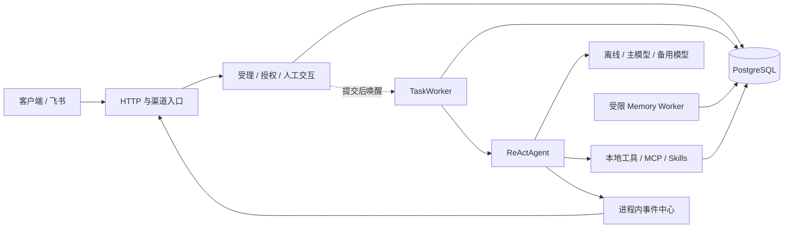

# FinanceClaw Java

一个基于 **Java 21、Spring Boot 3.5.16 和 AgentScope Java 2.0.3** 的独立 Agent 应用。它围绕模型的 ReAct 循环，提供双层长期记忆、会话工作上下文、预算与压缩、工具治理、人工审批、持久执行、取消与恢复能力。

本文中的 **Harness** 指这些能力组成的应用运行与治理层。当前主执行器使用原生 `ReActAgent`，并未直接使用 SDK 的 `HarnessAgent`；依赖中存在的功能不等于已经接入。默认使用离线模型，可以在没有模型 Key 的情况下启动和验证任务链路。

## 能力总览

| 模块 | 当前实现 |
| --- | --- |
| 上下文管理 | Turn 长期记忆快照、跨轮工作上下文与完整工具轨迹；分区预算、结构化压缩、大结果文件引用 |
| 记忆系统 | 用户手工维护的 Markdown 画像 + 有来源和确认状态的跨会话证据；可选向量搜索、独立遗忘账本 |
| ReAct 运行时 | 每个执行尝试独立 Agent / Toolkit / 状态 scope；持久命令、租约、检查点、审批恢复、取消和 SSE |
| 工具 | 本地 `ToolBase`、原生 MCP、Classpath Skills，以及受限研究子 Agent 和固定组合工作流 |
| 权限 | 服务端主体、会话授权版本、工具 scopes、原生 ASK 审批、执行围栏、受限数据库身份 |
| 模型管理 | 离线模型、OpenAI 兼容协议、主备模型、请求与调用次数预算、固定发布身份、凭据分离 |
| 中间件 | 最终答复过滤、Turn 记忆注入、工作上下文压缩、大结果归档、Skill 派发检查与传输校验 |

## 运行结构

HTTP API、AgentScope 执行、SSE、任务恢复和飞书投递运行在**同一个业务 JVM**，共享连接池与事件中心。受限记忆处理、数据库初始化和离线隐私恢复使用独立入口。工程保持单个 Maven 模块。



`Turn` 表示一次用户请求，`Command` 表示待执行工作，`Attempt` 表示持有租约的一次执行尝试；SDK 检查点保存可恢复的 Agent 状态。它们各自承担不同职责：保存状态或结束事件流，都不等于业务任务已完成。

### 1. 上下文管理

上下文分为 Turn 级长期记忆快照、conversation 级工作上下文，以及当前用户输入和本轮 ReAct 消息。

- **长期记忆固定一轮**：受理 Turn 时冻结画像与确认事实的完整正文，后续 ReAct、重试和审批恢复沿用同一快照；普通画像编辑在下一 Turn 生效。遗忘和撤权仍立即阻断后续执行。
- **工作上下文跨轮延续**：从同会话最新已完成 Turn 的投影接续，保留用户问题、回答、工具调用参数与结果；每轮独立轨迹保留被压缩前的消息。发布、授权和隐私 epoch 必须一致。
- **接近预算才压缩**：每次模型派发前，工作消息默认上限 24 KiB，达到 80% 时把较早的完整问答和已完成工具批次压缩成 `goals/tools/evidence/nextSteps`。保护当前问题、最近一轮和未完成工具配对；摘要是背景数据，不授予权限。最终回答追加后由输出预留承接，下次派发前再收紧输入。
- **检查最终请求**：`BudgetedTransport` 在 SDK 完成序列化后检查整个 HTTP 请求，计入 system、历史、工具 Schema、输出 Schema 和 JSON 封装，同时检查输出预留。当前使用保守 UTF-8 字节估算，不是精确 tokenizer 或成本计费。
- **分区预算**：固定系统内容、长期记忆、工作上下文、当前输入、工具 Schema、工具结果和摘要分别配置上限；最终模型窗口不足时进一步收紧工作上下文，不能裁剪当前请求或长期快照。
- **大结果变成文件**：本地工具、MCP、Skill 的完整回执默认超过 8 KiB 时生成受治理的 JSON 文件，后续上下文只保留描述、ID、hash、大小与读取引用；`read_artifact_range` 支持大字符串按 UTF-8 字节范围读取，也可通过下载接口获取完整文件。

工作上下文通过原生 ReAct 中间件管理，SDK CAS 检查点和会话投影在同一执行栅栏事务中写入。压缩模型不接收主对话 system 或长期记忆，也没有工具；其调用占用本 Turn 模型次数预算。离线模式只做确定性的原文摘录。未启用通用 Memory Flush 或任意文件系统 offload；未配置模态预算的多模态输入仍拒绝。

| 预算项 | 默认值 | 环境变量 |
| --- | ---: | --- |
| 固定系统内容 / 长期记忆 | 8 / 16 KiB | `FINANCECLAW_CONTEXT_SYSTEM_BYTES` / `FINANCECLAW_CONTEXT_LONG_MEMORY_BYTES` |
| 会话工作上下文 | 24 KiB | `FINANCECLAW_CONTEXT_WORK_CONTEXT_BYTES` |
| 当前用户输入 | 8 KiB | `FINANCECLAW_CONTEXT_CURRENT_INPUT_BYTES` |
| 工具 Schema / 单个回执 | 48 / 8 KiB | `FINANCECLAW_CONTEXT_TOOL_SCHEMA_BYTES` / `FINANCECLAW_CONTEXT_TOOL_RESULT_BYTES` |
| 结构化摘要 | 2 KiB | `FINANCECLAW_CONTEXT_SUMMARY_BYTES` |
| 压缩触发比例 / 最近保留轮数 | 80% / 1 | `FINANCECLAW_CONTEXT_COMPACT_AT_PERCENT` / `FINANCECLAW_CONTEXT_RETAINED_ROUNDS` |

当前输入与工具回执属于工作上下文的子预算，各项上限不能简单相加当作模型窗口。Compose 会将这些非密钥配置传入业务进程，可在 `.env` 中调整；直接运行 JVM 时设置同名环境变量。具体保留规则和错误边界见[上下文生命周期与预算](docs/architecture/context-management.md)。

大结果文件的完整 JSON 保存在 SQL Artifact 归档中，单文件上限 **2 MiB**，超过时明确拒绝。模型通过 `read_artifact_range` 每次读取最多 512 个 UTF-8 字节；HTTP 提供 `GET /v1/artifacts/{id}/range?start=0&maxBytes=4096` 和 `GET /v1/artifacts/{id}/download`，均使用正常 Bearer 认证，重新核验 owner、隐私和原工具权限。

源码：[TaskAgentRuntime](src/main/java/com/financeclaw/infrastructure/agentscope/execution/TaskAgentRuntime.java)、[BudgetedTransport](src/main/java/com/financeclaw/infrastructure/agentscope/model/BudgetedTransport.java)、[ExecutionPolicyService](src/main/java/com/financeclaw/app/execution/ExecutionPolicyService.java)。

### 2. 记忆系统

两层记忆共用可信主体 `(tenant, subject)`、隐私 epoch 和版本校验，但有独立的写入方式。

| 层 | 如何维护 | 执行时如何使用 |
| --- | --- | --- |
| 用户画像 | 每个逻辑用户一份 UTF-8 `profile.md`，支持直接维护服务器目录；SQL 保存已采样版本与 Turn 快照 | 作为稳定背景和表达偏好；当前请求优先，人工画像优先于冲突证据 |
| 跨会话证据 | 从已完成任务的可信用户消息提取，保留来源 Turn、原文引文、revision 和确认状态 | 受理时选取最多 16 条有效偏好并冻结正文，本 Turn 沿用；下一 Turn 才重新召回 |

画像默认开启，正文上限 **8 KiB**。配置 `FINANCECLAW_PROFILE_DIRECTORY` 后可直接编辑服务器目录里的文件，新 Turn 受理时自动采样，无需上传或重启；进行中的 Turn 保持原快照。目录按用户和隐私 epoch 隔离，没有监听或轮询线程，模型不会自动改写文件。目录模式拒绝 HTTP PUT；未配置目录时，HTTP 编辑仍通过绑定主体、epoch 和 revision 的 ETag 防止并发覆盖。

证据提取默认关闭。目前支持回答语言、回答风格、居住城市、旅行偏好和投资偏好五类持久偏好。普通提取结果先成为候选，由用户确认或拒绝；少量严格匹配的 `/remember` 明确指令可以自动确认。候选事实不会直接进入模型上下文。

可选向量搜索使用 **1024 维**嵌入，固定模型 revision 和配置指纹；SQL 事实是权威，向量索引是可重建投影。`GET /v1/memory/search` 是显式搜索接口，当前 Agent **不是每轮自动向量召回**。提取和索引由独立受限 Worker 执行，远程调用在事务外，写回前重新检查租约、owner、epoch 和 revision。

遗忘会提升 epoch，清理画像与记忆正文、召回、投影和作业，并阻断旧版本执行。可选独立遗忘账本用于恢复旧备份后的核对和重放，默认关闭。P3a.2 已补齐执行副本的物理清理与恢复残留检查并完成本地验收：同一遗忘事务先擦除根／研究子 Agent 的全部历史 attempt 检查点正文并保留 CAS 墓碑，再删除旧步骤、子调用记录和 `privacy_bound=true` 的工具文件。普通业务 Turn、Journal、报告和非隐私绑定 Artifact 继续按业务保留策略管理，不能将遗忘解释为账户数据全删。

恢复核对同步升级为 Snapshot v3，必须包含 SDK 状态、步骤、子调用、工具文件四类残留计数及全局孤立运行行计数；v2 无法证明这些执行副本已清理，当前比较器拒绝使用。未知且仍有正文的 SDK 状态会阻断清理，不能因为 epoch 已更新就报告成功。范围与操作入口见[执行数据隐私清理](docs/architecture/execution-privacy.md)。

直接目录维护的路径、权限和 Compose 启动步骤见[画像目录配置](docs/architecture/user-profile-memory.md#直接维护服务器目录)，也可使用 `compose.profile.yml` 挂载服务器目录。

未配置目录时，启动应用并配置 `FINANCECLAW_API_TOKEN` 后（见下方请求示例），可通过 HTTP 维护画像：

```bash
python3 scripts/user-profile.py pull --file /tmp/financeclaw-profile.md
# 编辑文件后显式上传；pull 默认不会覆盖已有文件
python3 scripts/user-profile.py push --file /tmp/financeclaw-profile.md
```

源码：[MemoryService](src/main/java/com/financeclaw/app/memory/MemoryService.java)、[UserProfileService](src/main/java/com/financeclaw/app/memory/UserProfileService.java)、[MemoryProcessingService](src/main/java/com/financeclaw/app/memory/MemoryProcessingService.java)、[PrivacyRecoveryService](src/main/java/com/financeclaw/app/memory/PrivacyRecoveryService.java)。完整说明见[用户画像与证据记忆](docs/architecture/user-profile-memory.md)。

### 3. ReAct 运行时

每个 attempt 创建独立 `ReActAgent`、Toolkit、权限上下文与状态 scope，避免跨用户或跨任务复用可变执行状态。

1. **受理**：校验主体、幂等键、会话授权和用户隐私版本，原子保存 Turn、Command 及受理快照。
2. **领取**：Worker 先预留执行槽位，再领取命令、建立租约并推进 fence；默认并行度为 4。
3. **运行**：SDK 驱动“模型 → 工具 → 观察”循环，每个 attempt 最多 6 次迭代，达到上限可能额外生成总结，该调用仍计入模型预算；根 Turn 默认还受 12 次模型、32 次工具治理计数限制。
4. **暂停与回答**：ASK 或补充输入保存真实 SDK 检查点，并将问题绑定到原动作。回答核验通过后，在新 attempt scope 中通过 CAS 复制检查点并恢复。
5. **完成**：重新检查租约、授权、隐私和检查点版本，封存 attempt 回执，再提交业务状态与结果。

状态存储使用完整 AgentState、CAS 与墓碑，冲突策略为 `FAIL`。主任务 ReAct 的模型和工具调用自动重试及未知工具自动恢复关闭；取消、租约失效和恢复由持久业务边界决定。有封存回执的过期执行可以安全收尾，无确定回执则进入 `blocked/unconfirmed_execution`，不能自动重放未知操作。

SSE 转发原生文本增量和工具状态，并回放持久任务事件。先订阅再回放、按修订号去重，检测到缺口才补读；空闲心跳不轮询数据库。原生最终答复过滤器会缓冲模型轮文本，文本增量可能在该轮结束后才放出，不承诺逐 token 即时到达。临时进度没有断线重放保证，持久业务事件才带 SSE ID；当前没有跨实例事件总线。

源码：[IsolatedAgentFactory](src/main/java/com/financeclaw/infrastructure/agentscope/IsolatedAgentFactory.java)、[TaskWorker](src/main/java/com/financeclaw/worker/TaskWorker.java)、[ExecutionCompletionService](src/main/java/com/financeclaw/app/execution/ExecutionCompletionService.java)、[TaskEvents](src/main/java/com/financeclaw/api/TaskEvents.java)。

### 4. 工具：Tool、MCP 与 Skills

#### 本地 Tool

本地和 MCP 工具统一经过 `ToolBase` 边界：验证有效输入，核对当前权限/隐私/租约并扣减预算，再执行具体业务。可信身份从服务端运行上下文传入，不接受模型自行填写 owner。

| 能力 | 当前落点 |
| --- | --- |
| 基础工具 | 城市补充、示例目录检索、审批后创建本地报告、Artifact 分页读取 |
| 市场快照 | 发布时固定的数据，携带 provider / as_of；默认数据为空，不是默认接入实时行情 |
| 市场研究 | 固定目标、深度为一的 ReAct 子 Agent；持久调用身份与 4 次模型 / 10 次实际行情读取上限，额度同时计入根 Turn |
| 私有叶子 Agent | 同 owner、冻结发布、仅显式消息输入；支持空工具与单次行情两个固定契约；最多 4 次子模型并受根预算约束；P3a.6 已推送，远程 CI 通过 |
| 组合复盘 | `/workflow portfolio_review …` 固定步骤驱动，包含计算、数据新鲜度、敞口检查、人工批准和归档 |
| 紫微 | 本命、大限、年、月、日五个受治理入口；默认关闭，仍需显式开发配置 |

P3a.1 用一张 `child_invocations` 窄表保存研究调用身份和累计额度，结果继续复用 `capability_steps`，更换 attempt 不重置计数。相同快照回执不重复执行行情读取或扣减该次子/根读取额度；缓存与 SDK 状态读写都先通过父 Turn 的运行状态、fence、隐私与授权门禁。原验收与远程结果见[固定研究子调用](docs/architecture/child-invocations.md)，组合复盘仍是固定工作流。

P3a.2 已完成旧执行正文清理和恢复核对的本地验收并推送。P3a.3 已交付同 owner 空工具叶子 Agent 委派并通过远程 CI：父发布冻结目标版本，子 Agent 使用独立模型／提示词，只接收明确的 `message`；父侧 Artifact reader 依赖支持大结果引用，空工具契约的子侧保持零工具；固定行情扩展见[P3a.6](docs/architecture/private-agent-market-leaf.md)。仍复用父调度、取消和预算，不增加子队列或轮询。配置与验收边界见[私有叶子 Agent 委派](docs/architecture/private-agent-delegation.md)。

#### MCP

使用 AgentScope 原生 **Streamable HTTP** 客户端和服务端 Schema，当前配置型接入酒店查询与内部太卜。约束包括 authority 白名单、租户和工具名白名单、工具重名检查、禁重定向和超时；外部端点要求 HTTPS，太卜禁止配置为外部服务。凭据通过引用解析，密钥值不进入发布定义。

P2b 显式组装的 `agent-release/3` 在发布时通过事务外发现，冻结所选 MCP 工具的 SDK 有效契约及摘要，规范化版本为 `mcp-sdk-effective/1`。有效契约包含名称、描述及 SDK 暴露的输入/输出 Schema；执行初始化和远端派发前比较契约，漂移时阻断执行或恢复，详见[能力组装与升级边界](docs/architecture/agent-composition.md)。旧格式和 `agent-release/2` 没有这份完整快照，不能事后补造历史指纹。该机制不固定远端业务实现，也不能消除发现与 `tools/call` 之间的服务端竞态。

#### Skills

使用原生 `ClasspathSkillRepository` 发现、渐进加载和激活，通过 `load_skill_through_path` 读取；打包内容和资源摘要进入发布身份，加载受 `skill:use` 与工具预算约束，代码执行关闭。目前打包一个调酒 Skill，没有运行时安装、联网下载或用户上传技能入口。

源码：[GovernedTools](src/main/java/com/financeclaw/infrastructure/agentscope/execution/GovernedTools.java)、[McpTools](src/main/java/com/financeclaw/tools/McpTools.java)、[McpToolContribution](src/main/java/com/financeclaw/infrastructure/agentscope/capability/McpToolContribution.java)、[PackagedSkills](src/main/java/com/financeclaw/infrastructure/agentscope/skills/PackagedSkills.java)、[MarketResearchAgent](src/main/java/com/financeclaw/infrastructure/agentscope/capability/MarketResearchAgent.java)、[PortfolioDriver](src/main/java/com/financeclaw/infrastructure/agentscope/capability/PortfolioDriver.java)。

### 5. 权限与治理

- **主体与归属**：任务、画像、证据、授权及运维查询按 owner 隔离。当前 Bearer 配置只映射一个服务端主体，尚未接入 JWT/OIDC、多用户身份目录或完整 RBAC 平台。
- **权限快照**：Turn 绑定发布 hash、会话授权 revision 和允许 scopes；之后派发模型/工具和提交结果时继续校验。授权修改使用预期 revision 与幂等键，旧请求重放只返回原回执。
- **工具权限**：发布允许范围与会话授权共同决定工具集；采用原生 `PermissionMode.DEFAULT`，拒绝 BYPASS。审批工具使用 ASK，未授权工具不注册。
- **动作绑定**：回答绑定 Turn、Command、Attempt、stateVersion、grant revision、release hash、call ID、工具名和动作摘要，不能把一次批准套到另一个动作。
- **执行围栏**：租约 token、数据库时间和 fence 共同决定是否可写；迟到执行不能恢复过期租约或覆盖新结果。画像编辑、遗忘和受理之间有明确的共享/独占锁边界。
- **结果与外部发送**：本地报告实体和精确回执一次事务写入；飞书 SDK 成功只记为 `submitted_unverified`，未知发送不自动重投。审批不等于对任意外部系统提供 exactly-once 保证。
- **数据库身份**：初始化进程持有结构权限，业务进程持有业务权限；Memory Worker 无权访问业务、AgentState、飞书 schema 或画像正文。

源码：[SubmitTaskService](src/main/java/com/financeclaw/app/task/SubmitTaskService.java)、[GrantService](src/main/java/com/financeclaw/app/governance/GrantService.java)、[AnswerInteractionService](src/main/java/com/financeclaw/app/interaction/AnswerInteractionService.java)、[ExecutionLeaseService](src/main/java/com/financeclaw/app/execution/ExecutionLeaseService.java)、[部署授权](src/main/resources/deployment/grants.sql)。

### 6. 模型管理

默认主模型为 `offline`，返回 `已收到：<消息>`，用于连通任务链路；它不会替代真实模型验收，也不会按自然语言自动选择所有工具。真实供应商通过 AgentScope 原生 `OpenAIChatModel` 接入 OpenAI 兼容流式协议。

| 配置/机制 | 当前行为 |
| --- | --- |
| 主模型与备用模型 | 可分别配置名称、base URL、输入预算、窗口、输出预留和安全余量；当前使用同一业务模型凭据入口 |
| 备用切换 | 仅主模型流的首个信号就是错误时尝试备用；已输出任何响应后不接续，正常空流也不切换；下一次推理仍从主模型开始 |
| 自动重试 | 主任务 ReAct 的模型和工具总尝试次数设为 1；不因超时自动重放工具 |
| 调用次数 | 主备调用分别经过根 Turn 授权和预算检查；固定组合驱动及研究子 Agent 不配置同样的备用链 |
| 请求预算 | 检查最终序列化请求和输出预留；有 usage 时验证其合法性，不提供精确计费或统一成本账本 |
| Qwen thinking | 主对话显式设置 `enable_thinking`，默认关闭；工作摘要请求单独关闭；非 Qwen 配置不能启用 |
| 记忆模型 | 提取、embedding 单独配置和凭据；提取使用 SDK 类型化结构输出，不承诺供应商原生 JSON Schema 模式 |
| 发布身份 | AgentScope 版本、模型配置、预算、scopes、打包 Skill 和业务配置参与摘要；任务绑定受理时版本 |

发布清单、默认发布指针和变更历史保存在 PostgreSQL。启动登记当前配置，但已有指针不会被环境变更覆盖；显式切换使用 revision CAS。新会话创建时固定发布，后续 Turn、重试和审批恢复沿用该版本；升级通过新会话生效。缺失或摘要不匹配的历史清单会阻断执行，不回退到当前版本。P2a 增加 owner 私有的 Agent 身份、提示词草稿和独立发布指针，CLI 管理后可通过 `POST /v1/conversations` 的 `agent_id` 选择已发布目标；会话固定 Agent ID 与版本。P2b 在固定基础上增加模型 profile、Function/Skill/MCP 选择与依赖快照，详见 [受控能力组装](docs/architecture/agent-composition.md)；多资源池与模型网关继续分阶段实施。操作说明见 [Agent 定义与调用](docs/architecture/agent-definitions.md)、[平台化实施方案](docs/architecture/platform-implementation-plan.md)和[发布运维](docs/operations.md#发布版本管理)。

源码：[ModelFactory](src/main/java/com/financeclaw/infrastructure/agentscope/model/ModelFactory.java)、[ModelProfile](src/main/java/com/financeclaw/domain/release/ModelProfile.java)、[ReleaseService](src/main/java/com/financeclaw/app/release/ReleaseService.java)、[ReleaseIdentity](src/main/java/com/financeclaw/app/release/ReleaseIdentity.java)、[AgentScopeMemoryModels](src/main/java/com/financeclaw/infrastructure/agentscope/memory/AgentScopeMemoryModels.java)。

### 7. 中间件与执行边界

项目按拦截位置组织治理，不把所有校验都称为 SDK Middleware。

| 层次 | 当前落点 | 作用 |
| --- | --- | --- |
| SDK Middleware | `FinalAnswerFilterMiddleware.onReasoning` | 过滤工具调用轮文本；无工具调用的文本在模型轮结束后放出 |
| SDK Middleware | `onSystemPrompt` | 注入 Turn 开始时冻结的长期记忆正文，恢复沿用同一快照 |
| SDK Middleware / Hook | `onReasoning`、`onModelCall`、`PostActingEvent` | 分区预算、结构化工作摘要、大结果文件引用 |
| SDK Middleware | `onActing` | 原生 Skill 加载前检查 `skill:use` 并扣减预算 |
| SDK 技能装配 | `DynamicSkillMiddleware` | 启用原生 Skill Repository 后，由 SDK 管理技能上下文与激活 |
| SDK 运行时 | `GracefulShutdownMiddleware` | 固定版本 ReActAgent 自带的优雅停止处理，配合应用取消/中断 |
| Model 装饰器 | `TaskAgentRuntime.guarded` | 模型调用前核验策略和预算，接收 attempt 停止信号 |
| Tool 边界 | `GovernedTools.register` | 输入、权限、隐私、租约与工具治理计数 |
| HTTP Transport | `BudgetedTransport` | 发送前检查完整模型请求 |
| HTTP 服务 | `BearerIdentity` / `HttpRequestConfiguration` / `ApiErrors` | 认证、严格 JSON 绑定和稳定错误码，避免回显敏感细节 |

这些扩展在代码中明确装配，没有面向用户的任意 Middleware 插件安装或配置中心。当前提供 Actuator 健康/就绪、任务运维查询和只读预检；尚未接入统一 OpenTelemetry 调用链或完整成本与性能观测体系。

## 本地启动与体验

需要 Docker、Python 3.12+（仅用于工具链安装和验收脚本）及 curl。业务运行与镜像不依赖 Python 应用；JDK 和 Maven 使用仓库锁定版本。

```bash
python3 scripts/bootstrap-jdk.py
python3 scripts/init-local.py
scripts/mvn.sh -B -ntp clean package -DskipTests
docker compose up -d --build --wait --wait-timeout 180
curl --fail http://localhost:8080/actuator/health/readiness
```

就绪预期返回 `{"status":"UP"}`。Compose 的 `init-db` 完成新库结构与授权后，启动统一业务服务 `api` 和受限 `memory-worker`；API 仅绑定本机 8080。主库由 V1 基线及 V2–V9 演进建立 41 张应用表；V8/V9 扩充既有私有调用绑定与固定行情约束，不增加表。支持当前 Java V1 基线升级，不导入 Python 或历史实验库，详见[数据库初始化与升级](docs/architecture/fresh-schema.md)。

### 跑通一次请求

```bash
export FINANCECLAW_API_TOKEN="$(cat .secrets/api-token)"
BASE_URL=http://localhost:8080

conversation_id=$(curl --fail --silent --show-error \
  -H "Authorization: Bearer $FINANCECLAW_API_TOKEN" \
  -H 'Content-Type: application/json' -d '{}' \
  "$BASE_URL/v1/conversations" \
  | python3 -c 'import json,sys; print(json.load(sys.stdin)["conversation_id"])')

turn_id=$(curl --fail --silent --show-error \
  -H "Authorization: Bearer $FINANCECLAW_API_TOKEN" \
  -H 'Content-Type: application/json' -H 'Idempotency-Key: readme-turn-1' \
  -d '{"message":"你好"}' "$BASE_URL/v1/conversations/$conversation_id/turns" \
  | python3 -c 'import json,sys; print(json.load(sys.stdin)["turn_id"])')

curl --fail -N -H "Authorization: Bearer $FINANCECLAW_API_TOKEN" \
  "$BASE_URL/v1/conversations/$conversation_id/turns/$turn_id/events"

curl --fail -H "Authorization: Bearer $FINANCECLAW_API_TOKEN" \
  "$BASE_URL/v1/conversations/$conversation_id/turns/$turn_id"
```

提交返回 202，SSE 可回放任务事件；默认离线模式的最终结果为 `已收到：你好`。HTTP 请求拒绝隐式类型转换、重复键和尾随 JSON 值。画像 CLI 使用上方相同的 token 环境变量。

### 默认开关与配置

| 能力 | 默认状态 | 配置入口 |
| --- | --- | --- |
| 业务模型 | 离线 | `FINANCECLAW_MODEL` / `FINANCECLAW_MODEL_BASE_URL`；凭据挂载自 `.secrets/model-key` |
| 工作上下文 / 大结果归档 | 开启 | `FINANCECLAW_CONTEXT_*`，默认阈值见上方预算表 |
| 人工画像 | 开启 | `FINANCECLAW_PROFILE_ENABLED` |
| 服务器画像目录 | 未配置；配置后新 Turn 自动读取 | `FINANCECLAW_PROFILE_DIRECTORY`；Compose 叠加 `compose.profile.yml` |
| 证据提取 / 向量搜索 | 关闭 / 关闭 | `FINANCECLAW_MEMORY_ENABLED` / `FINANCECLAW_MEMORY_VECTOR_SEARCH`，另配提取与嵌入模型 |
| 独立遗忘账本 | 关闭 | 独立库与凭据、离线 bootstrap、`compose.forget-ledger.yml` |
| 酒店 / 太卜 MCP | 关闭 | `FINANCECLAW_HOTEL_*` / `FINANCECLAW_TAIBU_*` |
| 飞书 | 关闭 | `FINANCECLAW_FEISHU_*` 和对应 secrets |
| 紫微 | 关闭 | 同时要求 `FINANCECLAW_ZIWEI_ENABLED` 与显式开发配置 |
| 打包 Skill | 随权限装配 | `skill:use`，内容来自应用 classpath，代码执行关闭 |

非密钥配置见 [.env.example](.env.example)，完整属性见 [application.yml](src/main/resources/application.yml)，凭据经 configtree 挂载，不提交到仓库。真实模型选择、MCP 供应商、飞书租户和生产容量均需在实际环境另行验收。

常见问题：401 检查 token 与服务端配置；就绪 DOWN 检查数据库及角色权限；JDK 被拒绝时检查显式 `JAVA_HOME` 是否覆盖了锁定工具链；默认离线模式不会按自然语言执行真实 MCP 或 Skill。

## 验证与运行维护

```bash
python3 scripts/check-delivery.py
python3 scripts/test-live-acceptance.py
python3 scripts/test-inspect-drain.py
python3 scripts/test-restore-privacy.py
python3 scripts/test-user-profile.py
scripts/mvn.sh -B -ntp clean verify
python3 scripts/collect-evidence.py
python3 scripts/validate-compose.py --ziwei --admission --preflight --restore-privacy
```

数据库测试使用 Testcontainers 和独立数据库；模型、MCP、embedding 和飞书使用本地模拟服务。Compose 使用随机项目和新数据卷，覆盖进程故障、审批恢复、受理排空、画像隔离、备份恢复及隐私拦截。真实服务验收入口为 `scripts/validate-live.py`，不属于默认离线测试。

当前平台化阶段的 P1 已完成本地全量验收并推送：1,440 项 Java 测试、44 项脚本测试和 32 项 Compose 检查通过，见[实施与交付记录](docs/architecture/platform-implementation-plan.md#7-实施状态与验证记录)。P2a 也已完成本地验收：**1,516 项 Java 测试、44 项脚本测试、36 项 Compose 检查通过**，覆盖自定义 Agent 发布、目标会话、重启和 40 表恢复，见 [P2a 证据](docs/architecture/evidence/p2a-implementation.json)。P2a 已推送 `851446f`；P2b 与服务器画像目录的联合工作区已通过 **1,208 项单元/契约/架构测试 + 407 项集成测试 = 1,615 项**，另有 44 项脚本测试、39 项 Compose 检查和画像目录专项 4 项容器检查，见 [P2b 当前证据](docs/architecture/evidence/p2b-implementation.json)。两批分别交付，联合回归不等于 P2b 单独构建；本地和历史测试结果不替代远程 CI。

历史上下文阶段曾记录 1,032 项 Java 单元/契约/架构测试及 59 项定向回归，并因当时 Docker 超时未完成数据库/Compose 实测。该限制描述的是当时的验证范围；后续 P1 全量验收已覆盖当前数据库集成与容器场景，真实摘要供应商输出仍需单独验收。

P3a.1 提交 `5d82f24` 已推送，[远程流水线](https://github.com/westbrook0904/FinanceClaw/actions/runs/40045383841)整体 `completed/success`：`verify` 通过 **1,226 项单元/契约/架构测试 + 423 项集成测试 = 1,649 项**，`delivery` 的 **39 项部署检查**也通过。该次运行不包含后续 P3a.2。

P3a.2 提交 `c96b4e7` 已推送，[远程流水线](https://github.com/westbrook0904/FinanceClaw/actions/runs/40055663280)整体 `completed/success`：**1,226 单元 + 437 集成 = 1,663 项 Java 测试**及 **41 项部署检查**通过。提交前本地的进程超时／定向复跑、46 项脚本及 Compose 旧断言修正记录保留在[原本地证据](docs/architecture/evidence/p3a2-implementation.json)，不改写成远程结果。该次远程运行不覆盖 P3a.3；离线和本机模拟服务测试不代表真实外部服务或生产容量验收。

P3a.3 提交 `d433423` 已推送，[远程流水线](https://github.com/westbrook0904/FinanceClaw/actions/runs/40065079071)整体 `completed/success`：**1,242 单元 + 460 集成 = 1,702 项 Java 测试、46 项脚本测试、44 项部署检查**通过。[提交前本地证据](docs/architecture/evidence/p3a3-implementation.json)仍保留首次完整 verify 失败、精确复跑及 `single_full_verify_success=false` 的历史事实，不改写为后续远程成功。

P3a.4 提交 `467ba8f` 已推送，[远程流水线](https://github.com/westbrook0904/FinanceClaw/actions/runs/40072812866)整体成功：**1,242 单元 + 469 集成 = 1,711 项 Java、46 项脚本、44 项部署检查**通过。完整父子入口与取消传播修复见[运行时专项](docs/architecture/private-agent-runtime-validation.md)；[提交前本地证据](docs/architecture/evidence/p3a4-implementation.json)仍保留当时 1,404 项指定范围及失败过程，不改写为远程结果。

P3a.5 提交 `a4a6ef4` 已推送，[远程流水线](https://github.com/westbrook0904/FinanceClaw/actions/runs/40077157872)整体 `completed/success`：**1,242 单元 + 474 集成 = 1,716 项 Java、46 项脚本、44 项部署检查**通过。根检查点结果保留、画像与预算连续性见[暂停恢复专项](docs/architecture/private-agent-resume-validation.md)；[提交前本地证据](docs/architecture/evidence/p3a5-implementation.json)继续保留原先分次验收与测试假设修正，不改写为远程结果。

P3a.6 已推送 `13f73a7`，[远程流水线](https://github.com/westbrook0904/FinanceClaw/actions/runs/40105280949)整体 `completed/success`：**1,253 单元 + 490 集成 = 1,743 项 Java、46 项脚本和 44 项部署检查全部通过**。固定 `market_snapshot` 私有叶子最多一次行情读取，使用目标冻结发布的数据，结果归档保留行情权限。配置与范围见[固定行情叶子](docs/architecture/private-agent-market-leaf.md)；[原本地证据](docs/architecture/evidence/p3a6-implementation.json)继续保留分次验收和失败历史，P3a 整体仍未完成。

P3a.7 已推送 `c166da7`，[远程流水线](https://github.com/westbrook0904/FinanceClaw/actions/runs/40157422639)整体成功：**1,253 单元 + 497 集成 = 1,750 项 Java、46 项脚本和 44 项部署检查通过**。同次模型／工具扣额复用已校验发布，实测私有行情首次读取 **33→29 条 SQL**、子模型预算预留 **21→17 条**、直接根工具扣额 **15→11 条**；回放仍为 16 条，实时门禁与原子回滚保持。范围与原提交前本地证据见[预算查询优化](docs/architecture/execution-budget-queries.md)。

P3a.8 **已推送 `f330a17`，远程流水线通过**：[整轮数据库访问基线](docs/architecture/turn-database-baseline.md)跨线程观察 HTTP、Worker、SDK 异步执行和心跳。本次测试窗口中，普通 Turn 134 条 SQL、行情父子 Turn 380 条、双 owner 四会话整批 508 条，其中发布查询分别为 36／144／144 条。**原提交前本地 1,267 单元 + 64 选定集成 = 1,331 项 Java 测试通过**；测试调度参数与生产默认不同，这些次数不代表生产容量。[远程 run 40161632168](https://github.com/westbrook0904/FinanceClaw/actions/runs/40161632168) 整体成功，1,767 项 Java、46 项脚本、44 项部署检查通过；原本地证据保留。后续发布解析优化与独立验收见 P3a.9。

P3a.9 **已推送 `0c789b8`，随 `06ec674` 通过远程完整 CI**：[发布解析合并](docs/architecture/release-lookup-queries.md)将 v3 每次 4 条查询合为 1 条，普通 Turn 发布查询 36→9、行情与双 owner 四会话整批分别 144→36。非发布业务模板保持一致，实时授权、隐私、租约和预算门禁保持。原提交前本地 1,806 个唯一 Java 用例分次通过及 46 项脚本通过；首次完整构建有 1 项记忆 Worker 启动窗口失败，同源码、同 JAR、原断言下整套 26 项复跑通过，**不是一次完整 verify 全绿**。

P3a.10 **已推送 `06ec674`，远程完整 CI 通过**：[Worker 与渠道 Outbox](docs/architecture/worker-outbox-queries.md)实测成功领取 **8→7 条 SQL**，完成通知首次投影并发送 **12→10 条**，waiting **12→11 条**；21 条旧通知加 1 条有效通知的完整积压 **135→94 条**。通知支持提交后本地唤醒，每轮最多检查 20 个候选、发送一次，空闲退避与独立恢复保留。原提交前本地同次 **1,299 单元 + 113 选定集成 = 1,412 项**全部通过；后续 [run 40173421896](https://github.com/westbrook0904/FinanceClaw/actions/runs/40173421896) 整条 completed/success，**1,299 单元 + 544 集成 = 1,843 项 Java、46 项脚本及 44 项部署检查**通过。心跳仍使用实时双锁 CTE，后续重点为批量投影、队首竞争、恢复重复读取和连接池争用。

P3a.11 **已推送 `2de8537`，远程完整 CI 通过**：[恢复回执复用](docs/architecture/recovery-receipt-queries.md)只在同一持锁事务内传递已读回执，已封存 completed 恢复 **16→15 条 SQL**、waiting **14→13 条**；19 个公共窗口 **159→151 条**，其余 SQL 与事务事实保持。新增 attempt/command/fence 绑定校验，正常 finish、未确认执行和实时隐私/授权检查保留。原提交前本地同次 **1,309 单元 + 150 选定集成 = 1,459 项**通过；后续 [run 40176176072](https://github.com/westbrook0904/FinanceClaw/actions/runs/40176176072) 整条 completed/success，**1,309 单元 + 557 集成 = 1,866 Java、46 脚本及 44 部署检查通过**。

P3a.12 **已推送 `24e74e5`，远程完整 CI 通过**：[Worker 状态返回](docs/architecture/worker-turn-returning-queries.md)使用同一状态更新返回真实 Turn，成功领取进一步 **7→6 条 SQL**，15 个公共窗口 **77→69 条**。普通迁移仍只写，Command/Turn 锁序、事件、回滚与心跳门禁保持。同次 **1,317 单元 + 161 选定集成 = 1,478 项**通过；首次沙箱 JVM 附加失败与相同输入重跑记录分别保留。原提交前本地命令未执行其余集成、脚本、Compose 或远程 CI；后续 [run 40179982140](https://github.com/westbrook0904/FinanceClaw/actions/runs/40179982140) 整条 completed/success：**1,317 单元 + 558 集成 = 1,875 Java、46 脚本及 44 部署检查通过**。

P3a.13 **已推送 `dda1d7d`，远程完整 CI 通过**：[通知领取双锁查询](docs/architecture/notice-claim-lock-queries.md)合并 binding/notice 锁读取，合法领取 **5→4 条 SQL**，完成通知首次投影并发送 **10→9 条**；21 条旧通知加 1 条有效通知的完整处理 **94→72 条**。原锁序、锁后独立 owner/Turn 查询、逐项投影提交、回滚及事务外发送保持。原提交前本地同次 **1,318 单元 + 170 选定集成 = 1,488 项**通过；后续 [run 40184268889](https://github.com/westbrook0904/FinanceClaw/actions/runs/40184268889) 整条 completed/success：**1,318 单元 + 567 集成 = 1,885 Java、46 脚本及 44 部署检查通过**。

P3a.14 **已推送 `e115834`，远程完整 CI 通过**：[通知候选结果瘦身](docs/architecture/notice-candidate-results.md)将候选映射由完整 Notice 的 8 列缩为两字段定位对象，移除重复正文读取。7 个新窗口的候选正文 getter UTF-8 逻辑字节 **152,264→0**，SQL 保持 **85→85**；锁内通知正文及后续独立 Turn 读取保留。**1,320 单元 + 173 选定集成 = 1,493 项**同次通过；首次校准测试的 Mockito 配置错误已修正并保留失败记录。原提交前本地命令未执行完整 verify、脚本测试套件、Compose 或远程 CI；后续 [run 40189599778](https://github.com/westbrook0904/FinanceClaw/actions/runs/40189599778) 整条 completed/success：**1,320 单元 + 570 集成 = 1,890 Java、46 脚本及 44 部署检查通过**。

P3a.15 **已推送 `36459c4`，远程完整 CI 通过**：[等待通知交互查询](docs/architecture/waiting-notice-queries.md)只读取 pending 交互，避免重复映射历史回答。9 个投影窗口的映射记录 **34→15 行**，旧回答 UTF-8 逻辑字节 **86,412→0**，SQL 保持 **34→34**；通用完整历史、原生审批恢复、过期检查和逐 binding 事务保持。原提交前本地 **1,320 单元 + 177 选定集成 = 1,497 项**同次通过；随后 [run 40193745424](https://github.com/westbrook0904/FinanceClaw/actions/runs/40193745424) 整条 completed/success：**1,320 单元 + 574 集成 = 1,894 Java、46 脚本及 44 部署检查通过**。

P3a.16 **已推送 `9d33018`，远程完整 CI 通过**：[交互回答完成判断](docs/architecture/interaction-completion-queries.md)只查询当前 Turn/attempt 是否仍有非 answered 项，避免每次回答映射完整历史。7 个实际回答窗口的交互实体 **32→0**、response 逻辑字节 **131,892→0**，改为每次一个 boolean，SQL 保持 **102→102**。并发只恢复一次、回放无探测、过期/invalid 阻断、回滚重试与原生 SDK 恢复通过；原提交前本地 **1,320 单元 + 208 选定集成 = 1,528 项**同次通过；随后 [run 40207741693](https://github.com/westbrook0904/FinanceClaw/actions/runs/40207741693) 整条 completed/success：**1,320 单元 + 580 集成 = 1,900 Java、46 脚本及 44 部署检查通过**。

P3a.17 **已推送 `cc90a6d`，远程完整 CI 通过**：[通知投影候选](docs/architecture/projection-discovery-queries.md)跳过无 live pending 的 waiting 空项，并同步运维通知队列。20 个全过期项首 tick **62→2 SQL**；20 个空前缀后的另一 owner 三 tick **186→12 SQL、0→1 次发送**，业务推进刻意不同，不是相同工作量的吞吐比较。过期未答仍保留任务/pending 积压。原提交前本地 **1,320 单元 + 245 选定集成 = 1,565 项**同次通过；随后 [run 40243547522](https://github.com/westbrook0904/FinanceClaw/actions/runs/40243547522) 整条 completed/success：**1,320 单元 + 586 集成 = 1,906 Java、46 脚本及 44 Compose 检查通过**。

P3a.18 **已推送 `5fe16cf`，远程完整 CI 通过**：[失联 sending 恢复](docs/architecture/notice-recovery-queries.md)仅增加当前 sending 部分索引，保持原 UPDATE、60 秒失联条件和 unknown 不自动重发。20,000 条合成非 sending 历史与 3 条真实 sending 下，根 shared hit blocks **679→17**，同样只更新 1 行；每次恢复仍为 1 条 SQL。原提交前本地 **1,320 单元 + 250 选定集成 = 1,570 项**同次通过；随后 [run 40248871652](https://github.com/westbrook0904/FinanceClaw/actions/runs/40248871652) 整条 completed/success：**1,320 单元 + 591 集成 = 1,911 Java、46 脚本及 44 Compose 检查通过**。高 sending 集合、锁等待及连接池/心跳延迟仍待独立测量。

P3a.19 **本地验收通过，尚未推送**：[过期命令候选扫描](docs/architecture/command-recovery-scan-queries.md)用一次数据库截止时间驱动已有 `command_expiry` 范围。20,000 条合成未来租约与 3 条真实过期命令下，原索引扫描过滤 20,000 行，改后直接返回相同 3 项，根 shared hit blocks **420→3**。每次发现仍为 1 条 SQL，LIMIT 50、实时租约与回执门禁保持。**1,320 单元 + 255 选定集成 = 1,575 项**同次通过；默认 2 秒调度不是恢复 SLA，密集过期积压、跨实例锁争用及连接池/心跳延迟仍待测量。

| 文档 | 内容 |
| --- | --- |
| [运行结构](docs/architecture/combined-runtime.md) | 统一 JVM、受限入口、SSE 与调度 |
| [上下文生命周期与预算](docs/architecture/context-management.md) | Turn 快照、会话轨迹、结构化摘要、预算与文件读取 |
| [Agent 定义与调用](docs/architecture/agent-definitions.md) | P2a 提示词草稿、发布 CLI 与指定 Agent 会话 |
| [受控能力组装](docs/architecture/agent-composition.md) | P2b 模型 profile、Function/Skill/MCP 选择、固定契约与升级边界 |
| [固定研究子调用](docs/architecture/child-invocations.md) | P3a.1 调用身份、持久预算、根门禁与步骤回放 |
| [平台化实施方案](docs/architecture/platform-implementation-plan.md) | 控制面、数据面、Scheduler 边界与分阶段验收 |
| [数据结构](docs/architecture/database-schema-review.md) / [数据库访问](docs/architecture/database-access-review.md) | 权威状态边界、锁与查询策略 |
| [画像与证据记忆](docs/architecture/user-profile-memory.md) | Markdown、来源、确认、版本和隐私 |
| [执行数据隐私清理](docs/architecture/execution-privacy.md) | 检查点墓碑、步骤与工具文件清理、Snapshot v3 恢复门禁 |
| [私有叶子 Agent 委派](docs/architecture/private-agent-delegation.md) | 同 owner 空工具目标、固定发布、显式消息与共享预算；P3a.3 已推送，远程 CI 成功 |
| [父子运行时验收](docs/architecture/private-agent-runtime-validation.md) | P3a.4 完整父子模型及取消传播修复；已推送，远程 CI 成功 |
| [暂停恢复验收](docs/architecture/private-agent-resume-validation.md) | P3a.5 根检查点结果保留、画像与预算连续性；已推送，远程 CI 成功 |
| [固定行情叶子](docs/architecture/private-agent-market-leaf.md) | P3a.6 单次行情能力、冻结数据与权限归档；已推送，远程 CI 通过 |
| [预算查询优化](docs/architecture/execution-budget-queries.md) | P3a.7 同次扣额减少发布查询；已推送，远程 CI 通过 |
| [整轮数据库访问基线](docs/architecture/turn-database-baseline.md) | P3a.8 跨线程 SQL、连接借用与多 owner 并发测量；已推送，远程 CI 通过 |
| [发布解析合并](docs/architecture/release-lookup-queries.md) | P3a.9 一条查询读取主/基础清单；已推送，远程完整 CI 通过 |
| [Worker 与渠道 Outbox](docs/architecture/worker-outbox-queries.md) | P3a.10 领取/通知减少查询、提交后唤醒与有限积压处理；已推送，远程完整 CI 通过 |
| [恢复回执复用](docs/architecture/recovery-receipt-queries.md) | P3a.11 同事务复用 sealed receipt，补齐绑定校验；已推送，远程完整 CI 通过 |
| [Worker 状态返回](docs/architecture/worker-turn-returning-queries.md) | P3a.12 领取复用真实更新行，成功 7→6 SQL；已推送，远程完整 CI 通过 |
| [通知领取双锁查询](docs/architecture/notice-claim-lock-queries.md) | P3a.13 保持 binding→notice 锁序并合并读取；已推送，远程完整 CI 通过 |
| [通知候选结果瘦身](docs/architecture/notice-candidate-results.md) | P3a.14 候选 8→2 列并移除重复正文；已推送，远程完整 CI 通过 |
| [等待通知交互查询](docs/architecture/waiting-notice-queries.md) | P3a.15 只读取 pending 交互，保留完整恢复历史；已推送，远程完整 CI 通过 |
| [交互回答完成判断](docs/architecture/interaction-completion-queries.md) | P3a.16 同 attempt 布尔探测，保留完整恢复历史；已推送，远程完整 CI 通过 |
| [通知投影候选](docs/architecture/projection-discovery-queries.md) | P3a.17 空 waiting 不占批次，运维口径同步、pending 索引；已推送，远程完整 CI 通过 |
| [失联 sending 恢复](docs/architecture/notice-recovery-queries.md) | P3a.18 sending 部分索引；已推送，远程完整 CI 通过 |
| [过期命令候选扫描](docs/architecture/command-recovery-scan-queries.md) | P3a.19 单次数据库截止时间、复用原索引范围；本地 1,575 项选定验收通过，尚未推送 |
| [HTTP 校验](docs/architecture/http-request-validation.md) / [Java 规范](docs/architecture/java-coding-guidelines.md) | 输入边界与关键逻辑注释约定 |
| [运行维护](docs/operations.md) | 受理排空、配置、备份与隔离隐私恢复 |
| [历史记录](docs/history/README.md) | 过去设计和验收证据，非当前迁移或兼容承诺 |

后续可强化的 Harness 边界包括：历史运行工件管理、可信多用户认证、跨实例事件转发，以及统一观测和模型成本记录；这些继续按后续阶段推进。P2a 在 P1 基础上加入 Agent 身份、提示词草稿和目标版本绑定，验收状态见[实施方案](docs/architecture/platform-implementation-plan.md#7-实施状态与验证记录)。
