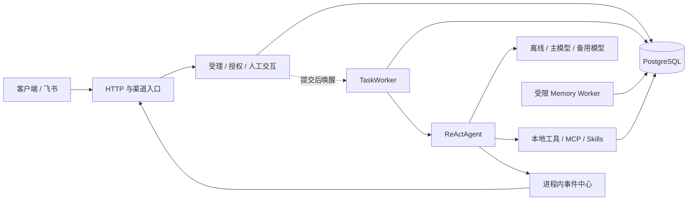

# FinanceClaw Java

一个基于 **Java 21、Spring Boot 3.5.16 和 AgentScope Java 2.0.3** 的独立 Agent 应用。它围绕模型的 ReAct 循环，提供上下文预算、双层记忆、工具治理、人工审批、持久执行、取消与恢复能力。

本文中的 **Harness** 指这些能力组成的应用运行与治理层。当前主执行器使用原生 `ReActAgent`，并未直接使用 SDK 的 `HarnessAgent`；依赖中存在的功能不等于已经接入。默认使用离线模型，可以在没有模型 Key 的情况下启动和验证任务链路。

## 能力总览

| 模块 | 当前实现 |
| --- | --- |
| 上下文管理 | 当前请求、受限会话历史、人工画像与确认事实；按版本过滤；最终模型请求预算检查 |
| 记忆系统 | 用户手工维护的 Markdown 画像 + 有来源和确认状态的跨会话证据；可选向量搜索、独立遗忘账本 |
| ReAct 运行时 | 每个执行尝试独立 Agent / Toolkit / 状态 scope；持久命令、租约、检查点、审批恢复、取消和 SSE |
| 工具 | 本地 `ToolBase`、原生 MCP、Classpath Skills，以及受限研究子 Agent 和固定组合工作流 |
| 权限 | 服务端主体、会话授权版本、工具 scopes、原生 ASK 审批、执行围栏、受限数据库身份 |
| 模型管理 | 离线模型、OpenAI 兼容协议、主备模型、请求与调用次数预算、固定发布身份、凭据分离 |
| 中间件 | 原生最终答复过滤、请求级记忆注入、Skill 派发检查，以及模型、传输和 HTTP 边界的校验 |

## 运行结构

HTTP API、AgentScope 执行、SSE、任务恢复和飞书投递运行在**同一个业务 JVM**，共享连接池与事件中心。受限记忆处理、数据库初始化和离线隐私恢复使用独立入口。工程保持单个 Maven 模块。



`Turn` 表示一次用户请求，`Command` 表示待执行工作，`Attempt` 表示持有租约的一次执行尝试；SDK 检查点保存可恢复的 Agent 状态。它们各自承担不同职责：保存状态或结束事件流，都不等于业务任务已完成。

### 1. 上下文管理

上下文由系统提示、当前用户请求、符合条件的会话历史，以及当前用户的画像和确认事实构成。

- **历史有边界**：最多读取同会话最近 8 个已完成 Turn，要求发布 hash、授权 revision 和隐私/画像版本一致；在剩余预算内按完整问答对截选，历史正文上限为 8 KiB。
- **当前请求与记忆优先**：先为完整当前请求和用户记忆预留容量，再计算历史容量；必需内容超预算时显式阻断，不静默截断画像。
- **检查最终请求**：`BudgetedTransport` 在 SDK 完成序列化后检查整个 HTTP 请求，计入 system、历史、工具 Schema、输出 Schema 和 JSON 封装，同时检查输出预留。当前使用保守 UTF-8 字节估算，不是精确 tokenizer 或成本计费。
- **记忆按 attempt 注入**：每次执行尝试读取一次用户记忆，经 `onSystemPrompt` 注入请求；画像和事实上下文不复制进 SDK 检查点。派发和提交时仍检查绑定版本。
- **大结果有界读取**：MCP 等结果先归档为 Artifact，模型先获得 ID、hash 和大小，再通过受权限控制的分页工具读取。

当前没有接入 `HarnessAgent` 侧按 token 压力触发的自动摘要/压缩、Memory Flush 或上下文 offload。SDK 在达到迭代上限时仍会做最终总结收尾；类型化结构输出也会清理内部响应工具消息，这两者都不是通用历史压缩。未配置模态预算的图片、音频、视频和文件输入会被发送前检查拒绝。

源码：[TaskAgentRuntime](src/main/java/com/financeclaw/infrastructure/agentscope/execution/TaskAgentRuntime.java)、[BudgetedTransport](src/main/java/com/financeclaw/infrastructure/agentscope/execution/BudgetedTransport.java)、[ExecutionPolicyService](src/main/java/com/financeclaw/app/execution/ExecutionPolicyService.java)。

### 2. 记忆系统

两层记忆共用可信主体 `(tenant, subject)`、隐私 epoch 和版本校验，但有独立的写入方式。

| 层 | 如何维护 | 执行时如何使用 |
| --- | --- | --- |
| 用户画像 | 每个逻辑用户一份 UTF-8 `profile.md`，下载、手工编辑、上传；SQL 保存当前权威正文 | 作为稳定背景和表达偏好；当前请求优先，人工画像优先于冲突证据 |
| 跨会话证据 | 从已完成任务的可信用户消息提取，保留来源 Turn、原文引文、revision 和确认状态 | 受理时冻结最多 16 条有效偏好，执行时重新核验后注入 |

画像默认开启，正文上限 **8 KiB**。上传必须携带绑定主体、epoch 和 revision 的 ETag，防止并发覆盖和遗忘前文件回写。它不是服务器目录中被监听的文件，模型也不会自动改写画像。

证据提取默认关闭。目前支持回答语言、回答风格、居住城市、旅行偏好和投资偏好五类持久偏好。普通提取结果先成为候选，由用户确认或拒绝；少量严格匹配的 `/remember` 明确指令可以自动确认。候选事实不会直接进入模型上下文。

可选向量搜索使用 **1024 维**嵌入，固定模型 revision 和配置指纹；SQL 事实是权威，向量索引是可重建投影。`GET /v1/memory/search` 是显式搜索接口，当前 Agent **不是每轮自动向量召回**。提取和索引由独立受限 Worker 执行，远程调用在事务外，写回前重新检查租约、owner、epoch 和 revision。

遗忘会提升 epoch，清理画像与记忆正文、召回、投影和作业，并阻断旧版本执行。可选独立遗忘账本用于恢复旧备份后的核对和重放，默认关闭。该能力不等于物理删除业务 Journal、所有 AgentState 和全部产物。

启动应用并配置 `FINANCECLAW_API_TOKEN` 后（见下方请求示例），可以维护画像：

```bash
python3 scripts/user-profile.py pull --file /tmp/financeclaw-profile.md
# 编辑文件后显式上传；pull 默认不会覆盖已有文件
python3 scripts/user-profile.py push --file /tmp/financeclaw-profile.md
```

源码：[MemoryService](src/main/java/com/financeclaw/app/memory/MemoryService.java)、[UserProfileService](src/main/java/com/financeclaw/app/memory/UserProfileService.java)、[MemoryProcessingService](src/main/java/com/financeclaw/app/memory/MemoryProcessingService.java)、[PrivacyRecoveryService](src/main/java/com/financeclaw/app/memory/PrivacyRecoveryService.java)。完整说明见[用户画像与证据记忆](docs/architecture/user-profile-memory.md)。

### 3. ReAct 运行时

每个 attempt 创建独立 `ReActAgent`、Toolkit、权限上下文与状态 scope，避免跨用户或跨任务复用可变执行状态。

1. **受理**：校验主体、幂等键、会话授权和用户隐私版本，原子保存 Turn、Command 及受理快照。
2. **领取**：Worker 先预留执行槽位，再领取命令、建立租约并推进 fence；默认并行度为 4。
3. **运行**：SDK 驱动“模型 → 工具 → 观察”循环，每个 attempt 最多 6 次迭代，达到上限可能额外生成总结，该调用仍计入模型预算；根 Turn 默认还受 12 次模型、32 次工具治理计数限制。
4. **暂停与回答**：ASK 或补充输入保存真实 SDK 检查点，并将问题绑定到原动作。回答核验通过后，在新 attempt scope 中通过 CAS 复制检查点并恢复。
5. **完成**：重新检查租约、授权、隐私和检查点版本，封存 attempt 回执，再提交业务状态与结果。

状态存储使用完整 AgentState、CAS 与墓碑，冲突策略为 `FAIL`。主任务 ReAct 的模型和工具调用自动重试及未知工具自动恢复关闭；取消、租约失效和恢复由持久业务边界决定。有封存回执的过期执行可以安全收尾，无确定回执则进入 `blocked/unconfirmed_execution`，不能自动重放未知操作。

SSE 转发原生文本增量和工具状态，并回放持久任务事件。先订阅再回放、按修订号去重，检测到缺口才补读；空闲心跳不轮询数据库。原生最终答复过滤器会缓冲模型轮文本，文本增量可能在该轮结束后才放出，不承诺逐 token 即时到达。临时进度没有断线重放保证，持久业务事件才带 SSE ID；当前没有跨实例事件总线。

源码：[IsolatedAgentFactory](src/main/java/com/financeclaw/infrastructure/agentscope/IsolatedAgentFactory.java)、[TaskWorker](src/main/java/com/financeclaw/worker/TaskWorker.java)、[ExecutionCompletionService](src/main/java/com/financeclaw/app/execution/ExecutionCompletionService.java)、[TaskEvents](src/main/java/com/financeclaw/api/TaskEvents.java)。

### 4. 工具：Tool、MCP 与 Skills

#### 本地 Tool

本地和 MCP 工具统一经过 `ToolBase` 边界：验证有效输入，核对当前权限/隐私/租约并扣减预算，再执行具体业务。可信身份从服务端运行上下文传入，不接受模型自行填写 owner。

| 能力 | 当前落点 |
| --- | --- |
| 基础工具 | 城市补充、示例目录检索、审批后创建本地报告、Artifact 分页读取 |
| 市场快照 | 发布时固定的数据，携带 provider / as_of；默认数据为空，不是默认接入实时行情 |
| 市场研究 | 独立 ReAct 子 Agent，工具缩至证券快照，使用服务端派生身份和根 Turn 预算 |
| 组合复盘 | `/workflow portfolio_review …` 固定步骤驱动，包含计算、数据新鲜度、敞口检查、人工批准和归档 |
| 紫微 | 本命、大限、年、月、日五个受治理入口；默认关闭，仍需显式开发配置 |

研究子 Agent 另有限定的模型/快照次数，完成的本地确定性步骤通过 `capability_steps` 回放。它不是生产 `SubAgentTool` 封装，也不承诺任意子 Agent 透明跨进程恢复；组合复盘是固定工作流，不是通用 Workflow DSL。

#### MCP

使用 AgentScope 原生 **Streamable HTTP** 客户端和服务端 Schema，当前配置型接入酒店查询与内部太卜。约束包括 authority 白名单、租户和工具名白名单、工具重名检查、禁重定向和超时；外部端点要求 HTTPS，太卜禁止配置为外部服务。凭据通过引用解析，密钥值不进入发布定义。

发布 hash 覆盖端点配置与允许工具名，**当前不包含远端实时 Schema 指纹，也没有 Schema 漂移比较**。不能用配置固定推导出远端契约已经冻结。

#### Skills

使用原生 `ClasspathSkillRepository` 发现、渐进加载和激活，通过 `load_skill_through_path` 读取；打包内容和资源摘要进入发布身份，加载受 `skill:use` 与工具预算约束，代码执行关闭。目前打包一个调酒 Skill，没有运行时安装、联网下载或用户上传技能入口。

源码：[GovernedTools](src/main/java/com/financeclaw/infrastructure/agentscope/execution/GovernedTools.java)、[McpTools](src/main/java/com/financeclaw/tools/McpTools.java)、[McpToolContribution](src/main/java/com/financeclaw/infrastructure/agentscope/capability/McpToolContribution.java)、[PackagedSkills](src/main/java/com/financeclaw/infrastructure/agentscope/skills/PackagedSkills.java)、[MarketResearchAgent](src/main/java/com/financeclaw/infrastructure/agentscope/capability/MarketResearchAgent.java)、[PortfolioDriver](src/main/java/com/financeclaw/infrastructure/agentscope/capability/PortfolioDriver.java)。

### 5. 权限与治理

- **主体与归属**：任务、画像、证据、授权及运维查询按 owner 隔离。当前 Bearer 配置只映射一个服务端主体，尚未接入 JWT/OIDC、多用户身份目录或完整 RBAC 平台。
- **权限快照**：Turn 绑定发布 hash、会话授权 revision 和允许 scopes；之后派发模型/工具和提交结果时继续校验。授权修改使用预期 revision 与幂等键，旧请求重放只返回原回执。
- **工具权限**：发布允许范围与会话授权共同决定工具集；采用原生 `PermissionMode.DEFAULT`，拒绝 BYPASS。审批工具使用 ASK，未授权工具不注册。
- **动作绑定**：回答绑定 Turn、Command、Attempt、stateVersion、grant revision、release hash、call ID、工具名和动作摘要，不能把一次批准套到另一个动作。
- **执行围栏**：租约 token、数据库时间和 fence 共同决定是否可写；迟到执行不能恢复过期租约或覆盖新结果。画像编辑、遗忘和受理之间有明确的共享/独占锁边界。
- **结果与外部发送**：本地报告实体和精确回执一次事务写入；飞书 SDK 成功只记为 `submitted_unverified`，未知发送不自动重投。审批不等于对任意外部系统提供 exactly-once 保证。
- **数据库身份**：初始化进程持有结构权限，业务进程持有业务权限；Memory Worker 无权访问业务、AgentState、飞书 schema 或画像正文。

源码：[SubmitTaskService](src/main/java/com/financeclaw/app/task/SubmitTaskService.java)、[GrantService](src/main/java/com/financeclaw/app/governance/GrantService.java)、[AnswerInteractionService](src/main/java/com/financeclaw/app/interaction/AnswerInteractionService.java)、[ExecutionLeaseService](src/main/java/com/financeclaw/app/execution/ExecutionLeaseService.java)、[部署授权](src/main/resources/deployment/grants.sql)。

### 6. 模型管理

默认主模型为 `offline`，返回 `已收到：<消息>`，用于连通任务链路；它不会替代真实模型验收，也不会按自然语言自动选择所有工具。真实供应商通过 AgentScope 原生 `OpenAIChatModel` 接入 OpenAI 兼容流式协议。

| 配置/机制 | 当前行为 |
| --- | --- |
| 主模型与备用模型 | 可分别配置名称、base URL、输入预算、窗口、输出预留和安全余量；当前使用同一业务模型凭据入口 |
| 备用切换 | 仅主模型流的首个信号就是错误时尝试备用；已输出任何响应后不接续，正常空流也不切换；下一次推理仍从主模型开始 |
| 自动重试 | 主任务 ReAct 的模型和工具总尝试次数设为 1；不因超时自动重放工具 |
| 调用次数 | 主备调用分别经过根 Turn 授权和预算检查；固定组合驱动及研究子 Agent 不配置同样的备用链 |
| 请求预算 | 检查最终序列化请求和输出预留；有 usage 时验证其合法性，不提供精确计费或统一成本账本 |
| Qwen thinking | 显式设置 `enable_thinking`，默认关闭；非 Qwen 配置不能启用 |
| 记忆模型 | 提取、embedding 单独配置和凭据；提取使用 SDK 类型化结构输出，不承诺供应商原生 JSON Schema 模式 |
| 发布身份 | AgentScope 版本、模型配置、预算、scopes、打包 Skill 和业务配置参与摘要；任务绑定受理时版本 |

发布目录当前是内存 Map，重启只加载启动配置；旧发布未做持久化注册，所需发布不存在时会阻断恢复。当前不是具备持久版本库、负载均衡、动态路由和独立供应商密钥池的模型网关。

源码：[ModelFactory](src/main/java/com/financeclaw/infrastructure/agentscope/execution/ModelFactory.java)、[ModelProfile](src/main/java/com/financeclaw/domain/release/ModelProfile.java)、[ReleaseService](src/main/java/com/financeclaw/app/release/ReleaseService.java)、[ReleaseIdentity](src/main/java/com/financeclaw/app/release/ReleaseIdentity.java)、[AgentScopeMemoryModels](src/main/java/com/financeclaw/infrastructure/agentscope/memory/AgentScopeMemoryModels.java)。

### 7. 中间件与执行边界

项目按拦截位置组织治理，不把所有校验都称为 SDK Middleware。

| 层次 | 当前落点 | 作用 |
| --- | --- | --- |
| SDK Middleware | `FinalAnswerFilterMiddleware.onReasoning` | 过滤工具调用轮文本；无工具调用的文本在模型轮结束后放出 |
| SDK Middleware | `onSystemPrompt` | 将本 attempt 的画像和证据作为请求数据注入 |
| SDK Middleware | `onActing` | 原生 Skill 加载前检查 `skill:use` 并扣减预算 |
| SDK 技能装配 | `DynamicSkillMiddleware` | 启用原生 Skill Repository 后，由 SDK 管理技能上下文与激活 |
| SDK 运行时 | `GracefulShutdownMiddleware` | 固定版本 ReActAgent 自带的优雅停止处理，配合应用取消/中断 |
| Model 装饰器 | `TaskAgentRuntime.guarded` | 模型调用前核验策略和预算，接收 attempt 停止信号 |
| Tool 边界 | `GovernedTools.register` | 输入、权限、隐私、租约与工具治理计数 |
| HTTP Transport | `BudgetedTransport` | 发送前检查完整模型请求 |
| HTTP 服务 | `BearerIdentity` / `HttpRequestConfiguration` / `ApiErrors` | 认证、严格 JSON 绑定和稳定错误码，避免回显敏感细节 |

这些扩展在代码中明确装配，没有面向用户的任意 Middleware 插件安装或配置中心。当前提供 Actuator 健康/就绪、任务运维查询和只读预检；尚未接入统一 OpenTelemetry 调用链或完整成本与性能观测体系。

## 本地启动与体验

需要 Docker、Python 3.12+（仅用于工具链安装和验收脚本）及 curl。业务运行与镜像不依赖 Python 应用；JDK 和 Maven 使用仓库锁定版本。

```bash
python3 scripts/bootstrap-jdk.py
python3 scripts/init-local.py
scripts/mvn.sh -B -ntp clean package -DskipTests
docker compose up -d --build --wait --wait-timeout 180
curl --fail http://localhost:8080/actuator/health/readiness
```

就绪预期返回 `{"status":"UP"}`。Compose 的 `init-db` 完成新库结构与授权后，启动统一业务服务 `api` 和受限 `memory-worker`；API 仅绑定本机 8080。主库由单一 V1 创建 34 张应用表，不提供历史库迁移或回填，详见[新库初始化](docs/architecture/fresh-schema.md)。

### 跑通一次请求

```bash
export FINANCECLAW_API_TOKEN="$(cat .secrets/api-token)"
BASE_URL=http://localhost:8080

conversation_id=$(curl --fail --silent --show-error \
  -H "Authorization: Bearer $FINANCECLAW_API_TOKEN" \
  -H 'Content-Type: application/json' -d '{}' \
  "$BASE_URL/v1/conversations" \
  | python3 -c 'import json,sys; print(json.load(sys.stdin)["conversation_id"])')

turn_id=$(curl --fail --silent --show-error \
  -H "Authorization: Bearer $FINANCECLAW_API_TOKEN" \
  -H 'Content-Type: application/json' -H 'Idempotency-Key: readme-turn-1' \
  -d '{"message":"你好"}' "$BASE_URL/v1/conversations/$conversation_id/turns" \
  | python3 -c 'import json,sys; print(json.load(sys.stdin)["turn_id"])')

curl --fail -N -H "Authorization: Bearer $FINANCECLAW_API_TOKEN" \
  "$BASE_URL/v1/conversations/$conversation_id/turns/$turn_id/events"

curl --fail -H "Authorization: Bearer $FINANCECLAW_API_TOKEN" \
  "$BASE_URL/v1/conversations/$conversation_id/turns/$turn_id"
```

提交返回 202，SSE 可回放任务事件；默认离线模式的最终结果为 `已收到：你好`。HTTP 请求拒绝隐式类型转换、重复键和尾随 JSON 值。画像 CLI 使用上方相同的 token 环境变量。

### 默认开关与配置

| 能力 | 默认状态 | 配置入口 |
| --- | --- | --- |
| 业务模型 | 离线 | `FINANCECLAW_MODEL` / `FINANCECLAW_MODEL_BASE_URL`；凭据挂载自 `.secrets/model-key` |
| 人工画像 | 开启 | `FINANCECLAW_PROFILE_ENABLED` |
| 证据提取 / 向量搜索 | 关闭 / 关闭 | `FINANCECLAW_MEMORY_ENABLED` / `FINANCECLAW_MEMORY_VECTOR_SEARCH`，另配提取与嵌入模型 |
| 独立遗忘账本 | 关闭 | 独立库与凭据、离线 bootstrap、`compose.forget-ledger.yml` |
| 酒店 / 太卜 MCP | 关闭 | `FINANCECLAW_HOTEL_*` / `FINANCECLAW_TAIBU_*` |
| 飞书 | 关闭 | `FINANCECLAW_FEISHU_*` 和对应 secrets |
| 紫微 | 关闭 | 同时要求 `FINANCECLAW_ZIWEI_ENABLED` 与显式开发配置 |
| 打包 Skill | 随权限装配 | `skill:use`，内容来自应用 classpath，代码执行关闭 |

非密钥配置见 [.env.example](.env.example)，完整属性见 [application.yml](src/main/resources/application.yml)，凭据经 configtree 挂载，不提交到仓库。真实模型选择、MCP 供应商、飞书租户和生产容量均需在实际环境另行验收。

常见问题：401 检查 token 与服务端配置；就绪 DOWN 检查数据库及角色权限；JDK 被拒绝时检查显式 `JAVA_HOME` 是否覆盖了锁定工具链；默认离线模式不会按自然语言执行真实 MCP 或 Skill。

## 验证与运行维护

```bash
python3 scripts/check-delivery.py
python3 scripts/test-live-acceptance.py
python3 scripts/test-inspect-drain.py
python3 scripts/test-restore-privacy.py
python3 scripts/test-user-profile.py
scripts/mvn.sh -B -ntp clean verify
python3 scripts/collect-evidence.py
python3 scripts/validate-compose.py --ziwei --admission --preflight --restore-privacy
```

数据库测试使用 Testcontainers 和独立数据库；模型、MCP、embedding 和飞书使用本地模拟服务。Compose 使用随机项目和新数据卷，覆盖进程故障、审批恢复、受理排空、画像隔离、备份恢复及隐私拦截。真实服务验收入口为 `scripts/validate-live.py`，不属于默认离线测试。

代码基线 [`b5cf86b`](https://github.com/westbrook0904/FinanceClaw/commit/b5cf86b4474bdd84379d68ca69e5a6dcd00b4720) 的[远程验证](https://github.com/westbrook0904/FinanceClaw/actions/runs/39894283554)通过 **950 项单元/契约/架构测试、319 项集成测试、44 项脚本测试和 31 项 Compose 检查**。这是该代码基线的结果，不代表真实外部服务已验收，也不代替后续提交的 CI。Java 汇总写入 `target/verification/results.json`，Compose 单独记录部署证据。

| 文档 | 内容 |
| --- | --- |
| [运行结构](docs/architecture/combined-runtime.md) | 统一 JVM、受限入口、SSE 与调度 |
| [数据结构](docs/architecture/database-schema-review.md) / [数据库访问](docs/architecture/database-access-review.md) | 权威状态边界、锁与查询策略 |
| [画像与证据记忆](docs/architecture/user-profile-memory.md) | Markdown、来源、确认、版本和隐私 |
| [HTTP 校验](docs/architecture/http-request-validation.md) / [Java 规范](docs/architecture/java-coding-guidelines.md) | 输入边界与关键逻辑注释约定 |
| [运行维护](docs/operations.md) | 受理排空、配置、备份与隔离隐私恢复 |
| [历史记录](docs/history/README.md) | 过去设计和验收证据，非当前迁移或兼容承诺 |

后续可强化的 Harness 边界包括：持久化发布定义与版本目录、远端 MCP Schema 指纹锁定、受治理的上下文压缩、可信多用户认证、跨实例事件转发，以及统一观测和模型成本记录；这些均不作为当前已交付能力。
