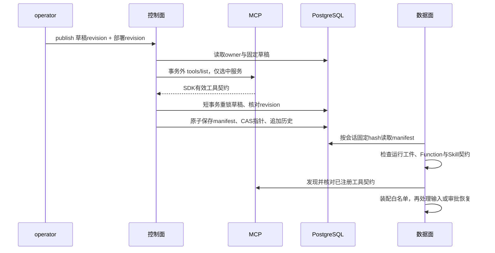

# Agent 能力选择与固定执行计划：P2b

本文承接 [Agent 定义与发布](agent-definitions.md)，描述 P2b 的 operator 配置与执行契约。代码已完成本地验收：P2b 与服务器画像目录的联合工作区通过 1,208 项单元/契约/架构测试和 407 项集成测试；另有 44 项脚本测试、39 项 Compose 检查及画像目录专项 4 项容器检查。完整回归不是 P2b 单独构建的结果，验证范围见 [P2b 验证记录](evidence/p2b-implementation.json)，不代表远程 CI 已通过。管理仍使用独立 `agent-admin`；普通对话 token 不具有管理权限。当前实现使用 AgentScope Java **2.0.3**，没有升级 SDK。

## 从受控目录组装

Agent 首次创建时固定 `baseReleaseHash`。目录来自该基础发布和当前安装的本地能力；只列出基础权限可用、MCP 租户策略允许的条目。目录查询不连接 MCP，也不读取远端凭据；条目存在只代表可以选择，发布阶段仍可能因远端不可用而失败。

```bash
docker compose run --rm --no-deps api agent-admin catalog \
  --agent-id 19a37cb0-fd86-4b59-8bdb-405150f32fe0 \
  --tenant local --subject developer
```

未创建 Agent 时可以对只读 `finance_agent` 查询默认发布的目录。响应只包含模型 profile 名称、能力 ID、kind、name、所需 scopes 和 dependencies，不返回端点、凭据、提示词或契约正文。创建后应重新查询该 Agent 自己的目录，基础发布可能与当前默认不同。

定义文件可以增加 `composition`：

```json
{
  "displayName": "资料检索助手",
  "systemPrompt": "根据已授权工具提供的信息回答，区分事实与推测。",
  "composition": {
    "modelProfile": "primary",
    "capabilities": ["function:search_catalog", "skill:cocktail-from-what-i-have"]
  }
}
```

随后沿用 `create/update --file` 和 `publish --draft-revision --expected-revision`。文件必须是严格 UTF-8 JSON，顶层只接受上述三个字段；`composition` 内只接受 `modelProfile`、`capabilities`。不接受重复、未知 ID、任意 URL、Java 类、脚本路径或凭据名。能力引用最多 128 项，发布还限制展开后的依赖数量与契约总字节数。

| 配置 | 语义 |
| --- | --- |
| 创建时省略 `composition` | 保持 P2a 的基础能力继承方式，发布 `agent-release/2` |
| 更新时省略 `composition` | 保留该 Agent 上一草稿的选择，不会退回继承或扩大能力 |
| `capabilities: []` | 纯对话，没有工具，也没有 Skill loader |
| 明确能力列表 | 发布 `agent-release/3`，执行只装配选择和必要依赖 |
| `modelProfile: primary` | 使用固定基础发布的主模型，保留它原有的备用模型 |
| `modelProfile: fallback` | 基础发布必须已有备用模型；将其作为唯一主模型 |

两个 profile 都继续使用平台既有模型凭据入口；这里没有新增模型供应商、凭据资源授权或模型网关。调用预算不因组装而增加。定义回执的 `contentHash` 包含能力选择；operator 应保留原文件，回执不返回提示词。

## 能力与依赖

能力 ID 使用 `function:name`、`skill:name`、`mcp:service/tool` 及 `agent:<UUID>`。每项冻结实际工具名称、所需 scopes、依赖、规范化契约正文和 SHA-256。发布展开依赖后检查完整闭包、循环、重名、基础权限上限与端点策略。

| 能力 | 必要约束 |
| --- | --- |
| `function:search_catalog` | 同时需要 `catalog:read` 和归档结果使用的 `artifact:read` |
| `function:market_research` | 依赖 `market_snapshot`，同时需要研究和行情权限 |
| `function:portfolio_review` | 固定组合 Workflow，内部行情读取仍需行情权限 |
| `function:create_report`、`function:publish_portfolio_report` | 保留人工审批、动作摘要与发布围栏 |
| `skill:cocktail-from-what-i-have` | 冻结所选 Skill 的 metadata、正文与资源；继续禁用代码执行 |
| `agent:<UUID>` | 仅同 owner 的已发布叶子；空工具 v1 或固定行情 v2，父发布冻结目标 hash；详见[空工具](private-agent-delegation.md)与[固定行情](private-agent-market-leaf.md) |
| `mcp:hotel/...`、`mcp:taibu/...` | 只能选择固定基础发布允许的工具及端点；继续检查租户、出口与凭据策略 |

非空能力集合会显式纳入 `function:read_artifact_range`，用于读取大结果归档；它读取时校验 Artifact 的 owner、原始权限以及当前执行的有效权限。即使同一 owner 在其他会话拥有更高权限，能力收窄的 Agent 也不能借这个支持工具读取越权产物。依赖展开中的本地工具也会出现在可用工具集合中，目录提前显示这些依赖。P3a 已增加受限叶子委派：市场目标保留 snapshot 与 reader 的编译闭包，但 v2 子运行时只执行 snapshot；父侧 reader 依赖与子侧白名单分别受冻结契约约束，不开放任意工具委派。

## 控制面发布与数据面执行



远端发现不能在调用方事务中运行。发现失败、草稿并发修改或发布 CAS 失败，均不留下半次发布；后两者也不创建孤立的新 manifest。原会话继续绑定旧清单，只有新会话使用新指针。

数据面实际装配取“已发布能力及依赖”和“当前 Turn 授权”的交集。MCP 在临时 Toolkit 注册，核对后才加入主 Toolkit；未选原生工具不会残留。Skill 使用只包含所选内容的只读 repository，并在 loader 入口核对 ID，不能仅靠隐藏提示词限制访问。所有恢复检查必须早于补充输入/审批恢复动作，以免旧回答触发新契约下的执行。

## 冻结的范围与升级行为

`agent-release/3` 保存明确选择、依赖闭包、实际缩小后的模型/权限/远端投影和运行工件摘要。Function 固定输入、人工回答、审批契约及实际生产代码；Skill 固定所选内容与资源。运行工件摘要来自同一生产代码来源中的 `com/financeclaw` class 字节，排除测试类，支持展开目录和打包 JAR。

这个摘要策略是保守的：生产代码发生变化时，即使接口看似兼容，旧 v3 发布也会阻断。要继续执行暂停的旧发布，需要保留与其摘要匹配的运行工件；使用新工件时应新建发布和新会话。当前没有自动下载历史工件或跨版本运行池，不能把持久 manifest 等同于任意历史二进制都可恢复。

MCP 固定的是 AgentScope 2.0.3 暴露的 **SDK 有效契约**，包括工具名、描述、有效输入/输出 Schema 等，并非完整服务器原始 Schema。规范化版本为 `mcp-sdk-effective/1`，描述变化也保守判定为漂移。每次执行尝试初始化、以及每次远端派发前都会重新比较。相同输入在新 Schema 下仍合法，也不能绕过摘要检查。

远端发现和 `tools/call` 之间仍存在竞态：没有服务端版本条件调用时，本地无法原子锁定远端实现；Schema 不变也不能证明远端业务实现不变。发现阶段只调用列表协议，不调用业务工具。未选服务不连接、不解析其凭据。

默认发现验收上限为 256 个工具、单项契约 256 KiB、目录有效契约总计 1 MiB，DNS、初始化和列表发现共享等待期限；SDK 客户端关闭可能额外等待，因此不承诺整个发布在该期限内结束。这些数量和字节检查发生在 SDK 返回有效契约后，不是 HTTP 响应或反序列化内存的硬上限；受控端点仍是部署前提。

legacy 和 `agent-release/2` 保留原 hash、正文与执行方式；旧格式没有新的完整契约快照，不能事后用当前 Schema 冒充历史。V5 只添加可空 composition 列和 v3 格式标记，不回填旧选择，不改 V1–V4 SQL，不增加应用表；P2b 时主库为 40 表，后续 V6 的子调用记录将其扩展到 41 表，见[当前结构](fresh-schema.md)。

## 错误处理与验收

| 错误 | 含义与处理 |
| --- | --- |
| `invalid_agent_definition` | 修正严格文件结构、profile、能力 ID 或重复选择 |
| `agent_capability_unavailable` / `agent_model_unavailable` | 选择超出该 Agent 固定基础；重新查询目录 |
| `agent_plan_invalid` | 摘要、依赖、名称冲突或执行投影违反发布约束 |
| `mcp_unavailable` / `mcp_tool_unavailable` | 选中服务发现失败；确认受控服务后以明确 revision 重试 |
| `mcp_contract_changed` | 远端有效契约与固定发布不同，阻断执行/恢复；核对服务版本 |
| `runtime_release_changed` / `capability_release_changed` | 运行代码或本地能力与旧发布不匹配；使用匹配工件恢复，或为新会话重新发布 |
| `agent_draft_revision_changed` / `release_revision_changed` | 并发修改，读取元数据和历史后核对，不盲目采用最新 revision |

测试使用隔离 PostgreSQL、真实 SDK 和本机模拟 MCP；Compose 使用离线模型。最终验证数字及交付状态统一记录在[实施计划](platform-implementation-plan.md#7-实施状态与验证记录)，不以代码存在替代验收。
