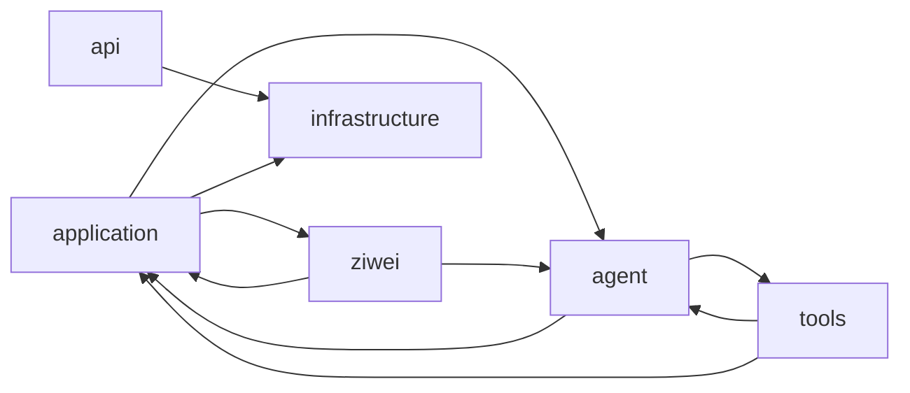
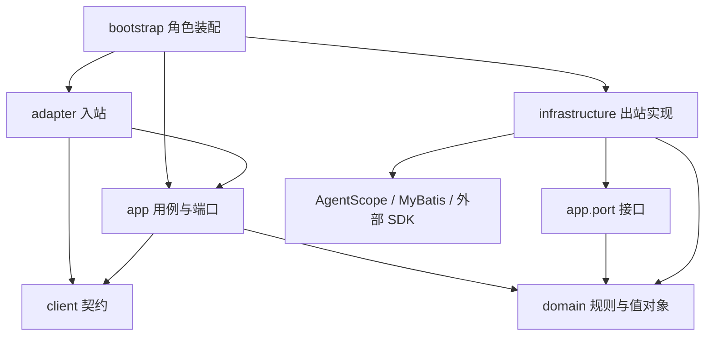

# AgentScope 复用与 COLA 架构整改方案

审查日期：2026-10-15；实施更新：2026-10-16。**R0–R4 与 R5a–R5c 已完成，最新完整回归 824 项通过**。固定契约、M0 隔离、编码边界与 Operations 切片见 [R0–R2 实施记录](r0-r2-implementation.md)；回答用例、工具交互、统一 SDK 快照与实际回归见 [R3 实施记录](r3-implementation.md)。任务用例、原生执行端口与事务回滚验证见 [R4 实施记录](r4-implementation.md)。组合复盘与市场研究的分层见 [R5a 实施记录](r5a-implementation.md)，紫微输入/资源/用例边界见 [R5b 实施记录](r5b-implementation.md)，记忆领域规则、模型/存储端口与发布配置见 [R5c 实施记录](r5c-implementation.md)。本地检查点 `bb58ea2` 已保存 M5e 与 R0–R5a；R5b/R5c 尚未提交。下一阶段为 R6 角色装配。组件选择依据见 [Spring 事务与组件复审](spring-transactions-component-review.md)。

## 1. 结论与决策

**存在局部重复和可收敛的适配代码，但没有证据支持把当前业务治理整体替换为 AgentScope Harness。建议采用 COLA 的分层和依赖倒置，先在单 Maven 工程内实施，再按实际需要拆模块。**

整改前的主要成本来自职责和依赖交织：`application`、`agent`、`tools`、`ziwei` 形成循环依赖，增加工具需要修改多处业务分支。R0–R5b 已将参与循环的具体类依赖从 93 条降到 0 条，并删除循环白名单。R5c 已继续完成记忆与发布配置分层；角色装配和剩余旧 facade 调用者仍需收敛，包图无环不等于这些工作已经完成。

本次建议分为四类：

| 类别 | 结论 | 优先动作 |
| --- | --- | --- |
| 已复审的重复候选 | M0 专用执行保护已迁入测试；原生执行器与包装器校验同一 Schema，但输入对象和入口不同 | R3 用原始 JSON、实际 input、直接调用和 preset 实测不等价，保留最终参数校验 |
| 项目内部可合并的职责 | JSON/摘要工具散落在应用服务和 Agent 恢复类；三处解析 SDK 待处理调用；通用注册器包含全部业务分支 | 明确一个序列化契约、一个 SDK 快照解释器，按业务贡献工具与交互处理器 |
| 应继续保留的业务规则 | 持久受理、租约/fence、完成回执、审批绑定、隐私 epoch、受限记忆 Worker、投递不确定性 | 下沉到正确的领域或应用边界，保留 SQL 原子性 |
| 需要实验才能替换的能力 | 原生 `SubAgentTool`、历史压缩、Harness Gateway | 单独做等价性验证；JDBC 事务已明确由 Spring 管理，2.0.3 状态库单加事务代理不可用 |

**面向对象的重点**：让 `Interaction` 负责回答是否有效、让 `Turn` 表达合法状态变化、让 `PrivacyEpoch` 表达遗忘后的有效性、让 `Portfolio` 表达持仓规则。网络、数据库和 SDK 调用继续由应用编排与基础设施完成。现有不可变 `record` 可以保留，不需要为了“面向对象”全部改成带 setter 的实体。

**组件优先的补充决定**：事务生命周期直接交给 Spring，数据访问继续复用 MyBatis-Spring，少量新 SQL 可用现有 JdbcClient；ArchUnit 已接入；静态 DTO 优先使用 Bean Validation。通用事务、验证、JSON 编码不再额外包成同形的自研框架。

## 2. 整改前审查基线、版本与证据强度

本节及第 3–5 节描述 2026-10-15 整改前发现，不代表所有问题仍未解决。当前完成状态以文首和实施记录为准。基线为本地提交 `993e7acded5340ace65d02c9aad3f272db5fac2f` 加当前工作区，其中包含当时尚未提交的 M5e 文档、脚本和演练证据。当前 [pom.xml](../../pom.xml) 固定 AgentScope Java **2.0.3**、Spring Boot **3.5.16**、MyBatis Starter **3.0.5**、JDK **21.0.12+8**。不把此前框架评估中的 2.0.4 API 当成本工程可用 API。

此次核查了生产 Java 源码、关键集成测试、现有迁移记录，以及 Maven Central 的 2.0.3 `core`、`harness`、`extensions-jdbc`、`extensions-agent-protocol` 源码包；同时核对缓存中的飞书源码与实际 embedding 调用。引用的 10 个官方源码文件已逐一确认：路径存在于 `v2.0.3`，Git blob 摘要与 Maven 源码包中的内容一致。源码包 SHA-256、生产源码指纹、工作区初始状态和依赖图记录在 [静态审查证据](evidence/agentscope-cola-audit.json)。

| 静态指标 | 结果 | 如何理解 |
| --- | --- | --- |
| 生产 Java 文件 | 67 个 | 包含两个独立启动入口，不含测试与生成文件 |
| 物理行数 | 8,943 行 | 包含注释、空行；不能据此推算缺陷率或“可删除比例” |
| 最大的编排类 | `TaskService` 473、`GovernedTools` 460、`GovernanceService` 333、`TaskAgentRuntime` 331 行 | 判断依据是职责混合，行数只是定位辅助 |
| 已确认的循环包组 | `application`、`agent`、`tools`、`ziwei` | 显式 import 图即可确认；行内全限定引用、反射和 Spring 装配未计入 |
| 当前 domain 的外部依赖 | 未直接 import Spring、AgentScope、Jackson | 已有可保留的基础，但 HTTP 状态码和数据形态仍需整理 |

第一轮完成静态调用链与源码等价性分析；第二轮实际执行了 3 项 ArchUnit 检查和 4 项 SQLite JDBC 事务实验。当时本机 Docker 未运行，没有重新完成 PostgreSQL、Compose、真实模型或真实飞书验收。既有完整回归仍是历史基线，不能据本报告宣称 SDK 替换、COLA 重构或生产迁移已经完成。

文档交付已通过 `scripts/check-delivery.py` 的本地链接、脚本语法、凭据模式和空白检查；另行核对了 67 个生产源码指纹与本次修改范围，既有 M5e 实现保持原样。

## 3. AgentScope 能力对照：哪些重复，哪些必须保留

| 能力 | 固定版原生能力与当前使用 | FinanceClaw 增量语义 | 整改判断 |
| --- | --- | --- | --- |
| Agent 循环与模型调用 | `ReActAgent`、`streamEvents`、`OpenAIChatModel`、原生 fallback 已使用 | 单次订阅、根预算、业务取消、完成回执 | 保留薄适配；没有必要再建执行引擎 |
| 会话串行与任务调度 | Harness Gateway 有 `SessionTurnGate`，默认 `LocalSessionTurnGate` | SQL 受理幂等、跨进程领取、租约、旧执行者隔离、暂停/排空 | 概念重叠，语义不等价；当前 SQL 任务模块保留 |
| 状态持久化 | 原生 `AgentStateStore` 接口已使用；原生 JDBC 实现已有版本与 CAS | namespace、固定身份、删除墓碑、Command fence 同事务 | Spring 统一事务，现有 MyBatis-Spring 适配承载业务约束；不要求使用 SDK 的具体 JDBC 实现 |
| 工具输入 Schema | 原生 `ToolExecutor` 调 `ToolValidator`；包装器验证实际执行参数 | HTTP 回答、合并后的修正输入、领域校验是不同边界 | R3 已实证入口不等价，保留现有 SDK 校验边界 |
| 权限与审批 | 原生 permission、ASK、`ConfirmResult` 已使用 | 当前授权版本、撤销、问题有效期、owner/action/checkpoint 绑定 | 保留治理；拆开技术转换与业务判定 |
| 挂起与恢复 | 原生 suspended tool、`AgentState` 已使用 | 回答只绑定保存过的问题，新 attempt 与旧 attempt 隔离 | 统一 SDK 快照解释，保留业务恢复协议 |
| 事件与 SSE | 原生事件 + Spring/Reactor 已使用；AgentProtocol 提供默认回放总线 | 数据库 revision、进程重启后重连、跨副本、脱敏 | 持久投影保留；不引入第二个执行 Controller |
| MCP | 原生建连、发现、Schema、工具调用已使用 | host/tenant、凭据引用、只读白名单、Artifact、预算 | 保留业务装饰；不增加第二套 MCP 协议实现 |
| Skills | 原生 repository、渐进加载工具已使用 | 发布指纹、`skill:use`、根预算、撤销后禁止继续 | 已充分复用；特殊权限挂钩仍需保留 |
| 子 Agent | 当前子任务也使用原生 ReAct；SDK 另有 `SubAgentTool` | 服务端派生身份、根预算、子权限收缩、结果绑定 | 可做替换实验；目前不应直接替换 |
| 固定业务 Workflow | 确定性 `Model` 驱动原生工具循环与 ASK | 持久步骤、输入 hash、本地发布效果只发生一次 | 拆业务编排和 SDK 驱动，不新增通用 DAG 引擎 |
| 历史与预算 | SDK 提供消息 token 估算、上下文压缩；当前使用完整请求检查 | 发布/授权/隐私过滤、最终发送体、fallback 各自预算 | 历史压缩可增量复用，发送前检查保留 |
| 长期记忆 | 原生结构化输出、embedding 已使用；Harness 也有 memory 功能 | USER 来源、事实/候选、遗忘 epoch、独立投影、受限 DB 角色 | 业务记忆保留，模型和向量技术接口可以隔离 |
| 飞书 | 原生 crypto、inbound mapper、token、outbound client 已使用 | 身份绑定、持久收件、旧审批隔离、投递不确定性 | 保留业务渠道层；协议适配集中到 infrastructure |
| 数据库、线程、部署 | Spring 事务/线程池、MyBatis、Flyway、Compose 已使用 | 角色约束与业务条件 SQL | 没有必要为 COLA 改成 JPA 或再建调度器 |

### 3.1 工具 Schema 的确存在重复，但应按调用入口裁剪

正常链路是：`Toolkit` → SDK `ToolExecutor.executeCore` → `ToolValidator` → 包装器 `ToolBase.callAsync` → `GovernedTools.register` 再次 `ToolValidator` → 业务执行。对应本地 [GovernedTools](../../src/main/java/com/financeclaw/infrastructure/agentscope/execution/GovernedTools.java) 的 `register`（第 349–392 行）与 [SDK ToolExecutor 源码](https://github.com/agentscope-ai/agentscope-java/blob/v2.0.3/agentscope-core/src/main/java/io/agentscope/core/tool/ToolExecutor.java)。

两次验证并非任何情况下都相同：SDK 先验证 `ToolUseBlock.content`，再合并 `ToolCallParam.input` 与 preset；本地包装器验证最终 `param.input`。当前生产源码未配置 preset，但这仍是需要写入约束的差异。此外，`GovernedTools.resumeInput` 会直接调用紫微、研究业务入口，未再次经过普通 Toolkit 路径。

整改建议：

1. 明确普通注册工具只能经 Toolkit 进入，并冻结“没有额外修改输入”的边界。
2. 用包含非法输入、确认后恢复、澄清后修正输入、输入表示差异的契约测试证明覆盖完整，再删除普通路径中等价的重复调用。
3. HTTP 回答 Schema、修正输入、金额/币种/日期等领域验证继续保留；这些校验并未被模型工具入口覆盖。
4. scope、fence、预算检查继续在实际执行边界进行。Schema 通过并不代表授权仍有效。

这是一项局部简化，不能宣称会显著改善模型端到端延迟；本次没有性能测量。

### 3.2 M0 实验实现已移出生产代码（R1）

[GuardedAgentRunner](../../src/test/java/com/financeclaw/m0/support/GuardedAgentRunner.java)、[ExecutionGate](../../src/test/java/com/financeclaw/m0/support/ExecutionGate.java)、[EffectLedger](../../src/test/java/com/financeclaw/m0/support/EffectLedger.java) 组成 M0 的 advisory lock/工具效果实验链路。当前引用检索显示它们由 M0 测试和 `ForkedProbe` 使用，正式业务执行已在 R4 改为 `TaskWorker` → `ExecuteTaskService` → `AgentExecutionPort` → `TaskAgentRuntime`，Command/fence/receipt 事务由应用用例负责。

整改前这是历史实验与产品代码并存，并非生产重复执行两次。R1 已将三个类与 `M0RuntimeMapper` 迁到 `src/test/java/com/financeclaw/m0/support`，在测试配置中显式注册 Mapper；正式 `RuntimeMapper` 保留状态 CAS 与墓碑。历史 Flyway 脚本与表保持不变，独立 JVM 验证继续使用 test classpath。

### 3.3 Harness 的会话能力不能直接替换业务 Turn/Command

固定版 Gateway 默认用每个 key 的进程内 semaphore 串行执行；可以注入其他 `SessionTurnGate`，也可持久化 session 路由，不能笼统称其“全部只在内存中”。但默认 gate 并不提供本工程的 SQL 命令租约和完成回执。[LocalSessionTurnGate](https://github.com/agentscope-ai/agentscope-java/blob/v2.0.3/agentscope-harness/src/main/java/io/agentscope/harness/agent/gateway/LocalSessionTurnGate.java)、[HarnessGateway](https://github.com/agentscope-ai/agentscope-java/blob/v2.0.3/agentscope-harness/src/main/java/io/agentscope/harness/agent/gateway/HarnessGateway.java)。

Harness 的 `WorkspaceMessageBus` 可以利用共享文件系统传输消息，但 drain 消费采用读取后移除，不能等价替换“先持久受理 → 租约执行 → 结果核对 → 业务完成与 Outbox 同事务”的协议。替换需要另外实现这些语义，容易把现有代码搬进框架接口后形成更深的一层包装。[WorkspaceMessageBus](https://github.com/agentscope-ai/agentscope-java/blob/v2.0.3/agentscope-harness/src/main/java/io/agentscope/harness/agent/bus/WorkspaceMessageBus.java)。

建议继续以业务任务为调度权威，AgentScope 负责一次 attempt 的 Agent 执行。以后只有在需要 Gateway 的渠道路由或 workspace 功能时再评估组合，避免并行存在两个任务受理入口。

### 3.4 Spring 统一事务，状态接口与业务约束分别处理

原生 [JdbcAgentStateStore](https://github.com/agentscope-ai/agentscope-java/blob/v2.0.3/agentscope-extensions/agentscope-extensions-jdbc/src/main/java/io/agentscope/extensions/jdbc/state/JdbcAgentStateStore.java) 已有版本与 CAS，但 2.0.3 会主动 `commit/rollback`，即使连接已经处于外部事务。当前 [MyBatisAgentStateStore](../../src/main/java/com/financeclaw/infrastructure/state/MyBatisAgentStateStore.java) 不手工管理 JDBC 事务：它通过 MyBatis-Spring 参与 `tasks.fenced(...)` 的 Spring 短事务，同时验证 scope 和墓碑。

第二轮真实 JDBC 实验已确认：MyBatis 与 JdbcClient 可以在同一 Spring 事务中统一提交/回滚；单加 `TransactionAwareDataSourceProxy` 不能阻止该 SDK 实现提前提交外层业务 SQL。因此当前决策是直接由 Spring 管事务，继续采用薄状态适配；不再把“能否用 Spring”留作后期实验，也不为 SDK 提交行为自建通用连接代理。数据访问实现以后可以换，**fence 与 CAS 同事务**以及墓碑/身份规则继续验收。详见 [事务复审与实验](spring-transactions-component-review.md)。

默认 [AgentProtocolTaskEventBus](https://github.com/agentscope-ai/agentscope-java/blob/v2.0.3/agentscope-extensions/agentscope-extensions-protocol/agentscope-extensions-agent-protocol/src/main/java/io/agentscope/extensions/agentprotocol/AgentProtocolTaskEventBus.java) 使用进程内 replay sink，并在 complete 后移除通道。业务 SQL 事件投影解决重启、跨实例和身份隔离，应保留。也可以为框架接口实现持久总线，但若当前产品没有协议接入需求，这会增加一层适配而不会减少业务实现。

原 `CapabilitySteps`（R5b 已移除，调用方直接使用 CapabilityStepService）的本地确定性步骤缓存、`GovernanceService.report` 的本地发布效果，以及 M0 `EffectLedger` 不是三个可无差别合并的“幂等工具”。前两者的事务和恢复语义不同；M0 则是实验代码。对于无法确认结果的外部写入，保持阻塞/核对语义，不能以框架 retry 或新的 command 自动重放。

### 3.5 子 Agent、Workflow、记忆：保留什么，未来可复用什么

原生 [SubAgentTool](https://github.com/agentscope-ai/agentscope-java/blob/v2.0.3/agentscope-core/src/main/java/io/agentscope/core/tool/subagent/SubAgentTool.java) 接受 `session_id`，独立状态保存/读取使用空 user 参数；它同时支持流式转发和不转发事件的调用路径。因此“内部事件无法关闭”不是拒绝使用它的充分理由。真正需要验证的是：服务端身份绑定能否覆盖所有入口、是否遵守根预算与子权限、保存状态是否受当前 fence 保护。

当前 [MarketResearchAgent](../../src/main/java/com/financeclaw/infrastructure/agentscope/capability/MarketResearchAgent.java) 已复用 ReAct，并通过 root scope、call id 和输入 hash 固定子任务；这部分是治理适配。可把原生 `SubAgentTool` 做成独立实验，但必须比较最终适配代码是否真的更少。如果仍需复制它的 session/save/dispatch 流程，保留当前小型入口更合理。

整改前 PortfolioReview 同时包含持仓规范化、分析、发布、步骤保存和确定性 `Model`。R5a 已拆为 [组合用例](../../src/main/java/com/financeclaw/app/portfolio/PortfolioReviewService.java)、领域对象与原生驱动，见 [实施记录](r5a-implementation.md)；没有验证到可以无损替换“跨进程审批恢复 + 幂等发布”的现成 SDK Workflow。也不应以 COLA statemachine 充当持久工作流引擎。

SDK 的 [LongTermMemory](https://github.com/agentscope-ai/agentscope-java/blob/v2.0.3/agentscope-core/src/main/java/io/agentscope/core/memory/LongTermMemory.java) 已标记废弃，跨会话持久化交给应用；这不等于 Harness 没有记忆、搜索或压缩能力。当前模型提取和 embedding 已原生化，SQL 来源、审批、epoch、审计和受限 Worker 是产品规则。向量命中必须再满足 owner/epoch/revision 条件，不能把向量库变成事实权威。

历史压缩可以在业务筛选后的历史上复用 [ConversationCompactor](https://github.com/agentscope-ai/agentscope-java/blob/v2.0.3/agentscope-harness/src/main/java/io/agentscope/harness/agent/memory/compaction/ConversationCompactor.java)，但要禁止摘要变成可信 USER 事实，并审查其 memory flush/offload 副作用。它不替代 [BudgetedTransport](../../src/main/java/com/financeclaw/infrastructure/agentscope/execution/BudgetedTransport.java) 对供应商最终请求的检查。

### 3.6 飞书与依赖不能只按名字去重

[AgentScopeFeishu](../../src/main/java/com/financeclaw/channel/AgentScopeFeishu.java) 已使用 SDK outbound client。固定版 `send` 返回 `Mono<Void>`，非零业务 code 只写日志，因此正常完成仍只能标为 `submitted_unverified`，不能在整理渠道包时改成“已送达”，也不能自动重发未知结果。[FeishuOutboundClient](https://github.com/agentscope-ai/agentscope-java/blob/v2.0.3/agentscope-extensions/agentscope-extensions-channel/agentscope-extensions-channel-feishu/src/main/java/io/agentscope/extensions/channel/feishu/FeishuOutboundClient.java)。

`agentscope-harness` 当前提供飞书使用的 `OutboundAddress`；`extensions-rag-simple` 提供实际使用的 `OpenAITextEmbedding`。不能因为没有构造 `HarnessAgent` 或通用 RAG Pipeline 就删除它们。若以后瘦身依赖，先做完整依赖树与打包运行验证，并与本次分层整改分开提交。

## 4. 当前结构的具体问题

### 4.1 已确认的依赖环

下图是编译时源码依赖的节选，箭头表示“import/引用”，不是业务执行时序。



整改前例如 `TaskService`/`ReleaseCatalog` 引用 `ResumeInputs.canonical`（R1 已消除）；`GovernanceService` 引用恢复 SDK 和紫微输入修正；`GovernedTools` 又调用这些应用服务。`ReleaseCatalog.Release` 还通过行内全限定名引用 `tools.BusinessCatalog.Features`，显式 import 统计会漏掉这条边。

### 4.2 问题与整改位置

| 编号 / 优先级 | 可核对的证据 | 造成的影响 | 整改方向 |
| --- | --- | --- | --- |
| A01 / 高 | [TaskService](../../src/main/java/com/financeclaw/application/TaskService.java)：`submit`、`claim`、`fenced`、`checkPolicy`、`seal`、`finish`、`recoverExpired`、`change` | 任务用例、执行租约、策略、投影和副作用集中；所有工具依赖大服务 | 按受理/查询/执行/恢复拆用例；先保持事务语句和锁顺序 |
| A02 / 高 | 同类 `governance()`、`releases()`（第 220、224 行），`MarketData`/`CapabilitySteps` 等经它访问 Mapper | 服务暴露内部持久化，形成 service locator；调用者能绕过用例边界 | 提供按能力命名的窄端口，关闭 Mapper getter |
| A03 / 高 | [GovernanceService.answer](../../src/main/java/com/financeclaw/application/GovernanceService.java) 直接读 SDK 快照并分支处理紫微 | 通用审批服务随业务工具数量增长 | `AnswerInteractionService` + 领域回答规则 + SDK 快照读取端口 + 业务回答处理器 |
| A04 / 高 | [GovernedTools](../../src/main/java/com/financeclaw/infrastructure/agentscope/execution/GovernedTools.java)：`business`、`resumeInput`、`pending`、`permissions` | 注册、权限、Schema、结果归档和恢复分支多点联动 | 按能力贡献 native Tool 与交互处理器；统一描述来源，禁止另造工具执行框架 |
| A05 / 中 | [TaskAgentRuntime](../../src/main/java/com/financeclaw/infrastructure/agentscope/execution/TaskAgentRuntime.java)：模型、历史、快照、事件、取消、业务分类同类 | SDK 升级影响业务编排；结果解释散落 | 应用执行协调器 + 原生执行适配 + 快照解释器 + 历史策略 |
| A06 / 中 | 整改前 `ResumeInputs.canonical`、`GovernanceService.parse/object/scopes/digest` 被大量调用；R1 已抽取 [PayloadJson](../../src/main/java/com/financeclaw/support/PayloadJson.java) 与 [PayloadDigest](../../src/main/java/com/financeclaw/support/PayloadDigest.java) | 纯数据处理依赖带 Spring/SDK 职责的类，构成多条反向依赖 | 抽取保持字节兼容的 JSON/摘要工具；不顺便更换序列化库 |
| A07 / 中 | [Task](../../src/main/java/com/financeclaw/domain/Task.java) 的 `status` 为 String、`Problem` 带 HTTP status；[Governance](../../src/main/java/com/financeclaw/domain/Governance.java) 多个大 record | 合法状态与绑定规则留在服务中；领域错误与传输契约耦合 | 状态/身份值对象、行为化领域对象；错误码由 web adapter 映射 HTTP |
| A08 / 中 | [OperationsController.view](../../src/main/java/com/financeclaw/api/OperationsController.java) 直接访问 `OperationsMapper` | 运维查询没有统一的应用入口，未来其他入口容易重复 | 作为 COLA 第一个低风险纵向切片；窄查询端口即可 |
| A09 / 中 | 整改前 PortfolioReview（现已拆分，见 [R5a](r5a-implementation.md)）、[ZiweiInputs](../../src/main/java/com/financeclaw/ziwei/ZiweiInputs.java)、[ZiweiCalculation](../../src/main/java/com/financeclaw/ziwei/ZiweiCalculation.java) 混合规则与 SDK/JSON/资源访问 | 纯领域算法也依赖应用和 Agent 包 | 拆类型转换和资源加载；算法继续使用现有冻结样本 |
| A10 / 高风险约束 | [主应用](../../src/main/java/com/financeclaw/bootstrap/FinanceClawApplication.java) 扫描 `com.financeclaw`；[记忆入口](../../src/main/java/com/financeclawmemory/MemoryWorkerApplication.java) 显式导入；[迁移入口](../../src/main/java/com/financeclawmigrate/MigrationApplication.java) 独立 | 机械搬包可能扩大组件与 Mapper 扫描，破坏角色隔离 | 先建立显式角色装配和负向加载测试，再整理启动包 |

这些优先级表示整改顺序和变更风险，并非已确认的生产漏洞评级。

## 5. COLA 是否适合：适合原则，按需选组件

COLA 官方把架构与组件分开，并在 5.0.0 说明中提供基于 package 的 light 分层方案。因此可以在现有工程采用分层、领域行为和依赖倒置，不必先引入整套依赖或六个 Maven 子模块。[COLA 官方说明](https://github.com/alibaba/COLA)。

| 方案 | 收益 | 代价 | 本项目决策 |
| --- | --- | --- | --- |
| 保持现状，只按大小拆类 | 改动少 | 循环依赖、Mapper 外泄和跨层规则仍在 | 不足以解决当前问题 |
| 单 Maven + COLA 分层 + 包约束测试 | 保留构建/部署方式，逐切片消除反向依赖 | 边界需要测试持续约束 | **第一阶段采用** |
| client/adapter/app/domain/infrastructure/start 多模块 | 编译期阻止非法依赖，更易形成独立交付边界 | POM、资源、测试夹具、多个启动角色和打包脚本都要调整 | 边界稳定后按需要采用 |
| 直接覆盖生成 COLA 工程 | 快速获得模板结构 | 会改变技术版本、数据访问选型和启动方式 | 不采用 |

读取时的官方 light 模板使用 Java 17、Spring Boot 3.2.0，并包含 JPA/MySQL 和测试组件 SNAPSHOT；这些是模板配置，不是本工程升级建议。只参考结构，保持当前锁定的技术栈。此处依据的是查阅日期的 master 内容，不代表已验证某个 COLA 发布组件与当前 Boot 组合兼容。[light 模板 POM](https://raw.githubusercontent.com/alibaba/COLA/master/cola-archetypes/cola-archetype-light/src/main/resources/archetype-resources/pom.xml)。

组件取舍是本项目的设计建议：

| 组件/做法 | 建议 | 原因 |
| --- | --- | --- |
| COLA 分层、Gateway 依赖倒置 | 采用 | 与当前循环依赖和业务规则外泄直接对应 |
| DTO/Exception 组件 | 首轮不引入 | 保持 `/v1` 响应、错误码、幂等回执和 SSE 格式；先在项目内明确边界 |
| statemachine | 5.0.0 已核查；R4 的少量规则由 Task/TaskTransition 表达，未引入组件 | 后续需要声明式状态图时直接复用；事务和恢复由 Spring/业务协议处理 |
| domain-starter | 暂不引入 | 领域对象应可脱离 Spring 测试，没有把每个实体注册成 Bean 的需求 |
| extension-starter | 暂不引入 | 当前工具扩展用少量类型化接口和组合即可；出现明确的多场景扩展冲突时再评估 |
| catchlog | 暂不引入 | 现有输出脱敏要求明确，自动记录参数/异常可能改变边界 |
| 测试组件 | 已引入 ArchUnit 1.5.1，保留 JUnit/Testcontainers | 已落地 3 项架构规则，不更换既有 PostgreSQL 故障测试环境 |

Spring 事务、JdbcClient、Bean Validation、Jackson、Spring Modulith 和认证组件的接入位置与状态见 [组件复用清单](spring-transactions-component-review.md)。本项目优先采用组件提供的标准机制，端口只保留在有业务含义的边界上。

采用 COLA 不会自动提升性能、恢复能力或算法精度。预期收益是降低变更耦合、让业务规则更易定位和独立验证；应通过实际改动涉及的类、依赖方向和测试范围评估。

## 6. 建议目标结构与依赖方向

### 6.1 单工程目标包

采用“层在外、业务能力在内”的结构，便于从现有包渐进移动。树中列出的类是目标职责示例，不是要求一次创建所有空目录或接口。

```text
com.financeclaw
├── client                         稳定的调用契约；有实际复用需求才独立
│   ├── task                       SubmitTaskCommand / TaskView
│   ├── interaction                AnswerInteractionCommand / AnswerReceipt
│   └── operations                 DrainView / BacklogView
├── adapter                        入站适配：鉴权、协议解析、调用用例
│   ├── web                        Controllers / ApiErrorMapper / SSE
│   ├── feishu                     回调验证与消息转换
│   └── scheduling                 TaskPoller / MemoryPoller / OutboxPoller
├── app                            应用编排、事务、用例端口
│   ├── task                       SubmitTaskService / CancelTaskService
│   │                              ExecuteCommandService / RecoverCommandService
│   ├── interaction                AnswerInteractionService
│   ├── artifact                   ArchiveArtifactService / ReadArtifactService
│   ├── memory                     RecallMemoryService / ForgetMemoryService
│   ├── channel                    IngestMessageService / DeliverNoticeService
│   ├── operations                 OperationsQueryService / AdmissionService
│   ├── capability                 PortfolioWorkflow / ResearchService / ZiweiService
│   └── port                       按能力分组的入站与出站接口
├── domain                         纯 Java 业务规则
│   ├── execution                  Turn / TurnStatus / CommandLease / CompletionDecision
│   ├── interaction                Interaction / InteractionBinding / AnswerDecision
│   ├── authorization              GrantSnapshot / ScopeSet / ReleaseSnapshot
│   ├── artifact                   ArtifactReference / ArtifactAccessPolicy
│   ├── memory                     MemoryFact / PrivacyEpoch / RecallPolicy
│   ├── portfolio                  Portfolio / Position / MarketSnapshot
│   ├── ziwei                      日期与排盘算法、输入规则
│   └── shared                     Owner / 少量身份值对象；不放业务服务或 JSON 万能工具
├── infrastructure                 出站适配，依赖 app/domain 定义的接口
│   ├── agentscope                 执行、模型、原生 Toolkit、恢复消息转换
│   │   ├── checkpoint             SdkCheckpointInspector / AgentStateStore 适配
│   │   └── capability             业务 ToolContribution / InteractionHandler
│   ├── persistence                MyBatis Mapper、行模型、领域映射
│   ├── channel.feishu             原生 token/outbound client
│   ├── integration                MCP、市场数据、embedding 等外部适配
│   └── configuration              发布资源、credential resolver、JSON 编解码
└── bootstrap                      角色装配；扫描边界验证完成后再统一入口位置
```

记忆和迁移入口在迁移过渡期继续保留 `com.financeclawmemory`、`com.financeclawmigrate`。目标目录中的 `bootstrap` 不是立即移动它们的指令。离线模型是现有开发/演示能力，可以放入明确的 offline 配置中；不要把所有确定性 `Model` 都误判为只能删除的测试代码。

### 6.2 静态依赖规则



约束如下：

- `domain` 不依赖 app、adapter、infrastructure、Spring、AgentScope、MyBatis、Jackson、HTTP 或 Reactor；时钟作为 `Clock`/时刻值传入，算法不得访问网络。
- `app` 可以使用 Spring 事务和注入；依赖出站端口，不能 import 具体 Mapper、SDK `Msg/ToolResultBlock` 或基础设施实现。
- `adapter` 依赖用例与契约，不读 Mapper。HTTP/飞书 payload 到命令的转换在这里完成。
- `infrastructure` 实现内层接口，允许认识框架类型；不把框架类型通过接口返回给 domain。共享的数据结构先明确业务含义，不能只把 `AgentState` 改名成自己的框架状态机。
- 一个端口对应稳定的能力和事务约束，例如 `TaskAdmissionGateway`、`InteractionCheckpointReader`、`ArtifactGateway`；不为每张表生成一层无意义的 CRUD Repository。
- 业务领域之间优先通过值对象或应用编排合作。不要创建一个容纳全部接口、SQL 和工具配置的 `common` 包。

Agent 执行期间会回调业务工具，这是正常的运行时调用。可由 infrastructure 中的原生 Tool 调用 app 定义的 `ToolDispatchUseCase`，由 app 的实现处理业务。静态依赖始终是 infrastructure → app/domain；app 通过 `AgentExecutionPort` 调用 SDK 适配，不能反过来 import 适配器。这与当前双向包依赖不同。

### 6.3 旧代码到目标职责的映射

| 当前入口 | 目标职责 | 必须保留的内容 |
| --- | --- | --- |
| `TaskService` | app.task 用例 + domain.execution + persistence/task gateways | 锁顺序、受理幂等、同事务完成/Outbox、fence 与 CAS |
| `GovernanceService` | 授权、交互、Artifact 三组用例；JSON 工具另放 | action hash、回答版本、过期、归属、撤销和大小限制 |
| `ReleaseCatalog` / `BusinessCatalog` | domain 发布值对象 + infrastructure 资源/凭据加载 | 原有 hash 输入/排序/JSON 字节契约；凭据不能进入发布快照 |
| `TaskAgentRuntime` / `IsolatedAgentFactory` | infrastructure.agentscope + app 执行协调 | 每 attempt 隔离、一次订阅、定向取消、SDK 原生状态 |
| `GovernedTools` | 原生工具装配 + 每业务一个贡献者；调用 app 用例 | 同一个工具定义是 Schema/权限/恢复处理的来源；动态授权不能变成静态注册检查 |
| `ResumeInputs` | R1 抽出 PayloadJson/PayloadDigest；R3 移到 infrastructure.agentscope 并共用 AgentStateInspector | action hash 与保存格式不变；统一待处理判定，具体语义修复见 R3 记录 |
| `PortfolioReview` | domain.portfolio + app.capability + 原生驱动适配 | BigDecimal、行情时效、审批后发布、步骤回执 |
| `MarketResearch` | app.research + 原生子 Agent 适配 | 根身份、子 scope 收缩、根预算、独立状态与取消 |
| `ZiweiInputs` / `ZiweiCalculation` | domain 纯规则 + adapter 输入转换 + infrastructure Schema/资源加载 | 领域契约、算法基准、敏感输入与结果投影限制 |
| `MemoryService` / `MemoryProcessor` / `MemorySearch` | app.memory 用例 + domain.memory + 模型/持久化适配 | SQL 事实权威、epoch、来源、租约、模型在事务外执行 |
| `FeishuService` / `FeishuIngress` / `FeishuDelivery` | 入站 adapter + app.channel + outbound infrastructure | 回调幂等、绑定、旧通知隔离、不确定结果 |
| `TaskWorker` | scheduling adapter + app 执行/恢复/Outbox 用例 | 领取前容量限制、心跳、已领取任务生命周期与 HTTP 连接独立 |
| `OperationsController` / 原 `OperationsService` | R2 已改为 OperationsQueryService / AdmissionService + 两个 gateway | 同主体查询、单 SQL MVCC 快照、分页顺序、旧 API 契约 |

将来若需要多模块，可以按上述依赖拆 `client`、`domain`、`app`、`infrastructure`、`adapter`、`start`。只有出现跨包边界持续失守、独立复用或独立打包需求时才启动；不按文件数量设机械阈值。多模块也不等于微服务，不引入分布式事务来解决当前单库问题。

## 7. 如何变得更面向对象

### 7.1 先把规则放回它们描述的对象

| 领域对象 | 应表达的规则 | 不应承担的职责 |
| --- | --- | --- |
| `Turn` + `TurnStatus` | 当前状态接受哪些事件，重复终态如何处理，生成何种转换决定 | 更新 Mapper、发飞书、执行 Agent |
| `CommandLease` | command/attempt/fence 的匹配与有效性语义 | 用 Java 内存判断替代数据库锁和条件 SQL |
| `InteractionBinding` / `Interaction` | owner、Turn、release、grant、call、action hash、state version、expiry 是否匹配 | 读取 SDK 快照、解释 HTTP、直接恢复模型 |
| `GrantSnapshot` / `ScopeSet` | 子 scope 只能缩小、授权版本一致 | 只在构造时验一次就永久信任；动态撤销仍需执行前读取 |
| `MemoryFact` / `PrivacyEpoch` | 来源可否采纳、候选如何确认、遗忘后何者可召回 | embedding、SQL 查询、把 LLM 摘要当可信用户输入 |
| `Portfolio` / `Position` | 正数量、币种、精度、行情新鲜度、分析决策 | ToolResultBlock、发布回执和网络取行情 |

`Owner` 已在构造时验证非空，`Turn.terminal()` 与 `Claim.scope()` 也已有行为。因此不应把现有 domain 描述为完全没有领域能力；问题是复杂规则仍主要留在 Service 中。

下面是拟议职责示例，**不是已编译或已实现的 API**：

```java
// domain.interaction：规则读取已加载的可信值，不能自行调用数据库或 SDK。
public AnswerDecision answer(ReplyContext context, Answer answer, Instant now) {
    binding.requireSameOwner(context.owner());
    binding.requireSameTurnAndRelease(context.turn());
    binding.requireCurrentGrant(context.grant());
    binding.requireSameCheckpoint(context.checkpoint());
    requireOpenAt(now);
    return question.decide(answer); // 批准、拒绝、澄清各自的业务约束
}
```

应用用例负责在事务里加载、锁定并核对最新值，把事实交给对象决定，再保存回答、幂等回执和待恢复命令。`CheckpointRef` 只表达业务需要的版本/摘要/调用绑定；完整 SDK 状态仍留在技术边界。领域对象不以“构造时已校验”为由跳过事务内复查。

### 7.2 分离三种数据形态，但按需转换

- **API DTO**：保持已有字段、未知字段拒绝规则、错误码和分页格式；不要为引入 COLA 强制包上统一 `Response<T>`。
- **领域对象**：表达规则和不变量；简单不可变值继续用 record。避免用二十多个 String 参数拼接身份，优先给 `TurnId`、`AttemptId`、`ReleaseHash` 等高风险参数赋予类型。
- **数据库行模型**：Mapper/SQL 需要的列与 JSON。只有对象形态和规则确实不同才增加映射，不为只读统计建立完整聚合。

`/operations/drain` 属于查询，继续使用一条 SQL 保持同一 MVCC 快照；不能为“每个领域一个 Repository”而拆成任务、飞书、记忆的多个独立快照后拼接。`Turn`、`Interaction`、`Grant` 可以有清晰的逻辑边界，同时通过同一个应用事务协调，不必为形式上的聚合隔离引入最终一致性。

### 7.3 算法与通用工具保持克制

紫微常量表、历法、星曜与排盘算法不应因类较长而改成大量策略类。先移除它们对 `GovernanceService`、`ResumeInputs`、Toolkit Schema 资源的反向依赖；保留 [既有排盘基准](../migration/m6b-charts.md) 和冻结测试，再决定哪些输入/输出值得类型化。

`PayloadJson`/`PayloadDigest` 是技术契约，不是领域大管家。抽取时必须复用当前排序和序列化行为；修改字段顺序、record 形态或换用 SDK `JsonUtils` 都可能改变 release/action/input hash。SDK AgentState 本来使用 SDK codec，应继续使用它，不能为了“统一 JSON”更换保存格式。

具体放置方式：复用 Jackson 配置好的专用 `ObjectWriter`，应用层按旧字节契约计算 hash；domain 接收已经计算好的 `ReleaseHash/ActionHash`，不调用编码器。仅使用 JDK 的身份摘要可继续保持纯函数。第二轮撤回通用 payload 编码 SPI 的建议：不为已有稳定组件再增加只有 serialize/parse 转发的方法层，也不让应用依赖 Agent 恢复类取 JSON 工具。

不引入通用 `BaseEntity/BaseService/BaseRepository` 继承体系，不为每个简单 if 建接口，也不让领域对象成为带数据库句柄的 Spring 单例。

## 8. 事务、执行和角色隔离：重构不可改变的边界

| 不变量 | 重构后的实现约束 | 破坏它的典型改法 |
| --- | --- | --- |
| 状态写入只能来自当前执行者 | fence/attempt/live 检查与 AgentState CAS 使用同一 DataSource、同一短事务 | 用两个 Repository 各自开新事务，或异步切线程后继续依赖原 ThreadLocal 事务 |
| 模型和外部工具不占业务锁 | 事务外执行网络；事务内只做确认、保存和条件更新 | 把整个 `execute()` 标成一个大 `@Transactional` |
| SDK 保存不等于业务完成 | 继续核对 sealed receipt 与 state version，之后提交终态、journal、Outbox 和记忆意图 | 看到 final text 或 `onComplete` 就直接置 completed |
| 回答与执行都必须授权有效 | 回答事务核对绑定，实际 dispatch 再核对最新 grant/privacy/fence | 把授权全部放进 Controller 或构造时的 permission rules |
| 不确定效果不得自动重放 | 保持未知状态和人工/专用核对路径；本地事务效果可依据持久回执恢复 | 通用 retry 包住全部工具和发布操作 |
| SSE 是观察端 | 新连接只读取持久投影，取消连接不取消业务执行 | 查询端直接订阅 native 执行 Publisher |
| 一个业务完成产生一致的后续意图 | 完成状态、journal、Outbox、记忆意图按既有事务更新 | 改用内存事件监听器异步插入，进程退出后丢意图 |
| 隐私事实以 SQL 为准 | embedding/extraction 在事务外，回写/召回前复查 epoch/revision | 向量命中直接返回，或遗忘后晚到结果重新写回 |
| 受限进程不能获得业务组件能力 | 显式 role configuration、精确 MapperScan、受限 DB 用户 | 把三个入口都放到同一个全包扫描下面 |

执行用例应保持以下时序：

```text
事务 A：领取 Command，形成 attempt/fence → 提交
事务外：构造当前 attempt 的原生 Agent，开始一次执行订阅
执行期间：每次需要持久变更，单独进入受 fence 保护的短事务
事务 B：SDK 状态 CAS；与该次写入的 fence 核对处于同一事务
事务 C：核对保存状态并 seal 完成/挂起回执
事务 D：依据回执提交业务状态与后续意图
```

这描述的是必须保留的核对边界，并不要求把已有 SQL 故意拆得更碎。B、C、D 之间的崩溃窗口正是现有恢复协议处理的对象；不要在类拆分时悄悄重新定义其含义。`CapabilityStepService` 的回调只容纳本地确定性工作，不能演变成在锁内运行任意网络工具的通用执行器。

## 9. 分阶段整改清单

建议将每一阶段拆成可独立审查的本地提交。迁移期间保留单一执行路径；过渡 facade 只委托新实现，不能让旧/新实现同时处理同一条 Command。

| 阶段 | 具体交付 | 依赖与风险 | 完成条件 |
| --- | --- | --- | --- |
| R0 基线与约束 | 保存证据；冻结关键 JSON/hash/API 样本；增加包依赖门禁 | 已保存 12 项固定 JSON/hash 结果、8 种 HTTP 成功响应、7 项 ArchUnit 规则；存量循环登记到具体类 | 新增依赖受检查；存量问题只减不增，不能把局部规则通过称为完整无环 |
| R1 清理历史与基础依赖 | M0 三个实验类迁入 test support；抽取兼容的 payload 编码/摘要边界 | 已移到 test support，提取 PayloadJson/PayloadDigest；不改 Flyway | 产品主源码不再包含 M0 执行器；forked probe 正常；旧 hash 字节不变 |
| R2 运维纵向切片 | `OperationsController` → 查询/受理用例 → 窄 Gateway → 原 Mapper | 已拆查询/受理用例与两个窄 gateway；SQL 与返回契约保留 | Controller 无 Mapper；查询逻辑可独立验证；快照/分页/权限测试通过 |
| R3 交互与工具边界 | `AnswerInteractionService`、`InteractionBinding`、统一快照解释器；五类 ToolContribution 与交互处理器 | 实现及实际回归见 [R3 记录](r3-implementation.md)；Spring 事务与原 SQL 保留 | 通用审批不再识别紫微；三处快照判定统一；Schema 入口实证不等价，保留最终参数校验 |
| R4 任务与原生执行分层 | 已拆受理/查询/取消/租约/完成/恢复；原生 runtime 实现 `AgentExecutionPort`；删除 Mapper/目录 getter | 实现与验证见 [R4 记录](r4-implementation.md)；沿用 SQL 和锁顺序 | 新 app 无 SDK/Mapper；9 项新增集成覆盖回滚、过期写入、事务外执行和不重放恢复 |
| R5 业务对象和记忆分层 | [R5a](r5a-implementation.md) 已拆 Portfolio 与研究，[R5b](r5b-implementation.md) 已拆紫微 I/O，[R5c](r5c-implementation.md) 已拆记忆与发布配置 | 不与算法升级、数据格式迁移同时做 | 领域、子预算、发布幂等、紫微冻结样本与恢复回归通过；R5c 增加记忆事务回滚、旧回执重放、搜索遗忘竞态和发布字节兼容验证 |
| R6 角色装配与可选模块化 | 先替换宽泛扫描为明确角色装配，再决定是否移动入口和拆 Maven | 需重验镜像、启动类、MapperScan、restricted role | memory/migrate 无业务 Controller/工具/TaskService；完整镜像和多进程恢复验收通过 |
| R7 可选原生替换实验 | SubAgentTool、历史压缩分别实验；SDK 存储仅在提供外部事务模式后重评 | Spring 事务方案已确定，不阻塞 R1–R6 | 满足本节后的等价性矩阵且适配代码减少，才合入默认路径 |

执行顺序以 R1 → R2 → R3 → R4 为主。R5 可以按业务逐项推进；R6 在职责稳定后实施。**不建议第一步全量搬包、同时改事务和升级 AgentScope。**

### 9.1 推荐的第一批实际改动

第一批只包含三个可分别回退的小切片：

1. 补 `release hash / action hash / canonical JSON / HTTP JSON` 的固定兼容样本，建立新包的依赖方向门禁。存量循环必须登记到具体类，不用 `ignore all` 隐藏。
2. 移出 M0 专用实验实现，保持正式状态 Mapper 和历史迁移不变；检查独立 JVM 测试需要的 classpath。
3. 以 Operations 查询为试点：抽出 `OperationsQueryService` 和按查询能力定义的 gateway，把 Controller 对 Mapper 的引用移入实现。原有单 SQL、owner 条件、分页和响应保持一致。

这批完成后再处理交互和执行，不先碰高风险的租约/恢复事务。编码工具抽取可以在固定样本就绪后单独提交；Schema 去重放到 R3，在所有入口覆盖明确后进行。

### 9.2 原生替换实验的通过标准

| 实验 | 必须证明 | 任一项不满足时的决定 |
| --- | --- | --- |
| `SubAgentTool` 替换研究入口 | 模型不能自选越权会话；状态 user/namespace 固定；工具/预算收缩；并行同 call id 隔离；子输出不泄露；取消与回执保持 | 保留现有 native ReAct + 小型治理入口 |
| 后续 SDK Spring 事务模式 | 仅在实现明确不主动提交外部事务后重评；再验证 fence/CAS 原子性、墓碑、namespace、旧 state 和晚写 | 当前直接使用 Spring + MyBatis-Spring；2.0.3 单代理方案已实验排除 |
| 原生历史压缩 | 只处理业务允许的历史；挂起调用不丢失；摘要不变成 USER 来源；关闭/约束副作用；最终请求仍受预算控制 | 保留当前历史策略，不能以减少 token 为由弱化来源/隐私 |
| Harness Gateway 接入 | 只有一个持久受理权威；连接生命周期不改变任务；新增收益超过适配和状态映射成本 | 不接入默认业务路径 |

原型应使用测试配置或隔离入口，不能在生产处理中途切换执行器。评估结论允许“不替换”；框架 API 数量不是衡量复用质量的指标。

## 10. 验收矩阵与防回归规则

### 10.1 静态架构门禁

优先在改造完成的纵向切片启用严格规则，旧包采用只减不增的显式基线。ArchUnit 1.5.1 已加入 test scope，[当前 10 项检查](../../src/test/java/com/financeclaw/architecture/ArchitectureTest.java) 覆盖当前实施切片；下面列的是完整目标，具体运行结果见实施记录，不能把未实现的规则也算作已覆盖。

| 规则 | 阶段目标 |
| --- | --- |
| domain 不依赖框架、传输、持久化和外层包 | 新建/迁入的领域类立即满足 |
| app 不依赖 infrastructure、AgentScope、具体 Mapper | 全部新 app/port 均启用；仅 app.ziwei 可引用受独立门禁保护的既有计算库；旧记忆等依赖留待后续 |
| adapter 不直接读写 Mapper | 已覆盖全部现有 api 包；Operations 例外已删除 |
| 领域包之间及分层包之间没有循环 | R5b 已清零并删除白名单，com.financeclaw 主业务包编译依赖图强制无环 |
| 生产 runtime 不引用 M0 probe | 已全量启用，另核查最终 Boot jar |
| 原生 SDK 类型仅出现在 infrastructure 和必要的 bootstrap 装配 | 根执行及已迁移业务适配均位于 infrastructure；旧记忆模型中的 SDK 使用待后续处理；domain 已禁止 |
| Memory/Migrate 角色没有加载业务 Bean 和宽泛 Mapper | R6 前先增加负向加载验证，再移动入口 |

包重命名后的图看似无环并不代表通过：还要检查行内全限定名、方法签名、Spring 注入、异步回调和真实装配。当前审查中的 import 图只能作为起点。

### 10.2 复用已有高价值测试

下面列的是复用的测试入口；实际执行批次和结果见 [实施记录](r0-r2-implementation.md)，不把测试名称当作运行证据。

| 风险 | 已有测试入口与代表场景 | 增补重点 |
| --- | --- | --- |
| CAS/互斥/恢复 | [M0 StateAndIsolationIT](../../src/test/java/com/financeclaw/m0/StateAndIsolationIT.java)、[RecoveryIT](../../src/test/java/com/financeclaw/m0/RecoveryIT.java) | 实验类移位后的 fork classpath；若换存储则补同事务回滚证明 |
| 领取、晚写、崩溃窗口 | [TaskLifecycleIT](../../src/test/java/com/financeclaw/m1/TaskLifecycleIT.java)：`T05_claimedCrashBlocksAndFencesLateSnapshotAndCompletion`、`T08_sealedSnapshotSurvivesCrashAndCompletesWithoutModelReplay`、`unsealedSdkSaveIsConservativelyBlockedWithoutReplay` | facade/新用例共存时只有一个执行者；事务边界保持 |
| 取消、完成、SSE | 同一类：`T09_cancelAndCompletionRaceHasOneTerminalAndOneOutbox`、`runningCancellationInterruptsOnlyItsSdkAndWaitsForAcknowledgement`、HTTP/SSE 重连场景 | 慢/无响应模型仍可取消；断连不再执行/不取消任务 |
| 审批绑定与恢复 | [GovernanceIT](../../src/test/java/com/financeclaw/m2/GovernanceIT.java)：`replyValidatesOwnershipTypeRevisionHashAndSchema`、`revocationBeforeReplyAndAfterReplyBlocksExecution`、`changedCheckpointCannotBeApproved` | 统一快照解释器覆盖 denied、suspended、已解决和多个待审批调用 |
| Schema 与预算 | [ModelPolicyTest](../../src/test/java/com/financeclaw/m2/ModelPolicyTest.java)、[ModelPayloadTest](../../src/test/java/com/financeclaw/m0/ModelPayloadTest.java) | 原生普通入口、直接澄清恢复、内容/参数不一致、preset 边界、fallback 完整 payload |
| 子 Agent 与 Workflow | [BusinessIT](../../src/test/java/com/financeclaw/m3/BusinessIT.java)：`researchHasIndependentChildStateNarrowedToolsAndSharedRootBudget`、`parallelResearchWithTheSameCallIdsCannotShareStateOrEvidence`、`deterministicWorkflowPausesBeforePublicationAndDuplicateAnswersPublishOnce` | 原生替换实验不能扩权；既有独立 JVM Workflow 回放 |
| 隐私与受限 Worker | [MemoryIT](../../src/test/java/com/financeclaw/m4/MemoryIT.java)：`forgettingDuringEmbeddingCannotResurrectProjection`、`memoryDatabaseRoleCannotReadBusinessStateOrChannel`、`completionRollbackCannotCreateMemoryIntent` | 角色装配负向断言；新对象映射不丢 epoch/revision |
| 飞书真实语义 | [FeishuIT](../../src/test/java/com/financeclaw/m4/FeishuIT.java)：非零业务码、传输失败、重复回调、旧通知与旧批准 | 不把 `submitted_unverified/unknown` 改成 delivered，不新增隐式重试 |
| 运维纵向切片 | [OperationsIT](../../src/test/java/com/financeclaw/m5/OperationsIT.java)、[AdmissionIT](../../src/test/java/com/financeclaw/m5/AdmissionIT.java)、[BacklogIT](../../src/test/java/com/financeclaw/m5/BacklogIT.java) | Controller 无 Mapper；旧 API/同快照/分页/受理竞争保持 |
| 角色与凭据 | [DeploymentAccessTest](../../src/test/java/com/financeclaw/m5/DeploymentAccessTest.java) | 新包位置和各启动方式均受限，凭据不进入 DTO/hash/snapshot |
| 紫微算法和恢复 | [ZiweiChartEngineTest](../../src/test/java/com/financeclaw/m6/ZiweiChartEngineTest.java)、[ZiweiRecoveryIT](../../src/test/java/com/financeclaw/m6/ZiweiRecoveryIT.java) | 领域类型化保持冻结输出、隐私/取消竞争和部署镜像无 Python 依赖 |

不要为每个 getter 或简单转发器新增镜像测试。新增测试优先覆盖此前无法隔离的领域规则、序列化兼容、跨入口校验，以及类拆分可能破坏的事务与角色边界。

完成涉及执行、装配或依赖的阶段后，使用项目已有验证入口；使用以下命令；每轮结果单独记录：

```bash
scripts/mvn.sh verify
python3 scripts/check-delivery.py
```

`verify` 需要已有工具链和可用 Docker；不能跳过集成测试后标记整阶段通过。纯文档变更只需要静态交付检查。镜像/Compose/真实服务验收按变更范围单列证据，参考 [M5 交付记录](../migration/m5-validation.md) 与 [M5e 隐私恢复核对](../migration/m5e-restore-privacy.md)。

### 10.3 阶段交付与回退

每个实现提交应说明移动了哪些职责、删除了什么重复、保留了哪些协议，以及实际运行了哪些测试。类移动与业务行为调整尽量分开；本次结构整改不修改历史 Flyway。若必须改变 JSON、数据库字段、发布 hash 或保存的 SDK 状态格式，先另立兼容迁移方案。

回退以代码提交为单位，保证旧进程仍能读取原数据库和固定发布。对于已经执行的外部效果，回退代码不会撤销它；仍必须依赖既有回执和不确定结果核对。运行中的 attempt 不切换实现，完成或按既有流程隔离后才启用新路径。

## 11. 仍未被本次分析证明的事项

- 已验证 2.0.3 原生 JDBC store 单加事务感知代理不能保留外层原子性；没有完成其他 SDK 存储改造或 PostgreSQL 替换验收。Spring 是当前确定的事务所有者。
- 未完成 SubAgentTool 等价原型，也没有测量 Schema 去重的延迟收益。
- 已验证 ArchUnit 1.5.1 的构建/测试接入，并核查 COLA statemachine 5.0.0 源码；Bean Validation、状态机和 Modulith 尚未完成本项目业务接入，按对应切片实施。
- 没有重新完成真实模型、远端 MCP、真实飞书、历史会话切换或生产验收。架构整改与 [迁移验收清单](../migration/acceptance-checklist.md) 是两条需要分别留证据的工作。

这份文档是后续开发的整改依据。R0–R5b 的实现与验证见各批实施记录，下一步继续 R5 的记忆和发布配置分层；是否拆 Maven 模块、是否换用更多原生实现，依据前面各项验收结果决定。
