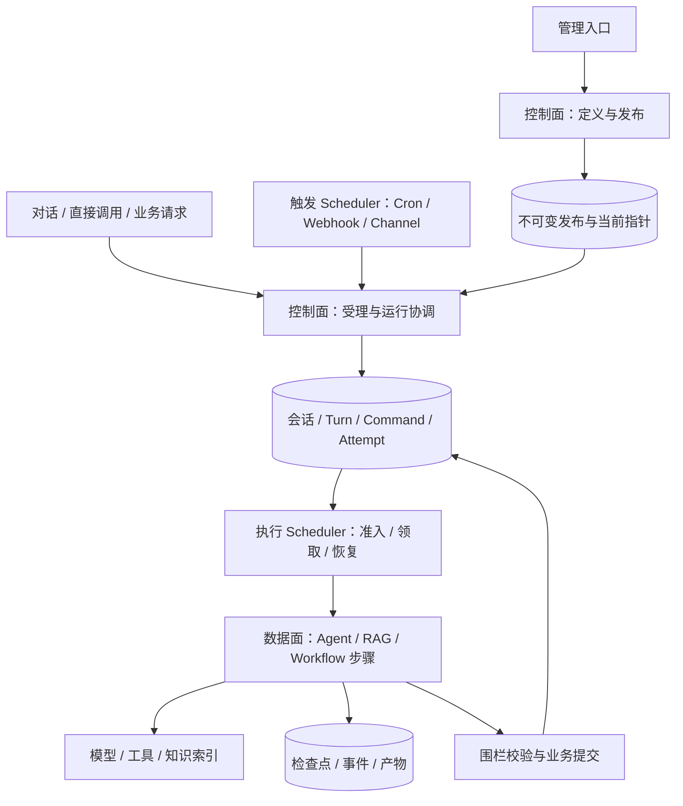

# 平台化实施方案：控制面、数据面与 Scheduler

本文是 FinanceClaw Java 的实施方案与阶段状态记录。面向四类使用方式：通用对话、定制 RAG Workflow、通过提示词与工具等配置组装 Agent，以及直接调用一个独立 Agent。本文中的目标模型不代表当前已经实现的能力。

截至 2026-10-24，P1 发布持久化、P2a Agent 定义、P2b 能力与依赖冻结、P3a.1 固定研究子调用以及 **P3a.2 执行数据隐私清理**均已交付。**P3a.3 同 owner 空工具叶子 Agent 委派**也已由 `d433423` 推送，整条远程流水线成功：1,702 项 Java 测试、46 项脚本和 44 项部署检查通过。P3a.4 完整父子链路验收与取消传播修复已本地验收，未推送；P3a 整体、P3b 和 P4 尚未完成。每阶段分别保留代码、验证记录与交付范围；固定深度的子执行器不等同于完整权限、跨 owner 或递归委派。

## 1. 实施前基线与改造目标

当前工程使用 Java 21、Spring Boot 3.5.16、AgentScope Java 2.0.3。HTTP、执行、恢复、SSE 和飞书投递位于同一个业务 JVM，项目保持单个 Maven 模块。主执行器是 `ReActAgent`，不是 SDK `HarnessAgent`。Memory Worker、初始化和隐私恢复仍是独立入口。运行方式见[应用运行结构](combined-runtime.md)。

| 领域 | P1 实施前已存在 | 平台化需要补充 |
| --- | --- | --- |
| 发布 | `ReleaseDefinition`、内容摘要、Turn 固定 `releaseHash` | 持久发布库、持久当前指针、会话绑定，逐步扩展 Agent/Workflow 依赖快照 |
| 会话 | conversation、owner、grant、工作上下文 | 会话持续使用同一发布；后续明确调用目标与独立 AgentSession 模型 |
| 执行 | Turn、Command、Attempt、lease、fence、检查点、交互、取消和恢复 | 统一执行描述；后续增加通用调用关系和执行类型 |
| Agent 装配 | 单个 `finance_agent`，配置与代码共同装配工具 | 可编辑定义、不可变发布、受控 Tool/Skill 注册与按发布装配 |
| 子 Agent | 受限市场研究子 Agent | 可直接调用的独立 Agent、显式子调用记录、版本与权限收敛 |
| Workflow | 固定组合复盘驱动 | 先提供明确的 RAG Workflow，再按需求扩展可发布的流程定义 |
| 知识 | 用户画像、证据记忆、可选记忆向量搜索 | 独立知识库、文档摄取、索引版本、检索与引用链路 |
| 调度 | TaskWorker 槽位、持久命令领取、恢复扫描、心跳 | 可配置触发、持久触发去重、执行准入与路由；最后再考虑拆进程 |
| 身份 | 服务端 owner、scope 与 grant revision | 后续可信多用户身份目录、资源管理权限、应用与最终用户身份分离 |

P1 开始前，`ReleaseService` 使用内存 Map，重启仅加载启动配置；旧发布不存在时恢复会阻断。`SubmitTaskService` 在创建每个 Turn 时读取当前发布，同一会话的不同 Turn 可能绑定不同发布。已有工作上下文检查发布一致性，但当时没有会话发布绑定。P1 首先补上这两个缺口；下文的实施范围和状态表说明本轮进展。

源码入口：[ReleaseService](../../src/main/java/com/financeclaw/app/release/ReleaseService.java)、[ReleaseIdentity](../../src/main/java/com/financeclaw/app/release/ReleaseIdentity.java)、[SubmitTaskService](../../src/main/java/com/financeclaw/app/task/SubmitTaskService.java)、[TaskWorker](../../src/main/java/com/financeclaw/worker/TaskWorker.java)。以上描述是本方案启动时的基线，阶段完成后以状态表与对应验证记录为准。

## 2. 参考 AgentScope Service 的范围

官方参考仓库为 `agentscope-ai/agentscope-java`，本轮研究固定在 commit `07c5f3078d682da30f29e96b6d76f68242cbc2e1`。SDK stable release 为 `v2.0.4`；Service 推荐安装版本为 `v2.1.0-BETA1`，是预发布，发布 commit 为 `5451c73abe47053340683a1cc6d67b290b056648`。本项目不因这次研究自动升级 SDK。

Service 位于 Java monorepo，但其 Control Plane 使用 Go，Dataplane 与独立 Scheduler 服务使用 Java。其职责划分可以借鉴；FinanceClaw 保持 Java 实现，也不复制它的数据库命名或全部公共 API。

| 官方设计 | 本项目采用方式 |
| --- | --- |
| 定义、发布、运行资源由控制面管理 | 发布配置与执行状态分开建模；执行时使用已解析的固定发布 |
| AgentTask 与 ExecutionAttempt 分开 | 保留现有 Turn/Command/Attempt，避免再建一套竞争的任务状态机 |
| 数据面通过 resolve 获得固定定义 | 将当前 `releaseHash` 读取路径演进为受校验的执行描述，不按最新配置重新装配 |
| 独立 Java Scheduler 处理 Channel/Cron/outbound | 将触发适配与任务执行分开；外部入口统一经过既有受理边界 |
| Go 控制面 Scheduler 做准入与 runtime placement | 单独定义执行调度职责，不把所有调度归入 Cron |
| Workflow revision、Workspace revision 与定义快照 | 分阶段引入依赖闭包、内容摘要与不可变发布 |

官方同一 commit 的 README 仍使用 Endpoint/Invocation，部分文档已使用 AgentSession/Turn；Automation 与 Workflow 文档仍存在 preview 标记。因此本文借鉴经过代码核对的边界，不承诺与其当前 HTTP API 兼容。当前 Service 的共享 Memory 是文档工具读取，不等于完整向量 RAG 产品。

固定参考链接：

- [Service 架构与四个组件](https://github.com/agentscope-ai/agentscope-java/blob/07c5f3078d682da30f29e96b6d76f68242cbc2e1/agentscope-service/README.md)
- [控制面准入与执行路由 Scheduler](https://github.com/agentscope-ai/agentscope-java/blob/07c5f3078d682da30f29e96b6d76f68242cbc2e1/agentscope-service/service-controlplane/internal/scheduler/scheduler.go)
- [Task plane：逻辑任务、物理尝试与围栏](https://github.com/agentscope-ai/agentscope-java/blob/07c5f3078d682da30f29e96b6d76f68242cbc2e1/agentscope-service/service-controlplane/internal/taskplane/service.go)
- [Java Cron 触发服务](https://github.com/agentscope-ai/agentscope-java/blob/07c5f3078d682da30f29e96b6d76f68242cbc2e1/agentscope-service/service-scheduler/src/main/java/io/agentscope/builder/web/managed/CronDeploymentScheduler.java)
- [固定定义的 resolve 契约](https://github.com/agentscope-ai/agentscope-java/blob/07c5f3078d682da30f29e96b6d76f68242cbc2e1/agentscope-service/service-dataplane/src/main/java/io/agentscope/builder/control/SessionResolveResult.java)
- [从控制面快照构建 Harness](https://github.com/agentscope-ai/agentscope-java/blob/07c5f3078d682da30f29e96b6d76f68242cbc2e1/agentscope-service/service-dataplane/src/main/java/io/agentscope/builder/web/catalog/HarnessAgentBuildService.java)
- [发布依赖冻结](https://github.com/agentscope-ai/agentscope-java/blob/07c5f3078d682da30f29e96b6d76f68242cbc2e1/agentscope-service/service-controlplane/internal/invocation/freeze.go)

上述细节按固定 main commit 核验；其中 BETA1 的 README、Scheduler 与依赖冻结代码也已核对，其他链接不据此宣称在 BETA1 具有完全相同的行为。

## 3. 目标职责边界

控制面需要区分“配置管理”和“运行协调”。数据面执行模型、工具与 Workflow 节点。Scheduler 分为触发调度和执行调度；Workflow 依赖推进属于运行协调，不是另一个独立任务权威。

| 逻辑模块 | 持有的权威与责任 | 对其他模块的约束 |
| --- | --- | --- |
| 控制面：配置管理 | Agent/Workflow 定义、资源目录、发布与依赖、部署指针、权限策略 | 发布不可变；凭据只保存引用；更改默认版本只影响新绑定 |
| 控制面：运行协调 | 会话绑定、Turn 受理、交互、取消、逻辑状态、Workflow 依赖、结果验收 | 沿用幂等键、授权/隐私检查与短事务，只有这里决定业务完成 |
| 触发 Scheduler | Cron/Webhook/渠道事件接收、触发去重、错过触发策略、投递记录 | 将触发转换为受理请求；不能绕过授权直接执行 Agent |
| 执行 Scheduler | 排队、容量、优先级、并发/预算准入、租约、worker 选择、恢复扫描 | 只派发已受理且绑定发布的工作；每次尝试有独立 fence |
| 数据面 | 发布校验与装配、ReAct、RAG/Workflow 步骤、工具、检查点、事件和 Artifact | 按指定发布执行；每次副作用重新核验有效执行身份 |
| 外部资源适配 | 模型、MCP、知识存储、凭据、文件环境、渠道 | 外部调用在数据库事务外；未知副作用不自动重放 |

P1 至 P3 的初始落地仍在单个业务 JVM 内完成：通过应用服务、端口与数据所有权表达边界，不增加 HTTP hop。已存在的内存/数据库事务边界不能因为名称变为“控制面/数据面”而被拆散。



图中的逻辑模块不表示当前部署为多个服务。实时 SSE 仍依赖单进程事件中心；在完成跨实例事件回放与通知设计前，业务服务保持单副本。

## 4. 实体、版本与调用模型

### 4.1 配置与发布

| 实体 | 含义 | 首次落地阶段 |
| --- | --- | --- |
| `ReleaseDefinition` / 发布记录 | 当前可执行配置的不可变正文、hash 与格式身份 | P1 持久化现有定义 |
| 当前发布指针 | 后续新会话默认选择的发布；更新有明确并发语义 | P1，仍是当前单 Agent 应用级默认 |
| `AgentDefinition` | Agent 的稳定身份、名称、维护者及生命周期 | P2 |
| `AgentDraft` / revision | 可编辑提示词、模型、工具、Skill、子调用许可及资源引用 | P2 |
| `AgentRelease` | 解析并冻结依赖后的可执行版本 | P2，逐步兼容现有发布身份 |
| `WorkflowRelease` | 固定步骤、依赖、输入输出、节点目标及重试策略 | P3 |
| `Deployment` | 发布到环境/渠道/应用入口的绑定及默认版本指针 | 后续平台管理能力，P1 不创建完整部署系统 |
| `RuntimeProfile` | 可执行器类型、能力、资源限制、工件/镜像身份 | P4 按实际拆分需求引入 |

版本号供人阅读和排序，内容 hash 用于校验不可变内容。二者不能替代权限 revision、隐私 epoch、检查点 version 或 Attempt fence。已有 hash 算法需要保持兼容；若引入新格式，应显式记录格式版本，不静默改变旧发布身份。

发布依赖至少应逐步覆盖提示词正文、模型配置、Function 实现/Schema、MCP 配置与已验证 Schema 指纹、Skill 内容与资源摘要、Workflow 图、引用 Agent release、知识检索策略及 runtime 兼容身份。P1 只保存现有 `ReleaseDefinition` 已表达的范围，不将持久化宣称为完整依赖冻结。

凭据值不能进入发布正文或 hash。发布记录保存可使用的凭据引用与策略；执行时重新验证访问并解析当前有效凭据。已发布旧版本即使可读取，也不因此绕过后续撤权或遗忘。

### 4.2 会话、Turn 与恢复

P1 将新创建的 conversation 绑定到创建时的发布。后续 Turn 从 conversation 读取绑定，而不是重新读取全局 current。新发布只改变之后创建的 conversation；已有 Turn、待审批动作、恢复尝试与工作上下文继续使用原发布。升级前已有 Turn 的会话按最近已受理 Turn 的 hash 回填；尚未使用的旧会话在首次受理时绑定。历史 manifest 缺失时明确阻断，不根据当前配置伪造旧版本。

未来的完整 `AgentSession` 可以增加 target、resource bindings、runtime capabilities 和外部会话映射，但 P1 不同时重建会话 API。直接执行一次 Agent 可以创建短生命周期会话，仍复用正常受理路径，避免另开绕过治理的直接执行入口。

| 运行对象 | 权威语义 |
| --- | --- |
| Conversation / 后续 AgentSession | owner、会话目标与固定发布、资源选择；是跨 Turn 的边界 |
| Turn | 一次已受理用户/业务请求，固定发布、grant、隐私和输入身份 |
| Command | 等待执行或恢复的持久工作；同一业务请求不因网络重试新建工作 |
| Attempt | 一次物理执行，具有 lease、fence、运行状态和封存回执 |
| Checkpoint | SDK 可恢复状态；不能独自证明外部副作用或业务完成 |
| Interaction | 绑定精确动作的审批/补充输入；发布升级不重写原动作 |
| 调用/步骤记录 | 后续保存根 Turn、父调用、目标发布、输入/输出与子尝试关系 |

目标是恢复前读取原发布，验证内容 hash 与执行器兼容性，然后才允许继续。P1 增加持久清单与摘要校验，沿用已有 Skill 等运行检查，尚未建立覆盖硬编码提示词、Function 和 Workflow 代码的完整工件兼容机制。后续若旧工件或兼容执行器不可获得，应明确阻断，不能替换成最新发布。未知写入继续沿用 `blocked/unconfirmed_execution` 边界。

### 4.3 组装 Agent 与子调用

P2 的 Agent 装配先支持受控目录中的能力：提示词、模型 profile、本地已注册 Function、已配置 MCP、已验证 Skill。Function 不是由用户任意上传 Java 类；Skill 也不是未经校验即可执行代码的包。不同来源通过统一能力描述表达 Schema、所需 scope、权限策略、预算与实现身份。

发布时解析明确声明的子 Agent release，并检查引用环、最大深度与可访问性。执行时记录 `rootTurnId`、`parentCallId`、目标 Agent/release 和输入摘要；子调用权限是父任务授权与子 Agent 发布允许范围的交集，预算归入根 Turn。子 Agent 不继承不需要的全部聊天历史或凭据。

“独立 Agent 可直接调用”与“父 Agent 内部临时子代理”分开表达：前者有平台身份和发布，后者是执行策略。先提供同步、受限、可观测的独立调用，再扩展后台协作与多成员 Team，避免一次引入多套会话与任务状态机。

### 4.4 定制 RAG Workflow

用户画像和证据记忆继续服务个性化与跨会话事实；业务知识问答使用独立 KnowledgeBase。两者不共用未经区分的“memory”权限与生命周期。

| RAG 对象 | 控制面管理 | 数据面执行 |
| --- | --- | --- |
| KnowledgeBase | owner、来源与访问策略、索引发布指针 | 按当前调用身份校验知识访问 |
| Corpus/Document revision | 来源、修订、删除/撤权状态 | 读取明确版本并生成证据引用 |
| IndexRelease | embedding revision、维度、chunker、索引构建身份与状态 | 选择已就绪索引，记录实际使用的版本 |
| RetrieverProfile | query rewrite、过滤、topK、rerank、阈值 | 检索、重排、证据裁剪与引用校验 |
| RAG Workflow release | 输入输出契约、步骤顺序、模型与检索依赖 | 执行检索与回答流程，保存步骤结果 |

首个流程建议为：输入校验 → 授权过滤 → 查询改写（可选）→ 检索 → 重排（可选）→ 证据充分性判断 → 带引用回答 → 输出与引用校验。索引尚未就绪、无权访问或证据不足都有明确结果，不能静默退化成无依据回答。

区分两类版本策略：回放/审计要求固定 `IndexRelease`；实时问知识可在 Turn 受理时解析指定知识库的最新就绪索引，并记录本轮实际版本。无论哪种策略，文档撤权与隐私删除仍在执行时生效，固定旧索引不能恢复被撤销的访问。

## 5. 跨模块契约与事务规则

后续执行描述应逐步包含：owner、conversation/turn/command/attempt、releaseHash、输入引用、grant revision、privacy epoch、lease/fence、预算、能力集合、资源引用以及父子调用关系。P1 直接使用现有领域对象和端口，不要求一次引入完整远程协议。

1. 创建 conversation 时，在同一事务中保存 owner、固定发布与初始授权；失败不留下半成品会话。
2. 受理 Turn 保持现有会话锁、幂等回放、暂停检查、权限/记忆快照和 Command 写入顺序；绑定发布读取不能移到可产生竞态的事务外。
3. P1 的 `prepare` 登记候选单独提交不可变清单，不切换已有指针；相同 hash 重复登记幂等，摘要与正文不一致必须拒绝。首次 bootstrap 在同一事务中登记清单、创建缺失指针并写入 revision 1 历史。后续 `activate` 在另一短事务中校验已登记清单、CAS 更新指针并追加历史；CAS 失败时指针和历史都不改变，之前登记的候选可以保留。回滚到旧 hash 也必须使用预期 revision。P2a 的 `publish` 则在持有 Agent owner 行锁的同一外层事务中完成清单登记、指针 CAS 与历史追加；任一步失败全部回滚。
4. 任务提交后才唤醒 Worker。网络、模型、MCP 和知识服务调用不占用业务事务；回写前重新验证执行围栏。
5. 数据面可以缓存不可变发布，但持久库是权威。缓存缺失从持久库读取；发布缺失或摘要校验失败必须阻断，不能退回 current。完整执行器/依赖兼容校验随 P2 逐步补充，不能把清单可读等同于任意历史代码可恢复。
6. Workflow 和 Scheduler 使用已有任务状态机推进工作。未来拆进程时引入 outbox、消费去重与可重放事件，再移除当前同 JVM 的直接通知依赖。

数据库保留现有 V1 文件与 checksum，新增 V2 发布目录、V3 会话绑定及 V4 Agent 定义前向迁移，支持当前 Java V1 基线升级与新库完整初始化。旧实验结构与 Python 数据不在支持范围。V3 仅从已有 Turn 回填会话 hash，不伪造旧发布 manifest。V4 默认历史 Agent 身份为 `finance_agent`，保留旧 hash 与恢复命名空间；自定义 Agent 使用带格式标识的新 manifest，不能混用旧解码器。初始化与升级仍由独立 init-db 入口和结构所有者执行，业务进程不能自动迁移。同步更新角色授权、结构检查和[数据库初始化说明](fresh-schema.md)，不得删除现有库来完成测试。

## 6. 分阶段实施与验收

### P1：持久发布与会话版本绑定

状态：**已完成实现与本地隔离验收**。本阶段只解决发布跨重启保留，以及同一 conversation 固定发布两个问题。

实施范围：

- 为现有 `ReleaseDefinition` 引入持久存储端口和 PostgreSQL 实现，保存 canonical manifest 与 hash。沿用现有 `ReleaseIdentity` 算法和清单结构，本阶段不增加独立的清单格式升级机制。
- 保存当前发布指针，区分启动配置注册与显式发布/激活。启动登记环境配置候选，仅在指针缺失时初始化默认发布；重启不能覆盖已持久化的当前选择。候选激活与回滚使用预期 revision 的 CAS，并保存不可变变更记录。
- `ReleaseService.require(hash)` 能读取持久发布并校验，不再仅依赖进程内 Map。
- conversation 创建时绑定发布；Turn 从 conversation 继承。已有 grant、隐私快照、命令、lease/fence 和交互语义保持原样。
- 保留 V1，新增 V2 发布目录与 V3 会话绑定迁移，更新角色授权、必要的 Mapper/DTO 和架构检查；保持单 Maven、单业务 JVM，不新增常驻服务进程。
- 增加一次性 `release-admin` 运维入口，只提供候选准备、CAS 激活/回滚与变更历史分页。入口不启动 HTTP、Worker 或 Flyway，输出只包含 hash、指针与变更回执，不输出 manifest 或密钥。
- 只提供当前应用需要的发布服务边界，不扩展完整管理控制台、AgentSession、Deployment、任意 Agent 编辑器或多环境发布系统。

验收必须证明：

| 场景 | 预期 |
| --- | --- |
| 注册相同发布两次 | 同一 hash/manifest 幂等，持久记录不被改写 |
| 重建服务实例/进程后读旧 hash | 在当前执行器兼容范围内仍能取得相同正文 |
| 先创建会话 A，再发布 B | A 的后续 Turn 继续绑定 A；新会话绑定 B |
| 同幂等键重试、暂停后重放 | 返回原 Turn，不重新选择发布 |
| 待审批/恢复任务遇到新发布 | 沿用原 hash 和精确交互身份，不变为新版本动作 |
| 发布缺失或正文损坏 | 明确拒绝/阻断，不使用 current 替代 |
| 创建会话与发布并发 | 每个会话得到一个完整、有效的发布绑定，不产生半成品 |
| 新库与受限角色 | 初始化成功，业务角色权限足够，Memory Worker 权限不扩张 |
| 当前 V1 数据升级 | V1 checksum 不变，有历史 Turn 的会话回填最近 hash，未用会话首次受理绑定 |
| 历史 manifest 缺失 | 即使会话/Turn hash 已回填仍阻断，不制造当前配置的假历史 |
| 运维候选与激活 | prepare 不替换已有指针；CAS 冲突不重试覆盖；history 可分页追溯回滚 |

主要风险：启动配置语义变化、旧测试夹具依赖内存发布、会话锁与发布事务的锁顺序、hash 兼容性、旧发布对应的代码/Skill 工件不可用。P1 不解决完整 MCP Schema 漂移、历史工件仓库、跨版本二进制恢复或动态凭据池；这些边界须在交付记录中明确。

运维命令的目标语法如下；数据库连接与候选配置从环境变量或 configtree 读取，不接受任意 Spring 参数。仅 `prepare` 在尚无默认指针的已初始化数据库中执行首次 bootstrap；已有指针不会被环境候选覆盖。`history` 和 `activate` 只使用已存目录，不解析当前环境候选，因此候选配置无效不会妨碍查询和回滚。

```bash
# 以下命令传给容器入口；容器的数据库与候选配置应事先准备好。
release-admin prepare
release-admin activate --hash <candidateHash> --expected-revision <currentRevision>
release-admin history --after-revision 0 --limit 20
```

`activate` 既可选择新候选，也可选择仍可用的历史 hash 实现回滚；每次成功都产生新的指针 revision。`history` 的 after-revision 默认 0，limit 默认 20、范围 1–100；下一页使用响应 `nextAfterRevision`。客户端应保存 prepare/activate 的回执，命令超时后先查询历史与当前指针，不能盲目换预期 revision 再提交。

### P2：通用 Agent 定义与按发布装配

P2 拆成两个独立模块。P1 发布库与会话绑定已通过验收；P2a **已完成并推送**，P2b 的实现与验证按下述约束推进。

**P2a：Agent 身份、提示词草稿与目标会话。** 内置 `finance_agent` 保留为只读兼容入口；自定义 Agent 使用显式 UUID、owner 和不可变草稿 revision。首次创建固定当时内置默认发布作为基础能力版本，只开放 `displayName` 与 `systemPrompt`，不让客户端选择模型 URL、凭据、Function、MCP 或 Skill。发布固定 Agent 身份、提示词与基础发布，并以独立部署指针 CAS 生效。新会话显式选择已发布且归属当前 owner 的 Agent，后续 Turn 和恢复保持同一 Agent/release。

P2a 管理走独立 `agent-admin` CLI，由可访问本机及业务数据库凭据的 operator 操作；普通 Bearer 仍只代表业务调用者，不自动成为平台管理员。CLI 严格解析 owner、UUID 和预期 revision，JSON 文件只允许两个字段，输出只含资源 ID、revision 与摘要。它不启动 HTTP、Worker、Flyway 或环境候选；当前数据库角色隔离水平保持原有边界，不能把独立入口等同于独立管理数据库权限。操作契约见 [Agent 定义与发布](agent-definitions.md)。

P2a 验收：两个 Agent 的身份、草稿、发布指针和会话彼此隔离；跨 owner 读取、发布和调用拒绝；草稿更新与发布均使用显式 CAS；创建重放保留最初草稿与基础发布；新发布不影响旧会话和暂停恢复；Agent 身份参与检查点与执行身份；用户 Agent 不因 `/workflow` 前缀切换固定业务驱动；既有内置 Agent 与治理回归通过。真实打包 CLI 还需验证错误脱敏、非法文件、坏环境候选、禁用自动迁移及不产生执行命令。以上已由单元/真实 SDK、PostgreSQL、打包 CLI 与 Compose 检查完成本地验收，具体范围见第 9 节。

**P2b：受控能力选择与依赖冻结。** 在 P2a 之上开放模型 profile、Function/MCP 与 Skill 选择。增加能力目录与身份校验，记录内容摘要、Schema 和所需权限，发布生成已解析依赖快照，数据面按该快照装配。MCP 需要在发布/验证阶段获取并规范化远端 Schema，执行与审批恢复时检测不兼容漂移；不能因冻结连接地址就认为契约已固定。外部发现失败时发布应失败或显式标记不可运行，不能保存“已验证”状态。

P2b 验收：Tool/Skill 白名单与 scope 交集实际控制装配；Schema/内容漂移能阻断；非法引用、越权、循环与摘要不一致均拒绝；当前业务 Agent 行为与治理回归通过。用户自助管理 HTTP、真正多用户认证、共享/委派策略与凭据资源授权需要另行落实，不能复用会话执行 scopes 代替。

主要风险：过早建立通用插件系统、任意代码上传、权限默认放宽、草稿内容进入运行时、凭据泄露到发布或日志。第一版只支持平台已安装且明确允许的能力。

### P3：独立 Agent 调用与定制 RAG Workflow

状态：**P3a.1–P3a.3 已推送并通过远程 CI；P3a.4 已本地验收，未推送；P3a 整体与 P3b 尚未完成**。P3a.1 为固定市场研究子 Agent 加入持久身份、累计额度、结果原子性和父门禁；P3a.2 补齐执行正文的遗忘清理及恢复残留检测；P3a.3 提供同 owner、冻结发布、仅显式输入的空工具叶子委派。见[固定研究子调用](child-invocations.md)、[执行数据隐私清理](execution-privacy.md)、[叶子委派](private-agent-delegation.md)及第 11–14 节。P3a 与 P3b 分别验收。

- P3a：建立统一调用入口及父子调用记录，支持直接调用已发布 Agent、受限同步子调用、父子预算与权限收敛；逐步将现有研究子 Agent 适配到同一契约。
- P3b：建立知识库、摄取作业、索引发布和 RetrieverProfile；先实现固定 RAG Workflow，再决定是否需要通用流程 DSL。摄取/embedding 属于后台工作，知识查询属于受治理的执行步骤。

验收：直接调用和子调用都产生正常受理/执行记录；子调用不能越过父权限或根预算；取消、失败、恢复与重试有明确归属；RAG 引用可回查实际文档版本，过滤在召回/结果访问两处生效；发布后使用固定或明确记录的索引版本；空结果、无权限、索引未就绪和部分失败均可解释。

主要风险：父子调用重复计费、无限递归、会话上下文泄露、知识与个人记忆混用、被删除知识经旧索引重新暴露、Workflow retry 重复外部副作用。涉及副作用的节点继续沿用精确动作身份与未知结果阻断，不因编排引擎引入自动重放。

### P4：Scheduler 完善与按需服务化

状态：**待实施**。先在当前进程内完成可靠调度，再根据容量与隔离需求拆分。

触发调度维护规则与触发实例：Cron 时区、`scheduledAt`、幂等触发键、错过触发策略、重叠策略、启停版本和投递记录。每次触发调用统一受理边界。执行调度扩展持久队列的公平性、优先级、租户/Agent 配额、worker 能力和运行路由；继续使用租约与 fence。

任务版本策略必须显式：规则可固定 release，也可在每次触发受理时解析 Deployment 当前发布；实际 Turn 一经受理就固定版本。禁止执行时才查询最新版本。禁用规则只阻止未来触发，取消已有 Turn 是另一个动作。

服务化前需要具备 outbox、消费者去重、跨实例事件订阅/回放、worker 注册与健康状态、运行协议版本、能力协商、失联取消与结果回收。控制面运行协调仍保持唯一逻辑任务权威；数据面报告执行事实，由围栏校验决定能否推进业务状态。

验收：多个触发副本不会生成重复业务工作；网络超时重试不新建 Turn；错过触发、重叠、时区和暂停行为符合规则；不同租户不会长期饥饿；租约丢失后迟到执行不能提交；控制面/数据面重启可依据持久记录恢复；跨实例 SSE 不丢持久事件且可去重。

主要风险：重复调度、双重逻辑状态机、共享数据库锁竞争、恢复误重放、事件乱序和基础设施成本。没有证据表明需要多进程前，继续使用单 JVM 中的清晰模块边界。

## 7. 实施状态与验证记录

状态只在对应工作和验证发生后更新。代码存在、构建通过、数据库集成通过与真实外部服务验收分别记录；不得互相替代。

| 项目 | 状态 | 已有证据 | 尚需完成 |
| --- | --- | --- | --- |
| 当前实现与 Service 对比 | 已完成只读研究 | 本文基线与固定官方源码链接 | 实施过程中按实际版本补充差异 |
| P1 发布持久化 | 已完成 | PostgreSQL 目录、并发 CAS、不可变历史、真实 CLI 与跨进程恢复通过 | 完整依赖冻结与工件兼容按 P2+ 推进 |
| P1 会话发布绑定 | 已完成 | 新旧会话、V1→V3 回填、并发、幂等与缺失清单阻断通过 | 完整 AgentSession 与显式目标按后续阶段推进 |
| P1 治理回归与文档同步 | 已完成 | 1,440 项 Java 测试、44 项脚本测试、32 项 Compose 检查；文档与静态检查通过 | 真实外部服务和生产环境不属于本轮验收 |
| P2a Agent 定义与目标会话 | 已完成并推送 `851446f` | 1,516 项 Java 测试、44 项脚本测试、36 项 Compose 检查；[证据](evidence/p2a-implementation.json) | 真实外部服务不在本轮验收范围；能力装配按 P2b 推进 |
| P2b 受控能力装配 | 已推送，远程基线已通过 | `8e57404` 远程 verify：1,214 单元 + 409 集成，delivery 成功；提交前[本地证据](evidence/p2b-implementation.json)单独保留 | 远程基线不覆盖后续 P3a.1；真实外部服务和生产容量未认证 |
| P3a.1 固定研究子调用 | 已推送 `5d82f24`，远程流水线通过 | 远程 1,226 单元 + 423 集成 = 1,649 项；delivery 39 项检查；提交前[本地证据](evidence/p3a1-implementation.json)单独保留 | 真实供应商或生产容量未认证；P3a.2 验证单独记录 |
| P3a.2 执行数据隐私清理 | 已推送 `c96b4e7`，远程流水线通过 | 远程 1,226 单元 + 437 集成 = 1,663 项，delivery 41 项；原[本地证据](evidence/p3a2-implementation.json)独立保留 | 真实供应商和生产容量未认证 |
| P3a.3 私有叶子委派 | 已推送 `d433423`，远程流水线通过 | 远程 1,242 单元 + 460 集成 = 1,702 Java，46 脚本、44 部署；提交前[本地证据](evidence/p3a3-implementation.json)独立保留 | 完整父入口链路另由 P3a.4 验收；完整权限委派未完成 |
| P3a.4 完整链路验收与取消传播修复 | 已本地验收，未推送 | 1,242 单元 + 10 套选定集成 162 项 = 1,404；新增 9 项包含其中，见[证据](evidence/p3a4-implementation.json) | 非全项目集成重跑；未重跑 Compose／脚本，不含远程 CI |
| P3a 独立 Agent 与子调用 | 部分实现，整体未完成 | P3a.1 固定研究，P3a.2 执行隐私，P3a.3 受限叶子委派已交付，P3a.4 完整入口与取消传播修复已本地验收 | 完整权限私有 Agent、共享授权和完整调用模型 |
| P3b 定制 RAG Workflow | 待实施 | 仅有现有记忆与固定 Workflow 基础 | 知识模型、索引发布、端到端引用验收 |
| P4 Scheduler 与服务化 | 待实施 | 现有 TaskWorker/lease/fence | 触发模型、调度扩展与拆分前置设施 |

P1 已于 2026-10-23 提交并推送到 `origin/codex/java-agentscope`：[2a811e7](https://github.com/westbrook0904/FinanceClaw/commit/2a811e7026bdf436cb916e820b15457ac6877282)。推送后核对远端 SHA 一致；此记录不代表远程 CI 成功。下方 P1 证据保留验证发生时的工作区状态。

P1 实际通过的验证命令（不代表 P2a 已通过）：

```bash
scripts/mvn.sh -B -ntp spotless:apply verify
scripts/mvn.sh -B -ntp spotless:check
python3 scripts/test-live-acceptance.py
python3 scripts/test-inspect-drain.py
python3 scripts/test-restore-privacy.py
python3 scripts/test-user-profile.py
python3 scripts/validate-compose.py --ziwei --admission --preflight --restore-privacy
python3 scripts/collect-evidence.py
python3 scripts/check-delivery.py
```

最终全量 `verify` 在 2026-10-23 18:01（Asia/Shanghai）完成：1,068 项单元/契约/架构测试、372 项集成测试，零失败、零错误、零跳过。此前一轮发现两处旧断言（仅 V1 打包、环境变化导致旧发布丢失），修正后重新运行了完整构建。格式检查、源码与报告一致性检查也通过。

Compose 的 32 项检查包含容器内发布命令、受限角色、强制退出后审批恢复、数据库中断恢复、38 张应用表的备份恢复、旧备份的隐私拒绝、恢复后重新受理。测试使用独立随机项目和隔离数据库；仅清理本次测试创建的容器及卷。模型为离线模式、行情为合成数据，其他协议测试使用本机模拟服务；这些结果不代表真实模型/MCP/飞书、生产容量或远程 CI 验收。

持久验证摘要见 [P1 验证记录](evidence/p1-implementation.json)，当时完整本地报告生成在 `target/verification/results.json` 与 `target/m5e/deployment/compose-results.json`，这些通用路径会被后续验证覆盖；P1 持久证据以该阶段 JSON 为准。记录保存 JAR、变更源码及报告摘要；P1 已由提交 `2a811e7` 推送。P2a 的实现与验证在第 9 节单独记录，不沿用 P1 测试数字宣称完成。

## 8. P1 实现入口与验收映射

| 实现内容 | 代码入口 | 关键验证 |
| --- | --- | --- |
| 持久目录、启动登记、CAS 激活与历史 | [ReleaseService](../../src/main/java/com/financeclaw/app/release/ReleaseService.java)、[Repository](../../src/main/java/com/financeclaw/infrastructure/release/MyBatisReleaseRepository.java)、[V2](../../src/main/resources/db/migration/V2__release_catalog.sql) | [ReleaseCatalogIT](../../src/test/java/com/financeclaw/release/ReleaseCatalogIT.java)：并发 bootstrap/CAS、事务失败、重建实例、正文校验与不可变性 |
| 新会话绑定与旧会话回填 | [SubmitTaskService](../../src/main/java/com/financeclaw/app/task/SubmitTaskService.java)、[V3](../../src/main/resources/db/migration/V3__conversation_release_binding.sql) | [ConversationReleaseIT](../../src/test/java/com/financeclaw/p1/ConversationReleaseIT.java)、[迁移测试](../../src/test/java/com/financeclaw/p1/ConversationReleaseMigrationIT.java)：版本继承、幂等、并发、owner 隔离、原子回滚与历史缺失 |
| 发布运维入口 | [ReleaseAdministrationApplication](../../src/main/java/com/financeclawrelease/ReleaseAdministrationApplication.java)、[容器入口](../../ops/container-entrypoint.sh) | [CLI 集成测试](../../src/test/java/com/financeclawrelease/ReleaseAdministrationCliIT.java)：真实打包进程、CAS/回滚、坏候选下查询、禁用自动迁移与错误脱敏 |
| 暂停任务恢复与角色权限 | [角色装配](../../src/main/java/com/financeclaw/bootstrap/RoleConfiguration.java)、[角色授权](../../src/main/resources/deployment/grants.sql) | [ZiweiRecoveryIT](../../src/test/java/com/financeclaw/m6/ZiweiRecoveryIT.java)：配置变化后原版本继续；[RoleAssemblyIT](../../src/test/java/com/financeclaw/m5/RoleAssemblyIT.java)：Memory Worker 拒绝控制面权限 |

P1、P2a、P2b、P3a.1 和 P3a.2 已推送。工程继续保持单业务 JVM；当前实现受限私有叶子委派，用户自助管理、完整权限子调用、RAG 知识库与触发 Scheduler 继续按后续阶段推进。


## 9. P2a 实现与验收记录

2026-10-23 已完成 P2a：稳定 Agent ID 与 owner、不可变提示词草稿修订、CAS 发布、私有目标会话和按发布装配。管理入口为独立 `agent-admin`；普通 HTTP 只开放 owner 范围的目录读取和创建目标会话。当前仍继承首次创建时的内置受控模型、工具与预算，不能把 P2a 理解为完整能力自由组装。

| 内容 | 实现入口 | 验证 |
| --- | --- | --- |
| 身份、草稿与原子发布 | [AgentService](../../src/main/java/com/financeclaw/app/agent/AgentService.java)、[V4](../../src/main/resources/db/migration/V4__agent_definitions.sql) | owner 隔离、创建重放、草稿/发布并发 CAS、失败回滚、不可变约束 |
| 新格式与 legacy 兼容 | [AgentReleaseManifest](../../src/main/java/com/financeclaw/domain/agent/AgentReleaseManifest.java)、[ReleaseService](../../src/main/java/com/financeclaw/app/release/ReleaseService.java) | 原 hash 不变、双层摘要校验、错误 runtime/嵌套 base 拒绝、V1→V4 历史身份保留 |
| 目标受理和实际 SDK 执行 | [SubmitTaskService](../../src/main/java/com/financeclaw/app/task/SubmitTaskService.java)、[TaskAgentRuntime](../../src/main/java/com/financeclaw/infrastructure/agentscope/execution/TaskAgentRuntime.java) | 新旧会话固定、真实 SDK prompt/name/scope、审批恢复、工具权限与预算、普通输入不触发内置 Workflow 前缀 |
| 管理入口与部署 | [操作说明](agent-definitions.md)、[CLI](../../src/main/java/com/financeclawagent/AgentAdministrationApplication.java)、[Compose 验收](../../scripts/validate-compose.py) | 严格文件/参数、错误脱敏、不启动执行或迁移、容器 HTTP 执行、重启和 40 表备份恢复 |

实际通过：`scripts/mvn.sh -B -ntp spotless:apply verify`，**1,122 项单元/契约/架构测试 + 394 项集成测试 = 1,516 项**，零失败、零错误、零跳过。另有 44 项脚本测试，以及 `python3 scripts/validate-compose.py --ziwei --admission --preflight --restore-privacy` 的 **36 项检查**。一次完整构建的 JAR 与容器验收 JAR 摘要一致；原 V1/V2/V3 SQL 与 legacy hash 算法未改变。静态交付检查及源码/报告一致性检查通过。

Compose 新增覆盖两个 owner 的目录隔离、未发布目标拒绝、草稿/发布 CAS、旧会话继续使用原发布、新会话使用新发布、运行进程重启保留目录，以及恢复后继续执行已发布 Agent。恢复覆盖全部 **40 张主库应用表**，同时保留已有审批围栏和隐私恢复检查。模型为离线模式，外部协议使用本机模拟服务；这些结果不证明真实模型/MCP/飞书或生产容量，也不是远程 CI 结果。

持久摘要见 [P2a 验证记录](evidence/p2a-implementation.json)。当前完整报告为 `target/verification/results.json` 与 `target/m5e/deployment/compose-results.json`；后续运行可能覆盖通用路径。P2a 已由 [851446f](https://github.com/westbrook0904/FinanceClaw/commit/851446f375585ddabae6d9982081de6f4f4c610d) 推送到 `origin/codex/java-agentscope`，推送后远端 SHA 核对一致；默认分支未改变，未将远程 CI 记为成功。证据文件保留验证发生时的工作区状态。下一模块为 P2b 的受控能力选择和依赖冻结。


## 10. P2b 实现与当前验证状态

2026-10-23 已完成受控模型 profile、Function/Skill/MCP 选择和 `agent-release/3` 固定执行计划的实现与本地验收。本节及[持久证据](evidence/p2b-implementation.json)在 P2b 提交前记录；服务器画像目录改动已作为独立提交 `334b020` 保存。本次完整 Java 回归基于同时包含两批改动的工作区，不能将其表述为 P2b 单独构建的结果。操作文件、目录、兼容与升级约束见 [Agent 能力组装](agent-composition.md)。

| 内容 | 实现与验证边界 |
| --- | --- |
| 目录和选择 | `agent-admin catalog` 只读受控元数据；composition 严格解析，显式空列表是零工具 Agent；模型只能选择固定基础的 primary/fallback |
| 原子发布 | 事务外探测 MCP，短事务重锁草稿并核对 revision，再原子写清单/指针/历史；真实 PostgreSQL 验证发现失败、草稿变更、并发 CAS 和审计写入失败不留下半次发布 |
| 执行限制 | 依赖闭包、scope 交集与 Function/MCP 来源共同控制注册；未选同名本地工具不能覆盖 MCP；Skill repository 和 loader 都限制访问 |
| 冻结和恢复 | 真实生产 class 摘要、本地 Function/Skill 契约、SDK 有效 MCP Schema；实际 SDK 测试覆盖 MCP 漂移在审批恢复前阻断，以及调用中漂移不能被误记为完成 |
| Artifact 权限 | 当前 Claim、固定发布和执行收窄 scopes 必须同时覆盖产物权限，防止支持工具跨同 owner 的高权限会话越权读取；HTTP/旧格式保持原契约 |
| 数据库演进 | V5 新增 composition 列及 v3 格式标记；保持 V1–V4 文件，仍为 40 张应用表；初始化、发布持久化与备份恢复已通过数据库及容器验收 |

实际通过的完整命令为 `scripts/mvn.sh -B -ntp -o validate spotless:check verify`：**1,208 项单元/契约/架构测试 + 407 项集成测试 = 1,615 项**，零失败、零错误、零跳过。该次构建包含真实 PostgreSQL、CLI 子进程、AgentScope 2.0.3、打包和恢复检查；模型与 MCP 使用离线或本机模拟服务。另重新运行 4 组 Python 脚本，共 **44 项**；其中 HTTP 排空检查在允许本机回环监听的环境通过。

`python3 scripts/validate-compose.py --ziwei --admission --preflight --restore-privacy` 已通过 **39 项检查**，覆盖零工具发布、依赖闭包、新旧会话保持原计划及备份恢复后的组合 Agent 执行。Compose 报告和本次完整构建记录的 JAR SHA-256 均为 `75956008dffe45e2c378029da6ab897d212943f1997889cd37d3ae7e41599d6e`。服务器画像目录另有 **4 项真实容器专项检查**，覆盖直接编辑、原子保存与旧 Turn 快照、稳定版本与 HTTP 只读、遗忘后清除；这 4 项不计入 39 项 P2b Compose 数量。

完整运行的 Surefire/Failsafe 报告已冻结，持久证据保存其统计、报告摘要与日志 SHA-256。后续新增的市场工具预算修复、`MarketToolBudgetTest` 和 `ProfileDirectoryRecoveryIT` 未编译进本次构建，必须另行验证；本次结果不覆盖这些后续改动。通用 `target/` 路径可能被后续测试覆盖，不能以其未来内容替代本节记录。

以上是 P2b 提交前的本地验证记录，原证据不随后续运行改写。P2b 后续交付基线 `8e57404` 的远程结果见第 11 节；真实供应商输出、外部 MCP/飞书服务和生产容量仍未认证。当前 P3a.1 已完成本地验收，P3a 整体、P3b 和 P4 尚未完成。


## 11. P3a.1 固定研究子调用

P3a.1 已于 2026-10-24 完成本地验收。范围为固定 `market_research`、深度为一的同步子调用；没有增加子队列或独立调度。调用身份为根 Turn 与稳定 call ID，子模型 4 次、首次实际行情读取 10 次的计数通过数据库 CAS 持久保存，并同时受根预算约束。结果继续使用 `capability_steps`，完成标记与结果原子提交，缓存命中恢复 evidence 且不重复读取或占用该次子/根行情额度。

根 Turn、Command、租约、取消、隐私和授权仍是执行权威。子调用开始、预留、缓存和结果访问，以及 SDK 状态读取/CAS 写入，均经过父 running、fence 和隐私/授权门禁。V6 仅增加 `business.child_invocations` 一张窄表，主库现为 41 表、其中 business 17 表；不复制输入或结果，不增加 Mapper、心跳或轮询。

本地已通过 **1,226 项完整单元/契约/架构测试**及 **109 项定向 PostgreSQL 测试**。首次定向运行 108 项中，其他 9 个 suite 的 84 项通过，BusinessIT 旧手写无调用绑定缓存 fixture 失败；修成真实 research 流程并增加孤立缓存拒绝用例后，BusinessIT 最后 25/25 通过。生产实现未因该 fixture 修正改变。109 项是 10 个 suite 的当前结果，未运行一次完整 Maven verify。

同一 JAR 的 **39 项 Compose 检查**已成功并完成隔离环境清理，覆盖故障恢复、权限、遗忘、41 表备份恢复与恢复后的执行。模型为离线或本机模拟服务，行情为合成数据，不认证真实外部供应商或生产容量。[本轮证据](evidence/p3a1-implementation.json)保存冻结报告、运行日志、Compose 报告及 JAR 摘要。

实现与测试入口、SQL 成本、跨 attempt 及物理删除的边界见[固定研究子调用](child-invocations.md)。P3a 整体、P3b RAG 和 P4 Scheduler 尚未完成，不使用 P2b 历史数字代替本轮验证。

P3a.1 提交 `5d82f24` 的 [run 40045383841](https://github.com/westbrook0904/FinanceClaw/actions/runs/40045383841) 已确认整体 completed/success：verify 为 **1,226 单元/契约/架构 + 423 集成 = 1,649 项**，delivery 的 **39 项部署检查**通过。此前 [`8e57404`](https://github.com/westbrook0904/FinanceClaw/commit/8e574046eedb5c3ad4487b8fa7cb23759d365076) 的 [run 39975391411](https://github.com/westbrook0904/FinanceClaw/actions/runs/39975391411) 为 1,214 单元 + 409 集成，原记录继续保留。两次运行均不包含后续 P3a.2，也不代表真实外部模型/MCP/飞书或生产容量验收。

## 12. P3a.2 执行数据隐私清理

**状态：已本地验收、推送 `c96b4e7`，远程 CI 成功。** 本模块处理固定研究调用在遗忘后留下的步骤、子调用、SDK 正文和隐私绑定工具文件，为 P3a.3 的叶子私有 Agent 委派建立清理边界。详细契约见[执行数据隐私清理](execution-privacy.md)。

V7 不加表，主库保持 41 表；四个集合函数负责同构 scope hash、全部历史 attempt 的根／子 scope 映射、执行残留汇总和 owner 范围清理。普通遗忘及独立账本重放在各自原事务内调用清理：先清空 SDK 正文、保留递增版本墓碑，再删除步骤、子调用和 `privacy_bound=true` 工具文件。合法新 epoch、其他 owner 和既有墓碑版本保留；普通业务 Turn、Journal、报告及非隐私绑定 Artifact 保留。

未绑定 `child:*` 步骤只提供擦除定位，不恢复预算或授权。未知 live SDK 状态不能通过缺失 JOIN 被漏掉；无法证明已安全清理时抛错、回滚并保持原隐私屏障。清理使用 SQL 集合操作，不增加 Java 逐 attempt 查询、后台任务、心跳或轮询。三个部分索引分别支持 owner 范围 live 状态、根 Turn 的工具文件、Artifact 声明 owner 的工具文件；先收集两类文件候选再按主键删除，避免普通遗忘扫描全体用户的产物。

恢复快照升级为 v3，强制包含 `unsafe_sdk_states`、`unsafe_capability_steps`、`unsafe_child_invocations`、`unsafe_tool_artifacts` 和顶层 `orphan_runtime_rows`；v2 或缺字段输入拒绝，必须应用 V7 后重导双方快照。四类执行计数按 owner 一次聚合，不在每个主体下重复扫描残留集合。隔离恢复的 `unsafeRows` 使用同一残留函数，epoch 一致不再能掩盖旧执行正文。

本地已通过 **1,226 项单元／契约／架构测试、437 项集成用例的最新结果、46 项脚本测试和最终 41 项 Compose 检查**。集成初跑 435 项通过、2 项进程超时，同一 JAR 复跑关联 5 项全部通过并覆盖两处失败；这是最新逐用例结果，不能声称单次完整 Maven verify 全绿。

Compose 首轮 40 项通过后遇到遗忘后应清零步骤的旧断言；只修正验证脚本后完整重跑 41 项通过，隔离项目已清理。生产 Java、SQL、JAR 未因复跑改变，首次失败及最终报告摘要见[原本地证据](evidence/p3a2-implementation.json)。验证覆盖遗忘／重放原子性、历史根／子 attempt、墓碑与旧 CAS、有效新数据保留、未知状态阻断、v3 快照、受限角色及 41 表备份恢复。

随后提交 `c96b4e7` 的 [run 40055663280](https://github.com/westbrook0904/FinanceClaw/actions/runs/40055663280) 已整体 completed/success，verify 为 **1,226 单元 + 437 集成 = 1,663 项**，delivery 的 **41 项检查**通过。该结果属于 P3a.2，不覆盖后续 P3a.3。

## 13. P3a.3 私有叶子 Agent 同步委派

**状态：已推送 `d433423`，远程 CI 成功。** 父能力选择新增 `agent:<UUID>`，发布冻结同 owner 显式空工具目标的 Agent ID 和 release hash；`plan=null` 的继承式目标、自引用及不兼容工件拒绝。运行只用冻结 hash，不因目标 current 变化而升级。

叶子使用独立模型／提示词、空 Toolkit 和显式 `message`，不隐式注入父记忆、历史或工作上下文。深度为一，最多 4 次模型请求且受目标／根预算约束、0 次子工具；父侧 reader 依赖延续大结果文件引用。持久调用、结果、取消、SDK CAS 和隐私门禁复用现有父链路，不增加子调度状态机。

V8 不增表，仍为 41 表；增加冻结目标字段和不可变约束，同构映射全部历史私有 scope，并将失效目标绑定计入恢复残留。提交前本地 Java 的分次结果为 **1,242 单元 + 460 独立集成用例 = 1,702 项通过**，另有 46 项脚本通过。完整初跑集成 458 通过、2 失败；仅修迁移常数 6→7 后，迁移和原 30 秒 CLI 用例精确定向复跑均通过。生产、SQL、JAR 未改变，CLI 断言和超时未放宽，不将分次结果表述为单次完整 verify 全绿。

提交前同一 JAR 的 **44 项 Compose 检查全部通过**并完成清理，11 项部署输入摘要均匹配。新增三项验证候选目录与父发布冻结、叶子重新发布后父目标不变，以及恢复后双方绑定；离线父模型不被当作真实自然语言委派证明，实际 SDK 委派由全部 23 项 PrivateAgentDelegationIT 等运行时测试验证。[本轮证据](evidence/p3a3-implementation.json)保留分次过程，`single_full_verify_success=false`。配置与边界见[私有叶子 Agent 委派](private-agent-delegation.md)。


提交 `d433423` 的 [run 40065079071](https://github.com/westbrook0904/FinanceClaw/actions/runs/40065079071) 已整条 completed/success：verify 的 **1,242 单元 + 460 集成 = 1,702 项 Java 测试**及 **46 项脚本测试**通过，delivery 的 **44 项检查**通过。该远程结果单独记录，不覆盖提交前本地证据中的首次失败事实，也不包含 P3a.4。

## 14. P3a.4 完整链路验收与取消传播修复

**状态：已本地验收，未推送。** 本模块补齐 HTTP 受理、真实 Worker、父原生 ReAct 选择 delegate、子独立模型及父消费结果的完整链路，使用真实 Spring 应用、PostgreSQL 和本机 OpenAI 兼容 SSE 服务。它不通过替换生产 ModelFactory 或直接调用子适配器证明父链路，也不声称独立应用 JAR fork 或真实供应商验收。

新增真实链路用例验证正常委派、上下文隔离、发布冻结、大结果、预算、子违规工具、取消及撤权。前两次新增 9 项均为 8 过、取消 1 失败；加强后的取消用例确认根 stop 只接父模型，未覆盖在途子工具 HTTP。最终修复仅限 TaskAgentRuntime：源端记录每 attempt 的中断标记、finally 发出 stop、完整 SDK 事件流接入取消，以及 blockLast 后抛 Fenced 跳过旧检查点解释。业务终态仍依赖持久 cancel ack，权限、fence、隐私、SQL、超时及 sealed receipt 边界保持。最终一次指定范围 verify 通过 **1,242 单元 + 10 套选定集成 162 项 = 1,404 项**，零失败、错误、跳过，新增 9 项已包含其中。未重跑其余集成、Compose 或 Python 脚本；d433423 的远程 1,702／46／44 是独立基线。两次原失败与中间 4 项候选记录保留在[专项](private-agent-runtime-validation.md)及[证据](evidence/p3a4-implementation.json)。

同 owner、深度一、4 次子模型／0 次子工具、冻结 release、根 sealed receipt 及隐私边界保持。跨 attempt SDK final 补回执、开放只读工具叶子、共享授权、递归、RAG 和新子调度生命周期均不在本模块范围，P3a 整体仍未完成。
