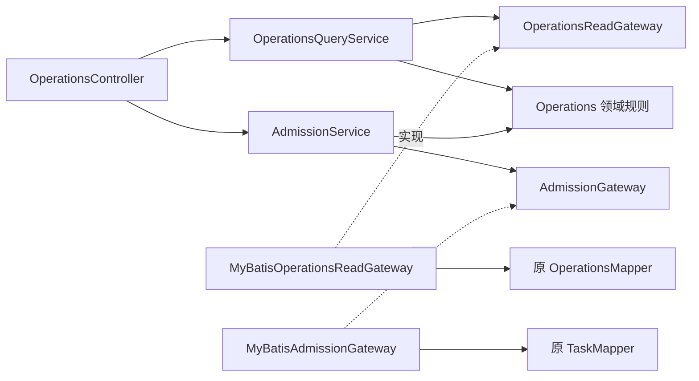

# R0–R2：兼容基线、M0 隔离与 Operations 分层

实施日期：2026-10-16。**第一批 R0–R2 已完成并通过回归**。对应 [整改方案](agentscope-cola-remediation.md) 的第一批；后续切片见 [R3 实施记录](r3-implementation.md) 与 [R4 实施记录](r4-implementation.md)，R5–R7 继续按计划推进。本文保留第一批的历史运行结果。

## 这批改变了什么

| 阶段 | 实际交付 | 保留的契约 |
| --- | --- | --- |
| R0 | 固定序列化/哈希和 HTTP 样本；7 项 ArchUnit 规则；登记具体类之间的存量循环依赖 | 发布哈希、动作哈希、身份派生、字段名、状态码、空值、分页游标 |
| R1 | 3 个 M0 实验类与实验 Mapper 移入测试；提取 PayloadJson/PayloadDigest | 正式 AgentState CAS/墓碑、旧 Flyway、SDK codec、JSON 排序及数字行为 |
| R2 | OperationsQueryService / AdmissionService、两个窄 gateway、领域行为 | Spring 事务、行锁次序、owner 条件、幂等回执、单 SQL drain 快照 |

没有新增生产依赖或升级 AgentScope。ArchUnit 是前轮已加入的测试依赖。数据库访问继续使用 MyBatis-Spring，事务直接使用 Spring `TransactionTemplate`，不增加事务 SPI 或通用 CRUD 框架。

## Operations 的新调用边界



[Controller](../../src/main/java/com/financeclaw/api/OperationsController.java) 负责 HTTP 输入契约与可信 owner，调用 [查询用例](../../src/main/java/com/financeclaw/app/operations/OperationsQueryService.java) 或 [受理用例](../../src/main/java/com/financeclaw/app/operations/AdmissionService.java)。原 `application.OperationsService` 已删除，没有新旧两套处理路径。

两个 gateway 按查询与受理能力定义在 [app/operations/port](../../src/main/java/com/financeclaw/app/operations/port)，由 [infrastructure/operations](../../src/main/java/com/financeclaw/infrastructure/operations) 实现。应用层不知道 Mapper、SQL 和 AgentScope 类型。原 Mapper 的 SQL 保持不变，暂不把 TaskMapper 的其它职责一并拆迁。

[Operations](../../src/main/java/com/financeclaw/domain/Operations.java) 开始承载规则：`Admission.advance` 核对修订号，`AdmissionChange` 校验版本并产生请求指纹，`Change.replay` 判断幂等冲突，`Drain.observed` 基于不可变观察值判断排空。[IdempotencyKey](../../src/main/java/com/financeclaw/domain/IdempotencyKey.java) 统一原有校验，保留大小写、空格和原字符串，不做会改变键身份的归一化。`TaskService.validateKey` 暂作为旧调用点的兼容委托。

这些行为可以在没有 Spring 容器、数据库和 AgentScope 的情况下测试。领域错误目前沿用 `Task.Problem` 的旧状态码；错误模型与 HTTP 的彻底分离仍是后续整改范围。

### 事务与观察语义

一次受理变更仍只有一个 Spring 事务，步骤顺序保持为：

1. 创建缺省受理行，然后 `FOR UPDATE` 锁住当前 owner。
2. 查找幂等回执；存在时先核对请求指纹并返回旧回执，不把旧操作重新应用到新修订号。
3. 核对当前修订号，条件更新受理状态，再插入回执。
4. 统一提交或回滚；调用方已有事务时参与该事务。

新的集成测试通过 PostgreSQL 约束故意让第 3 步的回执插入失败，分别验证首次创建和已有行更新都会完整回滚；另验证外层 Spring 事务回滚。已有暂停/受理锁竞争、独立会话共享锁、六个并发重试只写一张回执的测试继续复用。

`drain` 仍从同一条 SQL 读取 admission 与全部计数。gateway 只把数据库数值转换为类型化快照，用例调用领域规则计算 `drained`；不会拆成多次查询制造不同时间点的拼接结果。overview 原来是四次查询，仍保持该语义，不把它称为一致的排空快照。memory backlog 继续按数值 ID 翻页，其他类型保留原字符串游标和 `limit + 1` 探查。

## 历史代码与编码边界

[M0 测试支持](../../src/test/java/com/financeclaw/m0/support) 包含 `GuardedAgentRunner`、`ExecutionGate`、`EffectLedger`、`M0RuntimeMapper`。Spring M0 测试通过 `ConfigurationCustomizer` 显式注册实验 Mapper；独立 JVM 的 `ProbeFixtures` 同样显式注册。正式 [RuntimeMapper](../../src/main/java/com/financeclaw/infrastructure/state/RuntimeMapper.java) 保留四个状态操作，历史实验表仍由原 Flyway 脚本维护。

[PayloadJson](../../src/main/java/com/financeclaw/support/PayloadJson.java) 直接使用固定配置的 Jackson writer 与 reader，[PayloadDigest](../../src/main/java/com/financeclaw/support/PayloadDigest.java) 直接使用 JDK SHA-256。原先为了序列化而反向依赖 `ResumeInputs` 或 `GovernanceService` 的调用改为使用这两个技术工具。没有引入编码器接口层，也没有把 SDK AgentState 转换为业务 JSON 格式。`ExecutionScope.hash` 的长度前缀编码与普通 payload 摘要仍是两个不同契约。

## 兼容与架构门禁

[序列化固定样本](../../src/test/resources/architecture/serialization-baseline.json) 在修改生产实现之前生成，共 12 个结果，包含嵌套 Map 排序、数组顺序、中文/emoji/转义、null、整数/浮点/BigDecimal 精度、完整及最小发布配置、action hash 和身份派生。解析后的数值表现也单独固定，不把“统一 JSON”误当成可以改变历史字节。测试不会自动重写 expected 值。

[HTTP 样本](../../src/test/resources/architecture/operations-http.json) 固定 8 种成功响应。测试使用与生产一致的 `SNAKE_CASE`，严格比较字段集合、值、数组顺序、空值和游标；额外覆盖认证失败、字段注入和类型错误。相同样本已先在重构前编译出的 Operations Controller/Service 上通过，再用于新实现。它是合成 HTTP 契约验证，实际 Spring 装配、数据库和权限范围另由集成测试覆盖。

[ArchitectureTest](../../src/test/java/com/financeclaw/architecture/ArchitectureTest.java) 覆盖：

1. 包循环只能减少：根据字节码依赖图寻找参与包循环的具体类边，与 [旧依赖基线](../../src/test/resources/architecture/legacy-package-cycles.txt) 对照；新增循环边直接失败。
2. domain 只依赖自身和 JDK。
3. 生产代码不自行调用 JDBC commit、rollback 或 setAutoCommit。
4. 全部现有 API 不依赖 persistence；原 Operations 例外已删除。
5. 新 `app..` 只依赖 app/domain/support 与限定的 Spring 应用/事务 API；port 仅依赖 port/domain/JDK。
6. support 不反向依赖应用服务、AgentScope 或持久化。
7. 生产代码不包含或依赖 M0 实验类。

字节码图中的循环类依赖由 93 条减至 73 条，删除 20 条，没有新增。允许列表已同步收紧到剩余 73 条，因此恢复本批已消除的依赖也会失败。它是逐类记录，不是忽略整个包；这仍不证明项目已经无环，后续切片继续收紧，最终移除白名单。Spring 运行时装配与角色隔离仍需要集成测试，字节码检查不能代替它们。

## 验证记录

运行命令：

```bash
scripts/mvn.sh -B -ntp clean verify spotless:check
python3 scripts/check-delivery.py
```

| 实测范围 | 结果 |
| --- | --- |
| 完整 `clean verify spotless:check` | **687 项通过**：520 项单元/HTTP 测试 + 167 项集成测试；零失败、零错误、零跳过 |
| Operations PostgreSQL 回归 | 34 项，包括 3 项新增的真实事务回滚用例；原有分页、身份、暂停/受理竞争全部通过 |
| M0 PostgreSQL 与独立 JVM | 22 项，包含移位后的互斥、未知效果、恢复与状态隔离 |
| 打包与镜像 | Boot jar 不含 3 个 M0 实验类、M0RuntimeMapper 或旧 OperationsService；已有紫微部署镜像测试通过 |
| 架构门禁 | 全量中 7 项通过；允许列表由 93 条收紧到 73 条后再次单独运行 7 项，通过 |
| 静态交付检查 | 文档链接、脚本语法、凭据模式与 diff 空白检查通过 |
| 保留范围 | 36 个受保护文件指纹一致：M5e 脚本/SQL/演练记录、既有 CI/POM、全部生产资源与两个 Operations 所用 Mapper |

详细套件数量、源码 SHA-256、循环边变化、jar 指纹及验证范围见 [实施证据](evidence/r0-r2-implementation.json)。重构前的 67 个生产文件/8,943 行属于原审查基线；本批为 72 个文件/9,019 行。增加的是明确的领域行为与应用/持久化边界，不能把文件数量增长或行数减少本身当作架构收益。

完整运行开始后仅收紧了一份架构允许列表，随后用 `scripts/mvn.sh -B -ntp -Dtest=ArchitectureTest test spotless:check` 复验；没有在完整运行开始后修改生产源码。实施证据单独保存，不覆盖 M5e 历史演练证据。

本轮实际运行真实 PostgreSQL/pgvector、独立 JVM 和打包镜像测试，以及本地模拟供应商的 SDK 适配器。没有重跑 Compose 旧备份恢复演练，没有调用真实模型/MCP/飞书租户，也没有验证远程 CI 或执行生产切流。Java 全量回归不替代这些环境验收。

## R0–R2 完成时的下一批

下一阶段为 R3：抽出交互回答用例、统一保存状态中的待处理调用解释器、按业务提供工具与交互处理器。普通工具入口的重复 Schema 校验，须在全部入口及恢复路径的等价性测试通过后再裁剪。

在本批完成时，R4 的 TaskService/执行端口、R5 的业务与记忆对象、R6 的角色装配/可选 Maven 模块、R7 的可选原生替换实验尚未实施。本批保留已有 M5e 脚本、SQL、CI 和演练证据，不把架构回归等同于生产切流或真实供应商验收。
