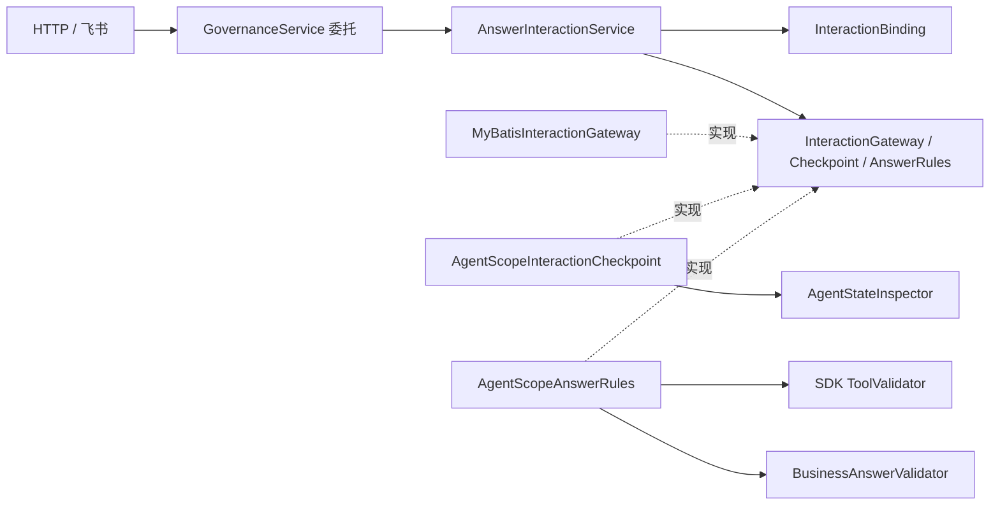

# R3：回答用例、SDK 快照与工具交互边界

实施日期：2026-10-16。对应 [整改方案](agentscope-cola-remediation.md) 的 R3；此前 R0–R2 的结果保留在 [第一批实施记录](r0-r2-implementation.md)。**本批已完成并通过 729 项完整回归**，包括 556 项单元/HTTP 测试和 173 项集成测试，零失败、零错误、零跳过。机器可核对的测试清单、源码指纹和变更范围见 [R3 验证证据](evidence/r3-implementation.json)。本文保留 R3 完成时的实现、调用图和验证结果；后续任务与执行拆分见 [R4 实施记录](r4-implementation.md)，旧 GovernanceService 删除、HTTP 直接调用回答用例及当前验证范围见[治理用例分层](governance-decoupling.md)。

## R3 完成时的调用边界

回答用例已从 `GovernanceService` 移入 [AnswerInteractionService](../../src/main/java/com/financeclaw/app/interaction/AnswerInteractionService.java)。R3 完成时，HTTP 和飞书的旧入口仍通过 `GovernanceService` 委托，只有新用例会处理回答；下图描述这一历史状态。用例依赖三个窄端口，签名不含 AgentScope、Mapper 或业务工具类型。



[InteractionBinding](../../src/main/java/com/financeclaw/domain/InteractionBinding.java) 承担回答规则：幂等回放、等待状态与有效期、attempt/release/grant/revision 绑定、批准/拒绝内容，以及保存调用的 ID、工具名、动作摘要和 ASK 状态。它只依赖领域对象和 JDK；状态码暂沿用既有 `Task.Problem`，彻底分离错误与 HTTP 留到后续切片。

R3 完成时，[MyBatisInteractionGateway](../../src/main/java/com/financeclaw/infrastructure/interaction/MyBatisInteractionGateway.java) 使用原 `TaskMapper`、`GovernanceMapper` 和 `TaskService` 的策略/状态转换能力。R3 不拆任务租约与执行事务；这些依赖随后由 R4 及后续切片拆分。

业务回答校验通过 `BusinessAnswerValidator` 注入。[ZiweiAnswerValidator](../../src/main/java/com/financeclaw/infrastructure/interaction/ZiweiAnswerValidator.java) 读取固定发布和请求时钟，再调用已有紫微输入修正规则。通用用例与通用 Schema 适配器均不识别紫微工具名，也不会在接受回答时执行工具。快照只读取一次，供动作绑定与业务回答核对共同使用。

## Spring 事务与兼容约束

接受一个回答仍由 Spring `TransactionTemplate` 完成短事务，保留原有顺序：

1. 校验幂等键、owner、revision、reason 和完整回答字节上限。
2. 按 Command → Turn → Interaction 顺序加锁；相同回答优先返回已有回执，不再次执行当前策略核对或排队。
3. 核对等待状态，再沿用原策略核对中的隐私 owner → grant 锁顺序。
4. 核对回答、保存的状态版本和动作；输入回答复用 SDK Schema 与业务规则。
5. 写回答回执；同一 attempt 的问题全部回答后，才更新 Command 恢复队列、Turn 状态和事件。

第 5 步的任一写入失败，之前的写入一起回滚。调用方已有 Spring 事务时参与外层事务，适用于飞书收件处理。未引入自研事务接口、原生 JDBC commit 或第二套 SQL。

保持原来的幂等语义：幂等键必须合法，但回答回放以问题和完整回答摘要为准；不同键提交同一回答仍返回原回执，修改决定、内容或 reason 产生冲突。仍使用原 JSON 排序、动作摘要、SDK codec、schema_json 和 response_json，未改数据库迁移或保存格式。

## 一个 SDK 快照解释器

[AgentStateInspector](../../src/main/java/com/financeclaw/infrastructure/agentscope/AgentStateInspector.java) 统一任务结果判断、生成交互问题、读取待回答调用三条路径。`ResumeInputs` 和 `IsolatedAgentFactory` 一起移至 `infrastructure.agentscope`；业务工具不再反向引用 `agent` 装配包。

| 保存状态 | 统一解释 |
| --- | --- |
| 没有结果、挂起结果、RUNNING | 调用尚未解决 |
| ASKING + SUCCESS | 调用仍等待确认；SUCCESS 本身不代表已批准 |
| ERROR / INTERRUPTED / DENIED | 终止结果，不再次生成该调用的问题；残留的 suspended 标记不能覆盖终止结果 |
| 完成调用 + SUCCESS | 调用已解决 |
| shutdown interrupted | 失败，不接受该快照的回答 |
| 同一调用多次出现在上下文 | 按 ID 保留最后调用/最后结果，一次只产生一个问题；问题顺序按首次出现顺序稳定 |

这是明确的语义修复：原先任务结果判断使用最后记录，而另两条路径使用“出现过任何非 suspended 结果就算完成”。这会让 `ASKING + SUCCESS` 或 `RUNNING` 被任务判断为等待，但没有可回答的问题。本批统一采用结果判断的规则，并为负向终止结果增加优先级。

非批准工具若异常进入 ASKING，或未注册交互处理器的工具留下待处理调用，仍拒绝生成可恢复问题。HTTP 还会核对工具名及批准/输入种类与保存的 ASK 状态，避免接受只能在恢复时才发现不匹配的回答。`ResumeInputs.result` 不再把业务恢复返回的错误、拒绝、绑定到调用的运行中结果或再次挂起结果强行标成 SUCCESS。

固定版 SDK 的 `ToolResultBlock.text()/of()` 作为工具方法返回值时，默认状态为 RUNNING 且尚无 ID/名称；它与保存到上下文中的 RUNNING 结果含义不同。直接恢复等待工具 Mono 完成后，适配器将这种未绑定的正常返回值封装为 SUCCESS，同时拒绝 `[ERROR]` 标记；依据是原生 ReAct 的 `determineToolResultState`。首轮完整回归发现了这一区别，修复后新增专门测试，并重新验证恢复与打包路径。

## 工具各自贡献交互行为

[capability 包](../../src/main/java/com/financeclaw/infrastructure/agentscope/capability) 按能力提供本地工具、市场数据/研究、组合复盘、紫微和 MCP 五类 `ToolContribution`。有交互的工具同时登记 `InteractionHandler`：

| 能力 | 拥有的交互行为 |
| --- | --- |
| 本地工具 | 城市问题及回答转 SDK ToolResult；报告创建的审批问题 |
| 研究 | 证券/期间补充、输入合并与研究恢复 |
| 组合复盘 | 发布审批问题；继续复用已有确定性流程与步骤回执 |
| 紫微 | 聚合提问、出生/日期修正、完整性复核与恢复 |
| MCP | 原生名称、描述、Schema 和调用；已有服务契约检查与结果归档 |

[GovernedTools](../../src/main/java/com/financeclaw/infrastructure/agentscope/execution/GovernedTools.java) 保留装配、动态授权、根预算、最终参数校验、SDK 权限规则和资源关闭。ASK 规则来自该工具注册的审批处理器；`pending`、`resumeInput`、`permissions` 不再分别硬编码业务工具分支。Skill 继续使用原生 repository 与 middleware。

贡献接口只传递工具声明和业务回调，实际注册、执行、挂起、确认、事件与状态仍使用 AgentScope Toolkit/ToolBase/ConfirmResult。没有新建工具执行器、插件扫描容器、DAG 或恢复协议；现有工具名称、描述、Schema 和业务注册顺序保留。

## Schema 复审结果：保留不同边界的校验

本批没有把重复调用次数作为删代码目标。固定版 [ToolExecutor](https://github.com/agentscope-ai/agentscope-java/blob/v2.0.3/agentscope-core/src/main/java/io/agentscope/core/tool/ToolExecutor.java) 验证 `ToolUseBlock.content` 后才合并 `ToolCallParam.input` 和 preset。包装器验证的是最终执行参数。直接调用注册的 ToolBase 也不会经过原生执行器的校验。

新增 PostgreSQL 回归构造四种情况：原始 JSON 非法、有效 JSON 配非法实际 input、直接调用包装器、preset 覆盖为非法值。均应在业务预算消耗和 Artifact 写入前被拒绝。因此，当前两个校验入口不等价，保留最终参数校验是验证结果，而不是尚未判断的重复代码。

HTTP 回答 Schema、紫微修正后的输入检查、组合命令文本入口的校验同样继续保留。它们验证不同数据或来自不同入口；未来若要裁剪，须先约束输入来源并证明等价。所有 Schema 校验仍调用已有 AgentScope `ToolValidator`，没有引入另一套校验实现。

## 架构门禁与验证

ArchUnit 增至 8 项检查，新增禁止 `application` / `tools` 反向依赖 `agent`，禁止旧 `GovernanceService` 再依赖 AgentScope 或紫微。新 `app.interaction` 及 port 已受 R0 的严格依赖规则覆盖。

参与包循环的具体类依赖由 **73 条减至 32 条**，删除 41 条，没有新增。允许列表已在完整回归前收紧；剩余循环主要是发布配置、业务工具和紫微资源之间的旧依赖，仍需 R4/R5 消除，不能把本批视为整体架构无环。

运行命令：

```bash
scripts/mvn.sh -B -ntp spotless:apply clean verify spotless:check
python3 scripts/check-delivery.py
```

最终 `clean verify spotless:check` 于 **2026-10-16 01:04:44 +08:00** 完成，耗时 7 分 30 秒。修改过的生产源码、测试与资源均与本轮测试时的指纹一致。

| 实测范围 | 结果 |
| --- | --- |
| 完整 Maven 回归 | **729 项通过**：556 项单元/HTTP + 173 项集成；零失败、零错误、零跳过 |
| 本批增量 | 相较 R0–R2 增加 42 项：18 项快照/原生返回值、17 项回答 HTTP、1 项架构门禁、6 项治理集成 |
| 治理 PostgreSQL | 26 项通过，包括 3 项事务回滚、批量输入回答、Schema 入口与快照问题生成 |
| 紫微与独立进程 | 13 项恢复、14 项工具集成、1 项打包测试通过 |
| 研究、组合、Skills | 18 项业务与 2 项原生 Skill 集成通过 |
| 飞书与记忆 | 12 项飞书、14 项记忆集成通过；使用本地协议服务与合成输入 |
| 正式打包 | 新回答用例与 SDK 适配类存在；旧包下的两个辅助类及 M0 测试类不存在 |
| 修改范围 | 82 个受保护文件指纹不变，包括全部 Mapper、生产资源/Flyway、渠道、紫微算法、M5e 脚本与证据 |
| 静态交付检查 | 本地链接、脚本语法、凭据模式、空白检查通过 |

首轮发现的 3 个恢复失败均来自对 SDK 未绑定返回值的错误判定，最终完整重跑已全部通过。证据保留初次失败用例名称和修复说明，最终计数只取修复后的完整运行。

新增集成用例覆盖同批两个输入回答、三个 Spring 回滚场景、四种 Schema 入口，以及实际工具装配与快照待处理规则的一致性。已有批准/拒绝、并发回放、scope 撤销、独立 JVM 恢复、紫微修正、飞书交互继续纳入完整回归。

本批未进行真实模型、远端 MCP、真实飞书租户或生产切换验收；M5e Compose 旧库恢复演练没有重跑。代码、测试及证据保留在本地工作区，未新增 commit 或推送。

## R3 完成时的下一步

继续 R4：按受理、领取、完成、取消和恢复拆分 `TaskService`，让执行用例通过 `AgentExecutionPort` 调用原生运行时，删除 Mapper getter。首先固定 fence/CAS/回执/事件/Outbox 的同事务边界；延续现有 SQL、锁顺序、崩溃窗口与未知效果处理，不与 SDK 升级或数据格式迁移混做。
