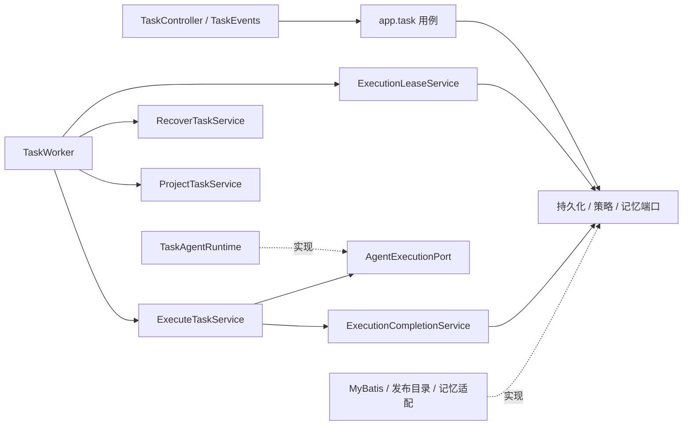

# R4：任务用例与原生执行分层

实施日期：2026-10-16。对应 [整改方案](agentscope-cola-remediation.md) 的 R4，承接 [R3](r3-implementation.md)。**本批已完成并通过 740 项完整回归**：558 项单元/HTTP 测试、182 项集成测试，零失败、零错误、零跳过。最终结果与源码指纹见 [R4 验证证据](evidence/r4-implementation.json)。本文保留 R4 完成时的结果；后续组合与研究拆分见 [R5a](r5a-implementation.md)。

## R4 完成时的调用路径

任务 HTTP 入口直接调用受理、查询、取消用例；SSE 只使用查询用例。Worker 保留并发上限、轮询、心跳、停止和线程池生命周期，执行结果的处理由应用层负责：



`AgentExecutionPort` 只有 `execute(Claim)` 和 `interrupt(Claim)`，不含 SDK 类型。原生执行返回前必须关闭本次调用及其资源，应用层才确认取消或保存回执。`TaskAgentRuntime`、`GovernedTools`、`ModelFactory`、`BudgetedTransport` 已移入 `infrastructure.agentscope.execution`。公用快照、恢复输入和 Agent 工厂仍留在 `infrastructure.agentscope`，业务能力贡献留在其 `capability` 子包，避免子 Agent 反向依赖根执行装配。

| 职责 | 源码入口 |
| --- | --- |
| 会话与任务受理、幂等回放 | [SubmitTaskService](../../src/main/java/com/financeclaw/app/task/SubmitTaskService.java) |
| owner 隔离、任务/消息/事件查询 | [TaskQueryService](../../src/main/java/com/financeclaw/app/task/TaskQueryService.java) |
| 取消与取消回执 | [CancelTaskService](../../src/main/java/com/financeclaw/app/task/CancelTaskService.java) |
| 状态变化、journal、记忆完成意图、Outbox | [TaskTransitionService](../../src/main/java/com/financeclaw/app/task/TaskTransitionService.java) |
| 本地 Outbox 投影与确认 | 原 ProjectTaskService（已在 [V10](../../ops/retire-legacy-tables.md) 退役） |
| Command 领取、attempt/fence、续租与受保护写入 | [ExecutionLeaseService](../../src/main/java/com/financeclaw/app/execution/ExecutionLeaseService.java) |
| 发布/授权/隐私核对、历史、身份、预算与进度事件 | [ExecutionPolicyService](../../src/main/java/com/financeclaw/app/execution/ExecutionPolicyService.java) |
| 挂起/完成回执、业务完成、停止后的取消确认 | [ExecutionCompletionService](../../src/main/java/com/financeclaw/app/execution/ExecutionCompletionService.java) |
| 过期租约核对，不重新执行未知 attempt | [RecoverTaskService](../../src/main/java/com/financeclaw/app/execution/RecoverTaskService.java) |
| 原生调用与成功/失败/取消结果协调 | [ExecuteTaskService](../../src/main/java/com/financeclaw/app/execution/ExecuteTaskService.java) → [AgentExecutionPort](../../src/main/java/com/financeclaw/app/execution/port/AgentExecutionPort.java) |
| 本地确定性步骤的幂等记录 | [CapabilityStepService](../../src/main/java/com/financeclaw/app/execution/CapabilityStepService.java) |

R4 将旧 `TaskService` 从 473 行改为 190 行的兼容委托，供尚未迁移的业务工具、治理和渠道使用；它没有 Mapper、SDK 或事务管理依赖。HTTP、Worker、回答持久化适配已经直接使用新用例，不再经过该大入口。新用例单类最长 147 行，但验收依据是职责、依赖和事务行为，而不是行数。后续[原生执行适配依赖收缩](runtime-decoupling.md)已删除生产 TaskService，旧委托仅保留于测试夹具；Worker 不再构造投影用例及网关，投影由 Integrations/Standalone 装配。本文图示与指标保留 R4 时点。

## 面向对象与端口边界

[Task.Turn](../../src/main/java/com/financeclaw/domain/Task.java) 表达受理回放与可领取状态；`Claim.requireCurrent` 核对租约、attempt 和 fence；[TaskTransition](../../src/main/java/com/financeclaw/domain/TaskTransition.java) 表达终态不可再写、交互失效、完成 journal 和终态 Outbox 的规则。领域对象保持不可变，不依赖 Spring、MyBatis 或 AgentScope。

[ExecutionPolicy](../../src/main/java/com/financeclaw/domain/ExecutionPolicy.java) 只向任务用例提供 scopes 与调用预算，不把模型供应商、凭据和业务工具配置带进新 `app` 包。[StepResult](../../src/main/java/com/financeclaw/domain/StepResult.java) 替代 Mapper 内嵌的步骤返回类型。

`governance()` 和 `releases()` 两个 service locator getter 已删除。业务调用改为 `scopes`、`requestClock`、`step`、`localStep`、指定 hash 的 `release` 和指定引用的 `credential` 等能力方法。步骤写入集中到 `CapabilityStepService`，步骤读取也经过当前 fence 与策略核对。其回调仍只允许本地确定性工作，不容纳 LLM 或远程 MCP。

持久化端口按受理、查询、状态写入、Command、回执、投影等职责拆分，由薄 MyBatis 适配实现；全部沿用原 Mapper。`ExecutionReceiptGateway` 只返回保存版本是否匹配，不向用例暴露 SDK state 或 `RuntimeMapper.StateRow`。发布和记忆适配独立放在 `infrastructure.execution`，避免持久化包反向依赖旧应用包形成循环。

这仍是增量 COLA 分层。旧业务工具还通过兼容委托读取发布 DTO，`ReleaseCatalog` 与 `BusinessCatalog` 的循环尚未消除；业务工具中的原生 Model 驱动也留待 R5。不能把本批称为整仓完成 COLA 或所有 SDK 类型均已隔离。

## Spring 事务边界

继续直接复用 Spring `TransactionTemplate`、MyBatis-Spring 和同一个 DataSource。没有引入事务端口、自定义 UnitOfWork、手工 JDBC commit，也没有修改 Mapper SQL、Flyway、状态格式或 release/action hash。

| 操作 | 同一短事务内必须保留的内容 |
| --- | --- |
| 受理 | 锁会话 → 优先幂等回放 → 暂停共享锁/忙碌检查 → Turn → 记忆受理 → grant 与策略快照 → Command、USER journal、事件 |
| 领取 | `SKIP LOCKED` 领取 Command → 锁 Turn → 新 attempt/fence/租约 → attempt 记录 → running 状态/事件 |
| 状态 CAS | 锁并核对当前 Command → SDK 状态条件写入；旧 fence 或过期租约不能写 |
| 保存执行回执 | 当前 Command → 隐私/授权核对 → 保存版本核对 → sealed receipt → 同批全部待回答问题 |
| 完成 | Command → Turn → receipt/状态版本 → 策略核对 → 状态/事件 → 完成 journal、记忆意图、Outbox → Command 完成 |
| 取消 | Command → Turn → 幂等取消回放/未知效果检查 → cancelling 或 cancelled → 取消回执 |
| 过期恢复 | 锁 Command 并复核过期 → Turn → 已封存回执完成；没有回执则 blocked/unconfirmed_execution |
| 投影 | 锁 Outbox → 单调 upsert 投影 → delivered 确认 |

领取、SDK 状态写入、封存回执、最终完成仍是独立提交边界。进程在它们之间退出，沿用原恢复协议；没有把整次 Agent 调用包进事务。`ExecuteTaskService` 明确拒绝在外层数据库事务中开始原生执行；`TaskTransitionService` 明确拒绝无事务的状态写入。它们使用 Spring 当前事务状态检查，不建立第二套事务机制。

取消可以在模型运行前或运行中获胜，但必须等原生调用停止后确认。原生调用返回后，若封存回执或最终提交发生异常，协调器保留可供恢复核对的事实；不能把“提交结果尚不确定”转成新的失败回执或自动再次调用模型。

本阶段没有引入 COLA statemachine：现有规则是少量明确的领域方法，复杂约束来自持久事实、锁与恢复时序，尚不需要通用转换表。若 R5 出现真正需要声明式状态图的业务，再采用已核查的组件；不自建通用状态机。组件选择仍以 [Spring 事务与组件复审](spring-transactions-component-review.md) 为准。

## 验证与范围

[TaskLifecycleIT](../../src/test/java/com/financeclaw/m1/TaskLifecycleIT.java) 增加 9 项真实 PostgreSQL 验证：

1. 受理最后一组写入之后失败，Turn、策略、Command、journal、事件全部回滚。
2. 领取 running 事件之后失败，attempt、fence、租约与状态全部回滚。
3. 第二个待回答问题写入后失败，整批问题和执行回执一起回滚。
4. 完成 Outbox 写入后失败，完成状态、事件、journal、Outbox 回滚；已封存回执可恢复且只完成一次。
5. 取消回执写入后失败，取消状态、事件、Outbox 与 Command 一起回滚。
6. 投影的 delivered 确认后失败，投影与确认一起回滚，可安全重试。
7. 原生执行只调用一次且不持有数据库事务；已有外层事务时在调用前拒绝。
8. 恢复未知 attempt 和已有 sealed receipt 的 attempt 均不调用原生执行端口。
9. 租约已过期但恢复尚未运行时，晚到的状态 CAS、回执与进度写入也被拒绝。

原有并发受理、独立 JVM 崩溃恢复、取消竞争、SSE 重连、同事务记忆意图、授权撤销、审批/输入恢复、业务工具和受限 Worker 测试继续保留。首轮新增测试有一处错误地把原生进度事件当成完成事务的写入；已改为比较封存回执后的状态与事件快照，保留此前已提交的进度。

[ArchUnit](../../src/test/java/com/financeclaw/architecture/ArchitectureTest.java) 增至 10 项检查，新增约束任务入口/Worker 只面向应用层、旧 TaskService 不得依赖 Mapper/SDK/事务或再次暴露 getter，并检查正式 runtime 实现执行端口、旧 agent 包不再出现在产品类中。参与包循环的具体类依赖由 **32 条减至 30 条**，没有新增；允许列表已在完整回归之前收紧。

运行命令：

```bash
scripts/mvn.sh -B -ntp spotless:apply clean verify spotless:check
python3 scripts/check-delivery.py
```

最终 `clean verify spotless:check` 于 **2026-10-16T11:29:00+08:00** 完成，耗时 **07:02 min**。全部 223 个生产/测试源码、资源和 POM 指纹与最终运行开始时一致。

| 实测范围 | 结果 |
| --- | --- |
| 完整 Maven 回归 | **740 项通过**：558 项单元/HTTP + 182 项集成；零失败、零错误、零跳过 |
| 本批增量 | 9 项任务集成 + 2 项架构门禁，原有套件全部保留 |
| 任务事务、并发与恢复 | 26 项通过，包括 6 个事务回滚场景及执行端口/过期租约核对 |
| 独立进程与部署镜像 | 13 项紫微恢复测试全部通过；真实产品镜像无 Python，5 个原生工具完成 |
| 业务、记忆与渠道 | 18 项业务、2 项原生 Skill、14 项记忆、12 项飞书测试通过 |
| 架构与产品包 | 10 项门禁通过；正式执行适配与新用例存在，旧 agent 包及测试夹具不在产品 jar 中 |
| 受保护范围 | 79 个文件指纹不变：全部 Mapper、生产资源/Flyway、渠道、紫微算法、POM、M5e 脚本/SQL/证据、历史架构证据 |
| 静态交付 | 本地链接、脚本语法、凭据模式和空白检查通过 |

首轮完整回归发现 12 个独立探针/容器失败：`ZiweiRuntimeProbe` 引用了仅存在于测试 classpath 的 `TaskWorkerFixture`。修复后探针直接使用产品包的用例装配，仍只打包探针自身；未向产品 jar 加入测试夹具。最终完整重跑全部通过，初次失败名称、原因和日志摘要保存在 R4 证据中。

本批只进行本地自动化验收，不代表真实模型、远端 MCP、飞书租户、远程 CI 或生产切流已验收。M5e Compose 旧库恢复演练没有重跑。修改保留在本地工作区，未新增 commit 或推送。

## R4 完成时的下一步 R5

先拆组合复盘与市场研究的领域规则、持久步骤和 SDK Model 驱动，让持仓/风险/发布规则不依赖容器和 SDK；随后整理紫微 I/O、记忆事实/隐私规则与模型适配。逐项消除旧发布配置和业务工具循环，并收缩兼容 TaskService。保持算法基准、发布幂等、子预算、隐私竞争和恢复语义，角色装配与 Maven 模块化仍留到 R6。
