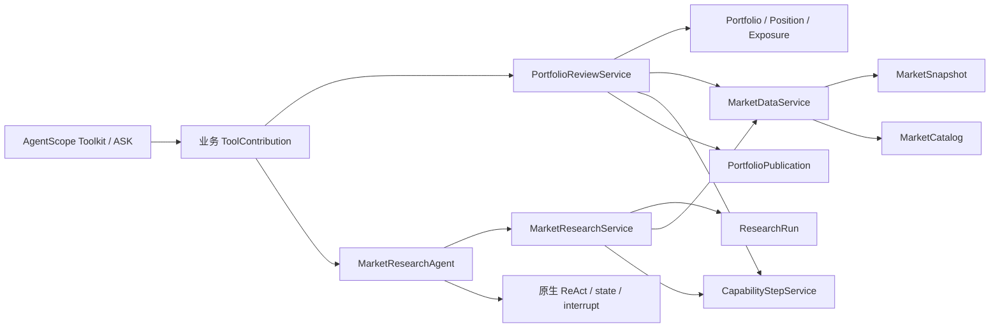

# R5a：组合复盘与市场研究分层

实施日期：2026-10-16。承接 [R4](r4-implementation.md)，对应 [整改方案](agentscope-cola-remediation.md) 的 R5 第一条业务切片。**本批已完成，764 项完整回归通过**（576 项单元/HTTP、188 项集成），零失败、零错误、零跳过。本文保留 R5a 完成时的结果；该批与 M5e、R0–R4 已保存为本地检查点 `bb58ea2`。后续紫微拆分见 [R5b](r5b-implementation.md)，记忆、发布配置与最新回归见 [R5c](r5c-implementation.md)。

## 当前调用路径



[BusinessCapabilities](../../src/main/java/com/financeclaw/infrastructure/agentscope/capability/BusinessCapabilities.java) 负责组合已迁移能力，注入正式应用用例；它不从 TaskService 取得 Mapper 或新用例。原 `tools.PortfolioReview`、`tools.MarketResearch` 和 `tools.MarketData` 已删除，只有一条业务执行路径。R5a 完成时，旧 TaskService 中已没有步骤读取方法；当时紫微工具使用的本地步骤委托已在 R5b 移除。

| 职责 | 当前入口 |
| --- | --- |
| 持仓规范化、金额精度、风险阈值、时效与币种 | [Portfolio](../../src/main/java/com/financeclaw/domain/portfolio/Portfolio.java)，包含 Position、Holding、Exposure |
| 冻结行情的价格、来源和时间规则 | [MarketSnapshot](../../src/main/java/com/financeclaw/domain/market/MarketSnapshot.java) |
| 子身份、证券范围、4 次模型/10 次行情预算、完整结果条件 | [ResearchRun](../../src/main/java/com/financeclaw/domain/research/ResearchRun.java) |
| 原参数表示与领域对象转换 | [PortfolioRequest](../../src/main/java/com/financeclaw/app/portfolio/PortfolioRequest.java) |
| 组合步骤、草稿和归档幂等 | [PortfolioReviewService](../../src/main/java/com/financeclaw/app/portfolio/PortfolioReviewService.java) |
| 根预算、缓存输入绑定、证据和研究结果持久化 | [MarketResearchService](../../src/main/java/com/financeclaw/app/research/MarketResearchService.java) |
| 行情授权、根预算和发布快照读取 | [MarketDataService](../../src/main/java/com/financeclaw/app/market/MarketDataService.java) → [MarketCatalog](../../src/main/java/com/financeclaw/app/market/port/MarketCatalog.java) |
| 复用现有 Artifact 事务与权限 | [PortfolioPublication](../../src/main/java/com/financeclaw/app/portfolio/port/PortfolioPublication.java) → [GovernedPortfolioPublication](../../src/main/java/com/financeclaw/infrastructure/portfolio/GovernedPortfolioPublication.java) |
| Schema、确定性原生 Model、子 ReAct 生命周期 | [PortfolioInputs](../../src/main/java/com/financeclaw/infrastructure/agentscope/capability/PortfolioInputs.java)、[PortfolioDriver](../../src/main/java/com/financeclaw/infrastructure/agentscope/capability/PortfolioDriver.java)、[MarketResearchAgent](../../src/main/java/com/financeclaw/infrastructure/agentscope/capability/MarketResearchAgent.java) |

领域规则只依赖 Java 和 domain；新 app 不依赖旧 application/tools、SQL Mapper、Reactor 或 SDK。业务用例直接复用 R4 的执行策略与本地步骤服务；类型转换保留在应用/适配层。不可变持仓对象保存数值规则，ResearchRun 保存一次子调用的预算与证据状态，避免把规则继续堆在静态工具函数或通用 BaseService 中。

## 复用组件与事务

仍由 AgentScope 2.0.3 处理 ReAct、Toolkit、ASK、状态格式和取消；Spring `TransactionTemplate`、MyBatis-Spring 处理数据库事务。没有新增生产依赖，没有升级 SDK，也没有实现另一套工作流、状态机或事务引擎。

组合模型只选择固定的 `prepare → publish → answer` 步骤；发布仍经原生 ASK 和已有回答用例。草稿读取校验当前 fence 和策略，发布步骤把 Artifact、访问 scope 与步骤回执放在同一个 Spring 事务中。归档失败不能留下孤立 Artifact；已有回执的同输入调用只返回原结果。

研究适配保留原生 Mono 生命周期，没有桥接为 Future，也没有后台脱离根调用运行。子状态 CAS 仍加入根 fence 事务，子身份继承 tenant/subject/Turn/attempt/release/grant，只携带 `market:read`。子模型与行情调用仍累计到根 Turn 的计数；缓存读取也要通过当前授权和输入 hash 核对。

模型调用在数据库事务外运行；每次计数和状态写入使用已有短事务。研究入口额外拒绝外层事务。行情来自发布时固定的本地 JSON，组合步骤内的读取与 Artifact 写入均是本地操作，不允许往本地步骤回调加入模型或远程网络调用。

SubAgentTool 的替换仍属于 R7 等价性实验。本批保留根身份、预算、输入绑定与持久回执，不能仅用 SDK 的迭代次数代替这些业务约束。COLA 在这里体现为分层、领域对象和端口，没有为采用分层而额外引入框架库。

## 持久兼容边界

修改生产代码前，用原 R4 编译产物生成 [固定样本](../../src/test/resources/architecture/portfolio-research-baseline.json)。样本包含组合原参数、行情、规范化输出、草稿、每一步输入 hash、工具 Schema、子 scope 和发布调用。

- 保留 `workflow:portfolio_review:1.1.0` 以及 normalize_input、request_clock、snapshot、validate_freshness、analyze_exposure、publication_approval、publish_report 的键名和输入形态。
- 数量/成本仍用十进制字符串，行情价格保留小数位；总值 2 位、权重 4 位，均为 HALF_EVEN，风险阈值仍为 0.50/0.30。
- 名称长度与原生 Schema 使用 Unicode 码点一致；显式 `48.0` 等原数字 JSON 表示保留，避免规范化改变 arguments hash。
- 行情最老时间使用已保存 request_clock，不因恢复时的当前时间重新计算；时效上下界、未来 300 秒容差与单一币种限制保持。
- 子状态仍以 root scope、`market_research` 与 call id 派生；持久结果仍为 `child:<call>/result`，相同 call 的不同输入拒绝回放。
- Schema、工具名、发布 action 内容、模型名、结果字段和限制说明保持原表示。

原数据表、Mapper SQL、Flyway、发布 hash、AgentScope 状态编码和紫微算法未修改。固定样本覆盖业务步骤表示，独立 JVM 测试覆盖本批代码的跨进程恢复；这不等同于已完成真实旧备份切流验收。

## 验证

[领域与兼容测试](../../src/test/java/com/financeclaw/architecture/PortfolioResearchRulesTest.java) 不启动 Spring 或数据库，覆盖原始字节/哈希、十进制极值、精度、风险边界、行情时效、币种、子权限/预算和完成条件。

[BusinessIT](../../src/test/java/com/financeclaw/m3/BusinessIT.java) 新增六项真实 PostgreSQL 验证：

1. Artifact 写入后制造异常，归档与步骤回执一起回滚；恢复正常后同 hash 重放只归档一次。
2. 注入重构前固定 publication_approval 步骤，直接恢复发布，不重新读取旧行情。
3. 已缓存研究结果不再调用模型；输入改变或授权撤销后不得返回缓存成功。
4. 子模型超过四次时停止，原生调用与根数据库计数一致；模型运行时无数据库事务。
5. 子任务无法读取未授权证券，超过十次行情调用不会继续消耗根计数；非完成状态不能保存成功。
6. 根任务取消后中断正在等待的子模型，不生成研究成功回执。

原有审批拒绝、重复回答、分 JVM 组合恢复、相同 call id 的并行子任务隔离、根预算耗尽、原生 Skill 等测试继续保留。完整结果与源码指纹见 [R5a 验证证据](evidence/r5a-implementation.json)。

执行命令：

```bash
scripts/mvn.sh -B -ntp spotless:apply clean verify spotless:check
python3 scripts/check-delivery.py
```

完整验证于 **2026-10-16T12:21:22+08:00** 完成，耗时 ** 07:30 min**。

| 实测范围 | 结果 |
| --- | --- |
| 完整 Maven 回归 | **764 项通过**：576 项单元/HTTP + 188 项集成；无失败、错误或跳过 |
| 本批增量 | 17 项领域/兼容测试、6 项真实数据库业务测试、1 项架构规则 |
| 组合与研究业务 | 24 项通过，包括独立 JVM 恢复和相同 call id 的并行隔离 |
| 任务、治理、记忆、飞书 | 26、26、14、12 项分别通过 |
| 紫微与产品镜像 | 14 项工具、13 项恢复、1 项产品包测试通过；产品容器无 Python，5 个原生工具完成 |
| 架构门禁 | 11 项通过；原有 JSON/hash 和 HTTP 固定样本继续通过 |
| 指纹保护 | 119 个文件不变，包括 Mapper、Flyway、发布配置、紫微算法、记忆/渠道源码、POM、运维脚本与历史证据 |
| 正式包 | 新业务用例与原生适配存在，删除的三个旧业务类、旧 agent 包和测试夹具均未打入产品 jar |
| 静态交付 | Markdown 本地链接、脚本语法、凭据模式和空白检查通过 |

初次编译补齐了一处独立探针构造参数；新增兼容断言修正了 record 字段顺序与 SDK 多态对象在嵌套 Map 中的序列化上下文，固定样本没有重新生成。Unicode 名称长度已按原生 Schema 的码点规则处理，避免领域校验额外拒绝原本合法的输入。

取消测试模拟根执行器取消子订阅，验证原生模型收到取消且无成功回执；它不单独证明真实远端供应商已停止计费。本批为本地自动化验收，没有运行真实模型/MCP/飞书租户、远程 CI、生产切流或 M5e Compose 恢复演练。R5a 验收当时修改保留在工作区；后续已保存为本地检查点 `bb58ea2`，未推送。

架构门禁新增已迁移业务适配不得依赖旧 TaskService/业务工具包，参与包循环的具体类依赖 **30 → 22**，没有新增；允许列表在完整验证前收紧。这是 R5a 当时的结果；剩余 22 条循环依赖随后已在 R5b 消除。

## R5a 完成时的后续计划

下一条切片为紫微输入、资源加载、结果投影与纯算法边界，保持全部冻结算法样本；随后分离记忆事实/隐私规则和模型适配，并拆发布配置，继续收缩 TaskService。角色装配及可选 Maven 模块化留到 R6；真实供应商验收仍按迁移清单单独完成。
