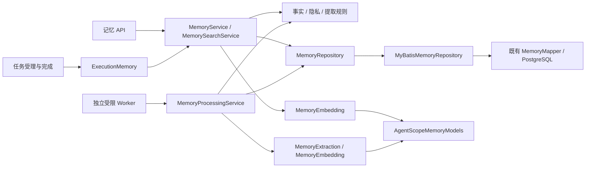

# R5c：记忆用例与发布配置分层

实施日期：2026-10-16。承接 [R5b](r5b-implementation.md)，完成记忆规则、用例、持久化和 AgentScope 适配的分离，同时拆开发布值对象、配置资源与凭据读取。**完整回归 824 项通过**（627 项单元/HTTP、197 项集成），零失败、零错误、零跳过。本文保留 R5c 完成时的验证结果；R5b/R5c 已保存为本地检查点 `7e5a903`，未推送。后续角色装配及该批完整回归见 [R6](r6-implementation.md)，最新职责拆分与验证范围见[治理用例分层](governance-decoupling.md)。

## 记忆职责与调用路径



| 职责 | 当前代码入口 |
| --- | --- |
| 隐私 epoch、候选所有权/修订号、来源、租约、逐字证据与明确偏好规则 | [Memory](../../src/main/java/com/financeclaw/domain/Memory.java) 的值对象方法 |
| 功能开关与搜索输入规则、有限 1024 维向量 | [MemoryPolicy](../../src/main/java/com/financeclaw/domain/memory/MemoryPolicy.java)、[EmbeddingVector](../../src/main/java/com/financeclaw/domain/memory/EmbeddingVector.java) |
| 受理来源、完成意图、冻结召回、确认/拒绝、遗忘与重建 | [MemoryService](../../src/main/java/com/financeclaw/app/memory/MemoryService.java)，直接实现 ExecutionMemory |
| 持久作业领取、提取与投影提交 | [MemoryProcessingService](../../src/main/java/com/financeclaw/app/memory/MemoryProcessingService.java) |
| 查询向量生成前后的隐私核对 | [MemorySearchService](../../src/main/java/com/financeclaw/app/memory/MemorySearchService.java) |
| SQL 与 PostgreSQL 向量表示 | [MyBatisMemoryRepository](../../src/main/java/com/financeclaw/infrastructure/memory/MyBatisMemoryRepository.java)、[MemoryVectorCodec](../../src/main/java/com/financeclaw/infrastructure/memory/MemoryVectorCodec.java) |
| 原生结构化提取与 embedding | [AgentScopeMemoryModels](../../src/main/java/com/financeclaw/infrastructure/agentscope/memory/AgentScopeMemoryModels.java)，仅通过 EmbeddingProfiles 端口固定模型修订 |
| 受限角色检查、轮询与显式 Bean 导入 | [MemoryWorkerApplication](../../src/main/java/com/financeclawmemory/MemoryWorkerApplication.java) |

原 `application.MemoryService`、`memory.MemoryProcessor/MemorySearch/MemoryModels` 和仅转发的 `GovernedExecutionMemory` 已删除。API 与执行用例直接依赖 app 服务或端口；app 不再依赖 Mapper、SDK、Environment 或文件读取。MemoryRepository 只承载记忆上下文的存储动作，MyBatis 实现继续加入调用方的 Spring 事务，没有新增通用 Repository 框架。

领域对象增加规则行为而保持原 record 字段及顺序。EmbeddingVector 复制已验证的 float 值，数据库数组/pgvector 文本由基础设施编码。提取模型仍由 AgentScope 的 ReActAgent 与结构化输出完成，embedding 使用原生 OpenAITextEmbedding；没有自建模型客户端、检索协议或记忆执行引擎。

## 事务、隐私与重试边界

继续直接使用 Spring TransactionTemplate 与 MyBatis-Spring。Mapper SQL、Flyway 和受限角色权限脚本均未修改。

| 场景 | 保留的边界 |
| --- | --- |
| 任务受理 / 完成 | 来源、冻结召回随受理事务提交；完成状态和提取意图随原业务事务提交 |
| 确认 / 拒绝 | 同一事务核对 owner、epoch、revision，写事实状态、索引意图、审计和幂等回执 |
| 遗忘 | 同一事务递增 epoch、建立 purge 屏障、擦除来源/事实/召回/投影、隔离作业、写审计与回执 |
| 重建 | 索引作业、审计和回执同事务；已完成的索引作业可重新排队 |
| 提取 / embedding | 先短事务核对租约与 epoch，再在事务外调用模型，落库前重新核对租约、epoch、状态与 revision |
| 搜索 | 记录查询前 epoch；事务外生成向量；查询时重新核对 epoch、purge、owner、revision 与模型修订 |
| 幂等恢复 | 按原请求摘要查回执，命中后优先返回原结果；请求不匹配仍报 idempotency_conflict |

本批新增外层事务防护：处理作业、向量搜索和原生模型适配入口拒绝已有事务，避免调用方无意把网络等待包在数据库事务中。模型失败仍只记录 `extraction_failed/index_failed` 等有界错误码，不持久化原始异常、来源内容或模型输出。

## 发布对象与配置来源

| 层次 | 职责 |
| --- | --- |
| [domain.release](../../src/main/java/com/financeclaw/domain/release) | ReleaseDefinition、ModelProfile、BusinessFeatures、RemoteEndpoint、ZiweiPolicy；不可变发布值与校验，只依赖 domain/Java |
| [ReleaseService](../../src/main/java/com/financeclaw/app/release/ReleaseService.java) / [ReleaseIdentity](../../src/main/java/com/financeclaw/app/release/ReleaseIdentity.java) | 校验并发布当前版本，保留旧 hash 查找；按原 JSON 和 `agentscope-2.0.3` 前缀生成身份 |
| [EnvironmentReleaseSource](../../src/main/java/com/financeclaw/infrastructure/release/EnvironmentReleaseSource.java) | 由 Spring Environment 读取既有属性和默认值 |
| [BusinessConfigurationLoader](../../src/main/java/com/financeclaw/infrastructure/release/BusinessConfigurationLoader.java) / [BusinessResources](../../src/main/java/com/financeclaw/infrastructure/release/BusinessResources.java) | 业务开关、固定配置资源及原读取限制；关闭的集成不解析其 URL/凭据配置 |
| [EnvironmentCredentials](../../src/main/java/com/financeclaw/infrastructure/release/EnvironmentCredentials.java) | 凭据引用解析，与发布快照分离；远程凭据按访问时读取，支持同一引用轮换 |
| [PackagedSkills](../../src/main/java/com/financeclaw/infrastructure/agentscope/skills/PackagedSkills.java) | 用原生 ClasspathSkillRepository 读取技能资产并形成原发布指纹 |

旧 ReleaseCatalog 与 BusinessCatalog 已删除，调用方改用发布领域值对象。ZiweiPolicy 从计算包迁入 domain.release，原规则标识保持固定，并用测试与未改动的计算内核常量核对。密钥字节仍在使用后清零，发布快照只保存引用和版本。模型 API key 保持启动时读取语义，不把这次拆分扩大为模型凭据热更新。

发布列表均防御性复制；发布新版本不会修改旧版本，也不会让在途 Turn 自动切换。校验失败不会改变当前 hash。这里保留原进程内发布目录，未新增持久发布注册中心，也没有改变未知发布版本的拒绝恢复行为。

## 兼容样本与故障验证

修改生产源码前，以已通过 R5b 回归的编译类生成 [冻结样本](../../src/test/resources/architecture/memory-release-baseline.json)：4 组发布 JSON/hash（默认、主备模型、酒店、开发紫微）、4 组向量编码、7 条偏好命令和 4 种记忆操作请求摘要。样本只使用合成凭据，测试不重新生成 expected。

[MemoryReleaseBoundariesTest](../../src/test/java/com/financeclaw/architecture/MemoryReleaseBoundariesTest.java) 新增 18 项测试：核对上述发布/向量/偏好字节契约，以及旧发布保留、集合不可变、无效发布不生效、凭据轮换和固定算法标识。原 R0 序列化、R5b 紫微 I/O 与 M6 算法样本继续独立运行。

[MemoryIT](../../src/test/java/com/financeclaw/m4/MemoryIT.java) 从 14 项增至 21 项，新增：

- 四种操作分别在最终回执写入时注入异常，比较真实 PostgreSQL 中 owners、sources、facts、recalls、jobs、projections、audit、operations 的全部行，确认事务完整回滚。
- 将旧实现请求摘要写入实际回执表；即使当前事实不存在或 epoch 不同，原请求仍能重放，冲突请求被拒绝。
- 验证查询 embedding 在事务外执行；在其返回前遗忘，查询结果必须为空。
- 外层事务不能包住提取/搜索，失败前不调用模型、不改变数据；正常事务外提取仍能完成。

既有独立受限 Worker、提取/embedding 遗忘竞态、过期租约、按来源顺序覆盖、受理/完成原子性测试继续运行。模型与 embedding HTTP 测试使用本地模拟供应商；SQL、Spring 事务、PostgreSQL/pgvector 和独立 JVM 均为真实组件。

定向验证命令：

```bash
scripts/mvn.sh -B -ntp spotless:apply clean package \
  -Dtest=ArchitectureTest,MemoryReleaseBoundariesTest,SerializationCompatibilityTest,NativeMemoryTest,BusinessContractsTest,DeploymentAccessTest,ZiweiBoundariesTest \
  failsafe:integration-test failsafe:verify -Dit.test=MemoryIT
```

完整验证命令：

```bash
scripts/mvn.sh -B -ntp spotless:apply clean verify spotless:check
python3 scripts/check-delivery.py
```

完整结果与源码指纹见 [R5c 验证证据](evidence/r5c-implementation.json)。

| 验证项 | 本次结果 |
| --- | --- |
| 完整 Maven 回归 | **824 项通过**：627 项单元/HTTP + 197 项集成，零失败、错误、跳过 |
| 完成时间 / 耗时 | `2026-10-16T13:50:01+08:00` / `07:09 min` |
| 定向验证 | 79 项单元/契约 + 21 项记忆集成通过 |
| 架构门禁 | 14 项通过；主业务包仍为零循环，无循环允许列表 |
| 兼容保护 | 82 个保护文件不变：Mapper SQL、资源/Flyway、原冻结样本、六个计算内核文件、POM 与运维脚本等 |
| 记忆 Worker | 产品 JAR 的独立受限进程实际消费持久作业，生成 1024 维投影 |
| 产品镜像 | 真实产品 Docker 镜像，无 Python；外部合成模型驱动五个原生工具，测试类未进入产品 JAR |
| 产品 JAR SHA-256 | `6fbe3bd6c970558310d2be7b68498a5346577a2266ced864a3e06f8663ef283e` |
| 静态交付 | 文档本地链接、脚本语法、凭据模式和空白检查通过 |

14 项 ArchUnit 门禁继续要求主业务包无循环、domain 只依赖 Java、app 通过端口访问技术实现；新增旧记忆/发布类消除和记忆模型适配不得访问业务持久层的断言。循环统计仍为 `com.financeclaw.*` 主业务包图，独立启动根的角色装配另由 R6 验证。

## 后续范围

R5c 完成时，下一阶段是收紧各角色的 Bean 和 Mapper 装配，并决定是否拆 Maven；后续实现见 [R6](r6-implementation.md)。后续[入口依赖收缩](entrypoint-decoupling.md)已提交为 `0c549fa`；[原生执行适配依赖收缩](runtime-decoupling.md)已删除生产 TaskService，并将旧委托移入测试夹具。[治理用例分层](governance-decoupling.md)进一步删除生产 GovernanceService，将授权、Artifact 和报告发布拆成独立应用服务，旧 application 生产包已清空。最新两批尚未提交或推送；Docker API 仍返回 HTTP 500，数据库、角色启动、独立进程恢复和 Compose 未重跑，不沿用本篇历史结果作为其验收。

本批不新增生产依赖，不升级 SDK，不修改算法或数据库格式。真实模型/MCP/飞书租户、M5e Compose 备份恢复重演、旧生产二进制切换、远程 CI 与生产交付不在本轮验证范围。
