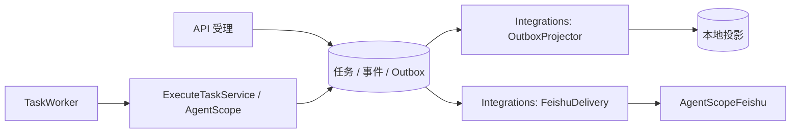

# R6：按运行角色显式装配

实施日期：2026-10-16。承接 [R5c](r5c-implementation.md)，基于本地检查点 `7e5a903` 开始开发。该检查点保存 R5b/R5c，未推送。**R6 已完成，完整回归 835 项通过**（629 项单元/HTTP、206 项集成），零失败、零错误、零跳过；隔离 Compose 的 27 项部署、故障、恢复与隐私检查通过。本批新增改动保留在工作区，尚未提交。

## 这次解决的问题

原主应用扫描整个 `com.financeclaw` 包并扫描全部 Mapper。API、Worker、Integrations 虽然有角色开关和 HTTP 过滤器，但仍会构造其他角色的 Controller、任务执行器或飞书客户端。Integrations 的 Outbox 投影还挂在 TaskWorker 上，飞书投递依赖完整的 TaskService/GovernanceService。

现在由 [FinanceClawApplication](../../src/main/java/com/financeclaw/bootstrap/FinanceClawApplication.java) 显式导入角色配置，[RoleConfiguration](../../src/main/java/com/financeclaw/bootstrap/RoleConfiguration.java) 使用 Spring `@Import` 和 `@ConditionalOnProperty` 选择实际组件。不增加装配框架、插件注册器或生产依赖；事务继续使用已有 Spring TransactionTemplate 与 MyBatis-Spring。

配置的外层 holder 不标记为 Spring 组件，防止 Spring 把所有嵌套配置一起解析。新增服务时必须在需要它的配置中显式导入；仅添加 `@Service` 或 `@Component` 不会自动加载到所有角色。

## 运行角色与实际装配

| 角色 | 业务 HTTP Controller | 定时消费者 | 注册的 Mapper |
| --- | --- | --- | --- |
| `api` | Task、Governance、Operations、Memory、Feishu | 无 | Task、Governance、Runtime、Memory、Operations、Feishu |
| `worker` | 无 | TaskWorker 领取/恢复和心跳 | Task、Governance、Runtime、Memory |
| `integrations` | 无 | OutboxProjector、FeishuDelivery | Task、Governance、Feishu |
| `standalone` / 未指定 | 同 API | Worker 与 Integrations 的消费者 | 全部六个 |
| 独立 Memory 入口 | 无 | 记忆提取与投影 Poller | Memory |
| 独立 Migrate 入口 | 无 | 无，执行 Flyway 后退出 | 无 |

Mapper 名称在表中省略 `Mapper` 后缀。[MapperConfiguration](../../src/main/java/com/financeclaw/bootstrap/MapperConfiguration.java) 通过 MyBatis-Spring 原有 `MapperFactoryBean` 精确注册接口，生产入口不再使用 `@MapperScan`。SQL、数据库迁移、角色授权脚本和 HTTP 数据契约保持原样。

API 不构造 TaskWorker、TaskAgentRuntime、BusinessCapabilities、OutboxProjector、FeishuDelivery 或 AgentScopeFeishu。Worker 不构造业务 Controller、飞书配置/客户端或记忆搜索模型。Integrations 不构造 TaskService、GovernanceService、ReleaseService、MemoryService 或任务执行器。

Memory 仍使用 [独立启动类](../../src/main/java/com/financeclawmemory/MemoryWorkerApplication.java) 和已有受限数据库角色，只注册 MemoryMapper。Migrate 的 [独立入口](../../src/main/java/com/financeclawmigrate/MigrationApplication.java) 明确排除 MyBatis 自动配置，保留 Flyway 和部署授权步骤。三个启动类的路径、容器入口命令和产品 Jar 不变。

业务 API 的 Bearer 认证与后台角色的 health-only 过滤仍由既有组件执行。部署角色和消费者开关不一致、部署角色启用 Flyway、未知角色仍在启动时拒绝；独立 Memory 仍拒绝未受限数据库角色或缺失的 embedding revision。

## 解除两处运行耦合



[OutboxProjector](../../src/main/java/com/financeclaw/worker/OutboxProjector.java) 独立调用原 ProjectTaskService，沿用每轮最多 50 项、原轮询间隔和 `financeclaw.integrations.enabled`。TaskWorker 仅负责执行、恢复与心跳，Integrations 不再为本地投影构造执行线程池。投影事务和 SQL 不变。

飞书查询端点改由 FeishuService 读取原 owner-scoped 通知列表，因此 API 无需构造发送客户端。FeishuDelivery 使用 TaskQueryService 校验 owner/conversation/turn，然后通过 ExecutionContextGateway 读取交互记录。发送仍由 AgentScope 执行，`submitted_unverified` / `unknown` 等回执含义保持原样；没有添加自动重发或伪造可靠送达。

## 验证方式

[RoleAssemblyIT](../../src/test/java/com/financeclaw/m5/RoleAssemblyIT.java) 使用真实 PostgreSQL、Spring 上下文和随机端口 HTTP，不 mock 容器或 Mapper。9 项测试覆盖：

- 默认、Standalone、API、Worker、Integrations 的实际 Controller、定时任务、Mapper Registry 与缺席组件。
- 给无关功能提供会阻止其启动的配置，证明 Worker 不初始化飞书、Integrations 不初始化业务发布/模型，Memory/Migrate 不初始化这些业务组件。
- 受限 Memory 数据库角色不能访问 `business`、`agent_runtime`、`channel` schema，且 readiness 正常。
- Migrate 完成全部六版 Flyway 迁移，未创建 SqlSessionFactory 或业务 Mapper；未知主应用角色启动失败。
- 三个独立应用上下文顺序启动：API 接收任务后保持 queued；Worker 完成任务但 Outbox 未消费；Integrations 启动后完成投影。

测试将实际项目 Bean 类名与 Mapper 名称写到 `target/r6/role-inventory.json`，不导出配置或凭据。[ArchitectureTest](../../src/test/java/com/financeclaw/architecture/ArchitectureTest.java) 增至 16 项，禁止生产组件/Mapper 扫描，防止投影/飞书投递重新依赖旧 facade 或原生执行器。无环检查范围扩大到三个启动根：`com.financeclaw.*`、`com.financeclawmemory.*`、`com.financeclawmigrate.*`，不使用循环白名单。

可复现命令（Docker 已启动，项目工具链已安装）：

```bash
# 角色装配及现有部署访问规则
scripts/mvn.sh -B -ntp package \
  -Dtest=ArchitectureTest,DeploymentAccessTest \
  failsafe:integration-test failsafe:verify -Dit.test=RoleAssemblyIT

# 全量单元、HTTP、PostgreSQL、独立 JVM 和产品镜像验证
scripts/mvn.sh -B -ntp clean verify spotless:check

# 使用既有本地开发 secrets；首次运行先执行 scripts/init-local.py
# 隔离项目、离线模型及合成行情，自动清理本次容器和卷
python3 scripts/validate-compose.py --ziwei --admission --preflight --restore-privacy
```

Maven 成功时输出 `BUILD SUCCESS`。Compose 结果位于 `target/m5e/deployment/compose-results.json`，故障细节见同目录 `compose-validation.log`。本轮验证结果与源码指纹见 [R6 验证证据](evidence/r6-implementation.json)。

| 本轮证据 | 实际结果 |
| --- | --- |
| 全量 Maven | 629 项单元/HTTP + 206 项集成 = 835 项；07:13 min；完成于 `2026-10-16T15:18:58+08:00` |
| 角色装配专项 | 9 项真实上下文测试；7 种角色/入口清单（含默认与 Standalone） |
| 架构门禁 | 16 项通过；三个启动根的包图均纳入零循环断言 |
| 产品镜像 | 原 Dockerfile 构建；容器不含 Python；原生五个紫微工具全部完成 |
| Compose | 27 项通过：新库启动、后台 HTTP/权限、并发幂等、暂停/排空、强杀审批恢复、数据库故障、备份恢复与旧备份隐私拦截 |
| 兼容保护 | 110 个 SQL/迁移/资源/算法/领域/脚本/构建配置文件指纹未变；310 个验证输入与本次构建一致 |

Compose 演练使用真实隔离容器、离线模型和合成行情。数据库故障观测到实际 HTTP 503，恢复后可完成新任务；旧备份缺少后续遗忘事实被阻断并保持隔离，当前备份隐私核对通过。报告保留具体耗时、输入指纹、Jar 与镜像标识，本批不覆盖真实供应商或生产负载。

## Maven 模块化决定与边界

本阶段继续保留单 Maven 模块、一个产品 Jar 和三个独立启动根。实际 Bean/Mapper 边界已有静态与启动验证，当前没有独立发布版本或不同依赖集合的要求；此时拆 Maven 会扩大打包、外部 JVM 探针和启动路径的变更范围。将来确有独立依赖或发布要求时，再以现有端口和角色配置为界拆分。

这次实现的是 Spring 装配边界，公共 Jar 仍包含所有角色代码。API、Worker、Integrations 仍使用原数据库授权，未新增各自独立的最小权限角色。TaskService 的剩余治理/原生工具调用者继续存在，API/Worker 因兼容 facade 仍构造部分共享用例，包括 ProjectTaskService；只有 Integrations/Standalone 装配定时 OutboxProjector，不能把“没有消费者”说成“没有全部写入用例”。

后续可继续收缩旧 facade 的调用者。R7 的 SubAgentTool、历史压缩实验保持可选，只有证明治理语义等价且减少适配成本后才进入默认路径。真实模型、MCP、飞书租户、生产数据切流和旧生产二进制到新二进制的升级验收仍应独立进行；本地离线演练不能替代这些验收。
