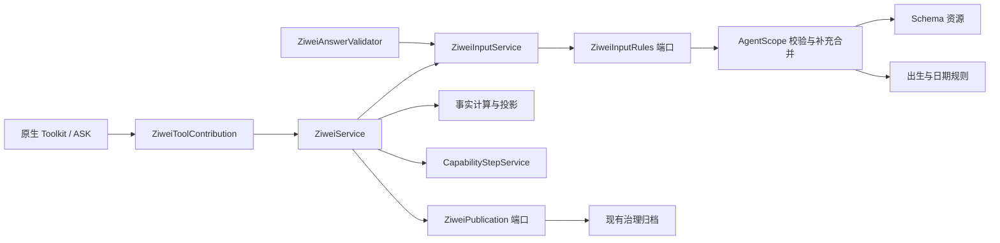

# R5b：紫微输入、资源与执行边界

> **历史记录**：本文保留当时的设计、命令与验证结果，不代表当前独立应用的部署结构或最新测试结论。当前操作见[运行说明](../../operations.md)，新库结构见[初始化说明](../../architecture/fresh-schema.md)；历史类名、版本号和外部导出命令仅用于理解证据。

实施日期：2026-10-16。承接 [R5a](r5a-implementation.md)，基于本地检查点 `bb58ea2` 开始本批开发。该检查点保存 M5e 与 R0–R5a，未推送。本批完成紫微 I/O、用例和计算边界拆分；**完整回归 797 项通过**（607 项单元/HTTP、190 项集成），零失败、零错误、零跳过。本文保留 R5b 完成时的验证结果；后续记忆与发布配置已在 [R5c](r5c-implementation.md) 完成；R5b/R5c 已保存为本地检查点 `7e5a903`，角色装配见 [R6](r6-implementation.md)。

## 当前调用路径



| 职责 | 当前入口 |
| --- | --- |
| 授权、密钥绑定、步骤重放、结果归档与安全错误响应 | [ZiweiService](../../../src/main/java/com/financeclaw/app/ziwei/ZiweiService.java) |
| 固定请求时间、完整输入核对与回答校验 | [ZiweiInputService](../../../src/main/java/com/financeclaw/app/ziwei/ZiweiInputService.java) |
| 保持原 HMAC 配方与身份绑定 | [ZiweiIdentity](../../../src/main/java/com/financeclaw/app/ziwei/ZiweiIdentity.java) → JDK `Mac` |
| Schema 校验和补充参数合并 | [AgentScopeZiweiInputs](../../../src/main/java/com/financeclaw/infrastructure/agentscope/capability/AgentScopeZiweiInputs.java)，实现 [ZiweiInputRules](../../../src/main/java/com/financeclaw/app/ziwei/port/ZiweiInputRules.java) |
| Classpath 资源读取、Schema 与描述 | [ZiweiSchemaResource](../../../src/main/java/com/financeclaw/infrastructure/ziwei/ZiweiSchemaResource.java)、[ZiweiSchemas](../../../src/main/java/com/financeclaw/infrastructure/ziwei/ZiweiSchemas.java) |
| 出生、地点、时间精度与目标日期语义 | [ZiweiInputs](../../../src/main/java/com/financeclaw/ziwei/ZiweiInputs.java)，接收已通过结构校验的参数 |
| 完整事实与分段、关注方向投影 | [ZiweiCalculation](../../../src/main/java/com/financeclaw/ziwei/ZiweiCalculation.java)、[ZiweiProjection](../../../src/main/java/com/financeclaw/ziwei/ZiweiProjection.java) |
| 发布配置/密钥与受治理归档适配 | [CatalogZiweiConfiguration](../../../src/main/java/com/financeclaw/infrastructure/ziwei/CatalogZiweiConfiguration.java)、[GovernedZiweiPublication](../../../src/main/java/com/financeclaw/infrastructure/ziwei/GovernedZiweiPublication.java) |
| 原生注册、挂起和恢复结果转换 | [ZiweiToolContribution](../../../src/main/java/com/financeclaw/infrastructure/agentscope/capability/ZiweiToolContribution.java) |

原 `tools.ZiweiTools`、`tools.CapabilitySteps` 已删除，TaskService 的 `localStep` 委托与步骤服务依赖也已移除。BusinessCapabilities 注入紫微应用服务。回答校验只依赖输入用例，不依赖发布用例，避免 `GovernanceService → 回答校验 → 归档 → GovernanceService` 的 Bean 循环。

## 计算边界与组件复用

本批保留 `com.financeclaw.ziwei` 作为独立计算库，没有批量移动已冻结算法。`ZiweiCalendar`、`ZiweiDates`、`ZiweiChartEngine`、`ZiweiRules`、`ZiweiStars`、`ZiweiTables` 六个文件逐字节未变，原历法与盘面样本也未改写。输入规范化移除 SDK、资源访问和密钥处理，结果投影从事实计算中提取。JSON 深层不可变值与字节预算集中在 ZiweiValues。

这不等于所有紫微代码都已成为只依赖 Java 的 domain 类。计算库继续使用已锁定的 `cn.6tail:lunar:1.7.7` 和共享 JSON/摘要编码；只有 `app.ziwei` 可以引用它。ArchUnit 另行禁止计算库依赖应用、基础设施、SDK、Spring 和文件/网络 I/O。`domain..` 的纯 Java 门禁仍保持严格，其他 app 包不能借此引入紫微依赖。

原生 `ToolValidator` 继续验证结构，JDK `Mac` 实现 HMAC，Spring `ClassPathResource` 读取资源；未新增生产依赖、另一套 JSON Schema 引擎或事务组件。Schema 的原始字节摘要固定在发布策略中，资源加载时必须匹配，防止通过资源读取反向依赖 BusinessCatalog。现有 Schema 字节和 release JSON/hash 不变；以后调整输入契约需显式更新固定摘要并重新验证兼容性。

## 必须保留的事务与恢复行为

`ZiweiService` 直接复用 CapabilityStepService，短事务仍由 Spring `TransactionTemplate` 和 MyBatis-Spring 执行。步骤回调只执行本地计算与数据库归档，没有网络或模型调用。

| 持久边界 | 本批行为 |
| --- | --- |
| `ziwei:key / binding` | 在输入澄清前保存原 HMAC 绑定；同版本密钥字节漂移仍拒绝重放 |
| `ziwei:<callId> / result` | 输入摘要仍为 `[tool, effectiveInput, birthFingerprint]`；复用旧回执前重新检查租约和授权 |
| Artifact 与结果步骤 | 共用同一 Spring 事务；归档之后异常时二者都回滚，先前提交的密钥绑定保留 |
| 输入恢复 | 沿用原 call id、action hash、release 和请求时间；仅合并允许的出生/目标日期补充，继续消耗根工具预算 |
| 密钥生命周期 | 配置端口返回本次执行拥有的字节数组，成功、澄清、领域拒绝或异常均在 `finally` 清零 |
| 输出与隐私 | 保留事实 ID、分段、投影选择、Artifact 归属、范围检查和字节预算；错误不返回原始出生资料 |

应用服务返回普通结果，ToolContribution 转换为 SDK 的文本或挂起结果。没有引入替代 ASK、ReAct、检查点格式或持久工作流的实现。

## 兼容与故障验证

编辑生产源码前，用检查点对应的 R5a 编译类导出 20 组固定样本（旧静态样本已退出当前源码，现行用例见[紫微边界测试](../../../src/test/java/com/financeclaw/architecture/ZiweiBoundariesTest.java)）：五个工具 × 四种关注方向。新增测试核对原 Schema/描述、规范化结果、HMAC、步骤输入摘要、完整 Artifact 摘要和模型投影摘要。原 M6 的日期、历法、排盘与分段样本继续独立运行。

[ZiweiBoundariesTest](../../../src/test/java/com/financeclaw/architecture/ZiweiBoundariesTest.java) 新增 30 项检查，覆盖上述 20 组样本、固定 release/resource 身份、六类退出时的密钥清零、拒绝授权前不读取密钥、回答校验无密钥依赖，以及不可变结果。密钥退出检查使用本地 Mock，不表示真实密钥管理系统验收。

[ZiweiToolsIT](../../../src/test/java/com/financeclaw/m6/ZiweiToolsIT.java) 在原有 14 项集成测试上新增两项：

1. 真 PostgreSQL 中在归档之后抛错，验证 Artifact 和结果步骤一起回滚，密钥绑定保留，重试只产生一个归档。
2. 向数据库写入旧实现生成的结果步骤输入摘要，验证旧回执可直接读取；修改输入或撤销授权后拒绝重放。该用例验证旧步骤契约，不等同于旧生产二进制到新版本的切流演练。

定向命令：

```bash
scripts/mvn.sh -B -ntp spotless:apply test-compile surefire:test \
  -Dtest=ZiweiBoundariesTest,ZiweiDomainTest,ArchitectureTest,SerializationCompatibilityTest \
  failsafe:integration-test failsafe:verify -Dit.test=ZiweiToolsIT
```

本次定向验证 100 项单元/契约与 16 项集成测试全部通过。之后移除循环白名单、集中值编码辅助方法，并执行下面的完整验证。

```bash
scripts/mvn.sh -B -ntp spotless:apply clean verify spotless:check
python3 scripts/check-delivery.py
```

完整结果与源码指纹见 [R5b 验证证据](../../architecture/evidence/r5b-implementation.json)。

| 验证项 | 本次结果 |
| --- | --- |
| 完整 Maven 回归 | **797 项通过**：607 项单元/HTTP + 190 项集成，无失败、错误或跳过 |
| 完成时间 / 耗时 | `2026-10-16T13:14:40+08:00` / `07:13 min` |
| 架构门禁 | 12 项通过；参与包循环的具体类依赖 **22 → 0**；删除旧白名单，改为主业务包零循环断言 |
| 故障与恢复 | 独立 JVM 的紫微恢复 13 项、紫微工具 16 项；任务、审批、组合、记忆与渠道回归继续通过 |
| 保护范围 | 六个核心算法文件和原有冻结样本、Schema/Flyway、Mapper、独立角色源码与 POM 等 53 个保护文件指纹不变 |
| 产品镜像 | 产品 jar 由 Docker 运行；无 Python，外部合成驱动调用五个原生工具，测试夹具未打入产品 jar |
| 产品 jar SHA-256 | `eec0fa5c3b1bbefa27e1ec1474111e126ad7b1aea1926fee5340091122e51fb3` |
| 静态交付 | 本地文档链接、脚本语法、凭据模式和空白检查通过 |

本批未运行真实模型/MCP/飞书租户、远程 CI、生产切流或 M5e Compose 备份恢复演练。R5b 验证当时改动保留在工作区；后续已与 R5c 一起保存为本地检查点 `7e5a903`，未推送。

## 后续工作

后续 [R5c](r5c-implementation.md) 已拆分记忆规则/用例/适配，以及发布对象、配置资源和凭据读取；本批历史结果和证据保留。后续角色装配、验证结果与 Maven 模块决定见 [R6](r6-implementation.md)。R5b 的循环统计范围为 `com.financeclaw.*` 主业务包；独立 Memory/Migrate 启动根的门禁扩展见 R6。包图无环只是本批的结构结果，不能代替这些职责与部署验收。
