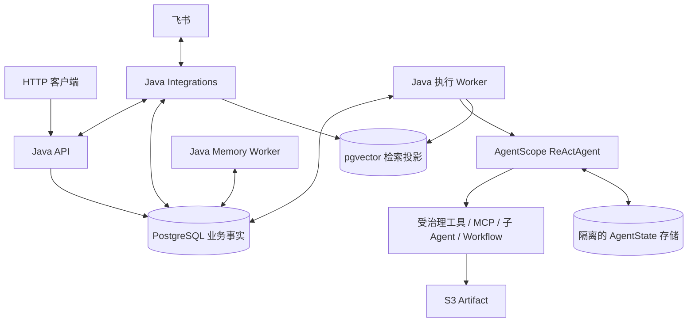

# FinanceClaw：Python → AgentScope Java 迁移方案

> 日期：2026-10-15。状态：M0–M3 已实现并进行本地验证，M4–M6 仍为实施方案。真实模型供应商、真实 MCP、飞书及生产恢复尚未验收。
>
> 项目入口：[README](../../README.md)。配套文档：[验收清单](acceptance-checklist.md)、[M0 验证与版本决策](m0-validation.md)、[M1 使用与验证](m1-validation.md)、[M2 使用与验证](m2-validation.md)、[框架复用审查](framework-reuse-review.md)。

## 1. 范围与结论

本方案按当前目标仓库 `FinanceClaw-java`，将“迁移到 AgentScope”解释为：**把 Python 应用迁移为 Java 应用，并以 AgentScope Java 替换 LangChain / LangGraph Agent 执行层**。不使用 Python AgentScope SDK，也不把 Python 示例直接翻译成 Java API。

迁移覆盖 HTTP 产品接口、Agent 编排、工具治理、人工交互、上下文、长期记忆、Artifact、飞书和后台任务。外部 MCP 服务继续通过协议接入，不需要因为客户端语言改变而重写服务。

建议采用以下决策：

| 决策 | 建议 | 原因与边界 |
| --- | --- | --- |
| 应用形态 | Java 模块化单体，一个代码库按角色运行 | 业务事务边界清晰；保留 API、执行 Worker、Integrations、Memory Worker 的职责隔离 |
| Agent 基座 | AgentScope Java `ReActAgent`，M0 固定 `2.0.3` | 配合自有 PostgreSQL CAS、权限入口和执行适配；业务恢复仍由 FinanceClaw 管理 |
| HarnessAgent | 后续按功能引入 | 工作区、文件工具、自动记忆和技能学习不能自动取得业务权限 |
| AgentScope Service | 首期不作为必需基础设施 | 会再引入一套会话、任务和控制面，需要独立评估权威状态归属 |
| 任务执行 | FinanceClaw 持久 Command + 后台 Worker + AgentScope 适配器 | `ReActAgent` 不是 LangGraph AgentServer 的 HTTP API、队列和 checkpoint 的直接替代品 |
| 数据持久化 | PostgreSQL 为业务事实源；运行态单独命名空间；pgvector 为可重建检索投影 | 保持任务、审计、记忆事实与 SDK 状态分工 |
| 迁移策略 | 先在新环境建立 Java 功能闭环；历史数据导入为独立交付项 | M0 已建立工程骨架，尚无在线切换或历史保留需求证据 |

M0 已以 28 项测试验证固定版本的编译、模型载荷、审批/澄清重启恢复、状态 CAS 和并发隔离，决定继续使用 `2.0.3` 并保留自有适配层。SDK 不提供业务任务的完整持久执行语义；M1 已补齐 Command/attempt、fencing 和完成事务，完整授权仍需在 M2 实现，不能把 M0 实验视为整体迁移完成。

## 2. 核对基线与证据

### 2.1 Python 项目

本次只读核对的源目录为 `/Users/hebinghui/PycharmProjects/FinanceClaw`。`HEAD` 为 `8332e2e20a5b7ccaef5d82959001b3fa4120774d`，标题为 `docs: refresh project showcase and onboarding guides`。

工作区有以下 **5 个未提交文件**，因此不能把所见代码全部归属于该 commit：

```text
financeclaw/shared/llm/budget.py
tests/mcp_integration/test_execution.py
tests/mcp_integration/test_hotel_result_views.py
tests/stage11/test_context_budget.py
tests/stage7/test_dependencies.py
```

其中 `budget.py` 已改为按模型适配器实际发送的消息投影计数，排除本地 Artifact、审计等元数据。本方案把这一行为作为待迁移契约；本次没有运行这些修改对应的测试，也未提交或改写源项目。

当前源依赖包括 Python `>=3.13,<3.14`、LangChain `1.3.18`、LangGraph `1.2.11`、LangGraph SDK `0.4.4`、langchain-openai `1.6.0`。Ziwei 的 `x-iztro==0.4.0`、`tzdata==2026.3` 属于可选依赖。M0 已冻结 `pyproject.toml`、`uv.lock`、配置和测试入口的 [SHA-256 清单](baseline/python-manifest.json)及 5 个文件的补丁；本次未运行 Python 基线测试，不将 Python 环境视为重新验收通过。

### 2.2 AgentScope Java

本次检查了官方文档、发布记录及 `v2.0.3` 源码；tag 对应 SHA 为 `1b8e3dcd2338550ae5198bdb2a7bae56df5bf2e0`。[发布页](https://github.com/agentscope-ai/agentscope-java/releases/tag/v2.0.3)

**在线 v2 文档与发布版存在差异，必须以固定 tag 和编译实验为准：**

| 核对项 | 发现 | 本方案处理 |
| --- | --- | --- |
| 发布版本 | 本次核对时，官方记录中 `2.0.3` 已于 2026-09-07 发布，`2.0.4` 仍标记为发布草案 | M0 固定 `2.0.3`；升级时重新运行兼容性实验 |
| 持久任务接口 | 在线文档介绍 `AgentSession` / `SessionLog`，但本次检查的 `v2.0.3` 完整源码树中没有这两个对应类文件 | 不在 `2.0.3` 方案中调用 `session.submit/respond/resume` |
| Middleware | 在线文档列出六个阶段；`v2.0.3` 的 `MiddlewareBase` 实际只有五个 hook，没有 `onAgentStateReady` | 按发布版五个 hook 设计，不复制在线新签名 |
| 状态并发 | `AgentStateStore` 提供版本接口，但默认 `supportsVersioning()` 为 `false`，默认 CAS 方法会退化为普通写入 | 不能因为接口有 CAS 就认为具体后端已经防并发覆盖 |
| 审批恢复 | 使用 `PERMISSION_ASKING`、`ToolUseBlock`、`ConfirmResult`；普通 `AgentTool` 绕过权限规则，须采用 `ToolBase` | M0 已验证持久化、独立 JVM 恢复及动作绑定；完整业务授权仍在 M1/M2 |

版本差异来源：[发布记录](https://java.agentscope.io/v2/en/docs/others/release-notes)、[在线 Session 文档](https://java.agentscope.io/v2/en/docs/harness/session-log)、[固定版本源码树](https://github.com/agentscope-ai/agentscope-java/tree/v2.0.3)、[MiddlewareBase](https://github.com/agentscope-ai/agentscope-java/blob/v2.0.3/agentscope-core/src/main/java/io/agentscope/core/middleware/MiddlewareBase.java)、[AgentStateStore](https://github.com/agentscope-ai/agentscope-java/blob/v2.0.3/agentscope-core/src/main/java/io/agentscope/core/state/AgentStateStore.java)。

### 2.3 证据等级

- **已核对**：上述本地文件、调用链、配置和官方 tag 的接口存在性。
- **设计约束**：下文的目标模块、业务状态机、数据库结构和迁移步骤。
- **M0 已验证**：Java 依赖解析、实际适配器到本地 HTTP 的载荷、真实 PostgreSQL、独立 JVM 恢复及并发隔离，见 [M0 记录](m0-validation.md)。
- **待验收**：业务任务生命周期、真实模型供应商、MCP 和飞书连接、生产故障与性能。

已有 Python 测试文件可作为行为样本，不表示 Java 已满足对应能力。本文没有沿用历史测试通过数作为本次结果。

## 3. 当前系统究竟迁移什么

### 3.1 实际请求链

```text
HTTP / 飞书
  → TurnAdmission：保存用户消息、Turn、固定发布与 start Command
  → TurnLifecycle / CommandService：观察、领取发送权、核对回执
  → NativeRuns：进程内 LangGraph SDK → 原生队列
  → Queue Worker：finance_agent → AgentFactory → 工具 / Workflow / 子 Agent
  → ResultService：保存最终 Journal、Interaction、终态和 Outbox
  → Integrations：通知、飞书卡片、历史与记忆索引
  → Memory Worker：异步提取、整合与隐私治理
```

`langgraph.json` 只公开 `finance_agent` 根图，并把业务 FastAPI 挂在 AgentServer 进程内。`compose.yml` 中 API 的 `N_JOBS_PER_WORKER=0`，执行任务由独立 Worker 负责。短事务受理与原生运行提交仍是两个动作，当前代码通过 Command 身份及回执核对处理不确定窗口。

三个身份必须继续区分：**Conversation 是会话，Turn 是业务任务，Command / ExecutionAttempt 是某次开始或恢复的执行操作**。人工回答继续同一 Turn；一次 Turn 可以产生多次执行。

### 3.2 能力与迁移归属

下表的 Python 路径相对于源项目的 `financeclaw/` 目录；以 `config/`、`tests/`、`evals/` 开头的路径相对于源仓库根目录。Java 包名是拟定名称。

| 能力 | Python 实现入口 | Java / AgentScope 方案 | 处理方式 |
| --- | --- | --- | --- |
| 根 Agent 装配 | `agent_server/agents/factory.py`、`agent_server/graphs/product.py` | `ReActAgent` + `AgentFactory` + 固定工具目录 | 重写装配，复用配置语义 |
| Turn 受理与生命周期 | `api/application/turns/`、`shared/turns/` | `application.turn` + SQL Command Worker | 保留业务契约，替换执行后端 |
| 鉴权与身份 | `api/authentication.py`、`api/native_auth.py`、`kernel/authorization.py` | Spring 认证入口 + `ExecutionContext` | 业务身份由服务端注入 |
| 发布快照 | `shared/releases/`、`kernel/agents.py` | 不可变 `ReleaseSnapshot` / `ModelProfile` / `ToolRef` | 保留哈希、版本和恢复校验 |
| 工具策略、重试和预算 | `agent_server/tools/policy.py`、`agent_server/middleware/` | PermissionEngine 接入 + 业务策略 + `onActing` / 工具包装器 | 授权规则与审计仍由业务定义 |
| 人工审批与澄清 | `api/application/turns/interactions.py`、`kernel/interactions.py` | `InteractionService` + SDK 审批/外部工具挂起适配 | 不把所有等待都当成布尔审批 |
| 上下文与最终检查 | `agent_server/context/`、`agent_server/middleware/final_context.py`、`shared/llm/budget.py` | `ContextPlanner` + `onReasoning` / `onModelCall` | 重新实现并做发送载荷契约测试 |
| 长期记忆 | `shared/memory/`、`agent_server/memory/`、`memory_worker/` | SQL 记忆领域 + Java 后台任务 + pgvector 投影 | 保留治理，替换 LangGraph Store |
| Artifact / 结构化回读 | `shared/artifacts/`、`agent_server/middleware/artifact_middleware.py` | `ArtifactService` + S3 适配 + 受限读取工具 | 复用格式语义与权限规则 |
| MCP | `shared/mcp/`、`agent_server/tools/mcp*.py`、`config/mcp.toml` | SDK MCP 客户端 + Toolkit 原生注册 | 原生发现/Schema/调用，保留业务授权和归档 |
| 受治理 Skills | `shared/skills/`、`agent_server/skills/`、`agent_server/middleware/skills.py` | `ClasspathSkillRepository` + `skillRepository` | 原生渐进加载与 AgentState，保留授权和许可证 |
| 领域子 Agent | `agent_server/graphs/ziwei_agent.py`、`agent_server/tools/subgraphs.py`、`shared/releases/subgraphs.py` | 受控工具调用子 `ReActAgent` | 迁移父子关联、预算与澄清协议 |
| 投资组合 Workflow | `agent_server/graphs/workflows/portfolio_review_v1.py`、`kernel/workflows/` | 显式 Java 工作流状态机 | 持久化每步状态；模型只负责适合推理的步骤 |
| 飞书 | `integrations/feishu/`、`integrations/notifications/`、`shared/channels/feishu/` | Java 飞书客户端 + 独立渠道适配器 | 重建事件去重、卡片与回调 |
| 观测与评测 | `evaluation/`、`evals/`、`tests/` | OpenTelemetry + 契约样本 + JUnit / 集成测试 | 迁移场景，重新采集证据 |

完整调用链可核对[源项目请求文档](https://github.com/westbrook0904/FinanceClaw/blob/8332e2e20a5b7ccaef5d82959001b3fa4120774d/docs/architecture/request-lifecycle.md)。

## 4. 目标技术与目录

### 4.1 技术选择

| 层 | 建议 | M0 必须确认 |
| --- | --- | --- |
| Java / 构建 | Temurin `21.0.12+8`、Maven `3.9.11` / Wrapper `3.3.4` | 已编译运行；Enforcer 验证 vendor、补丁与 build；分发包 SHA-256 固定 |
| API 与容器 | Spring Boot `3.5.16`、Spring MVC；M1 用显式 DTO/正文校验，不额外引入 Bean Validation | Boot 启动、Flyway 与数据库就绪检查已通过；直接依赖 SDK |
| Agent 执行 | `io.agentscope:agentscope-core:2.0.3` | 核心、模型和存储扩展统一版本；禁止使用动态版本 |
| 模型 | 按现有供应商选用 `agentscope-extensions-model-openai` 或 `agentscope-extensions-model-dashscope` | Qwen / DeepSeek 等的 base URL、工具调用、thinking、JSON 输出及 usage 字段 |
| 数据库 | PostgreSQL 16 / pgvector、MyBatis + Spring 事务、Flyway | JSONB、唯一约束、事务隔离、租约与 CAS；向量维度独立锁定 |
| 运行态存储 | 实现或包装 `AgentStateStore`，独立 schema | 具体 PostgreSQL 实现的 CAS、版本冲突、序列化和删除行为 |
| Artifact | S3 兼容对象存储 + 本地开发实现 | 加密、归属、访问校验、分页和清理 |
| 异步任务 | 首期 PostgreSQL 持久 Command / Outbox | 轮询可恢复，唤醒通知不是唯一任务来源；Redis 暂不承担事实存储 |
| 观测与测试 | OpenTelemetry、JUnit、Testcontainers、HTTP 模拟服务 | 日志脱敏、真实 PG 竞争测试、模型传输层 mock |

Spring MVC 处理短请求及 SSE；阻塞数据库/S3 操作与 AgentScope Reactor 执行链使用明确的线程池边界。不要在 Reactor 事件线程中等待数据库锁或调用阻塞 `.block()`。API 请求结束不应销毁后台 Agent 执行。

核心依赖如下；实际固定版本和构建配置以 [pom.xml](../../pom.xml) 与 [toolchains.lock.json](../../toolchains.lock.json) 为准：

```xml
<properties>
    <maven.compiler.release>21</maven.compiler.release>
    <agentscope.version>2.0.3</agentscope.version>
</properties>
<dependencies>
    <dependency>
        <groupId>io.agentscope</groupId>
        <artifactId>agentscope-core</artifactId>
        <version>${agentscope.version}</version>
    </dependency>
    <dependency>
        <groupId>io.agentscope</groupId>
        <artifactId>agentscope-extensions-model-openai</artifactId>
        <version>${agentscope.version}</version>
    </dependency>
</dependencies>
```

以上组件坐标已在 M0 通过依赖解析和编译核验。本阶段使用自有 PostgreSQL 状态适配器及 OpenAI 模型扩展，后续仅按实际需要引入其他供应商模块。

### 4.2 拟定工程布局

初期一个 Maven 应用即可，先通过包边界管理依赖；出现独立发布需求后再拆 Maven 模块。

```text
FinanceClaw-java/
├── README.md
├── docs/migration/
├── pom.xml                         # M0 已建立；下方目录包含后续规划
├── mvnw / .mvn/
├── src/main/java/.../financeclaw/
│   ├── domain/                     # Turn、Interaction、授权、发布、记忆领域
│   ├── application/                # 受理、恢复、取消、投影、后台任务用例
│   ├── agent/                      # AgentScope 工厂、运行适配、上下文、中间件
│   ├── tools/                      # 本地工具、MCP、子 Agent、Workflow
│   ├── infrastructure/             # MyBatis、运行态、S3、模型、配置
│   ├── channels/feishu/            # 飞书事件、卡片与回调
│   ├── api/                        # HTTP、鉴权、DTO、SSE
│   └── bootstrap/                  # api / worker / integrations / memory-worker
├── src/main/resources/
│   ├── db/migration/
│   ├── releases/
│   └── skills/
├── src/test/                       # 契约、确定性模型、数据库和恢复测试
├── config/                         # 模型、MCP、环境示例；无真实密钥
└── deploy/                         # Dockerfile、Compose、初始化与运维
```

`domain` 不依赖 Spring、AgentScope 或飞书 SDK；M1 的 `application` 直接使用 MyBatis Mapper 管理短事务，避免仅为转发增加 Repository；外部能力在需要时引入端口。SDK 的消息、事件、状态对象在适配层内转换，不能直接成为公开 HTTP DTO 或长期业务数据格式。

## 5. 运行架构与关键语义



### 5.1 从业务事务到 AgentScope

1. API 在短事务中校验身份、幂等键和活动任务，冻结发布与授权，写入用户 Journal、Turn 和 Command，提交后返回 `202`。
2. Worker 领取 Command，分配不可变 `attempt_id`，取得带递增 fencing token 的会话执行租约。事务提交后再调用模型。
3. `AgentRuntime` 适配器构造服务端 `RuntimeContext`，选择固定版本模型/工具，加载归属当前运行身份的 AgentState，并在后台消费 SDK 事件。
4. SDK 事件经白名单转为进度投影。挂起、失败、完成依据执行结果和已保存状态核对后，写入业务事实。
5. 完成事务保存最终 Journal、Turn 终态以及通知/索引/记忆提取 Outbox。Integrations 与 Memory Worker 分别消费。

拟定业务端口为 `AgentRuntime.execute`、`resumeInteraction`、`requestCancel`、`inspectSavedState`。这些是 FinanceClaw 自定义端口，**不是声称 SDK 已有同名方法**。旧 `NativeRuns` 将被替换，不保留对 LangGraph `runs.create` 的伪装兼容层。

新受理事务和任务意图都在本系统 SQL 内，因此可以去掉旧架构的“向远端 AgentServer 提交并绑定回执”步骤；模型调用和外部工具仍不受该 SQL 事务保护。不能因此删除执行身份、结果核对、幂等和不确定结果处理。

### 5.2 持久恢复是首要技术门槛

`AgentStateStore` 的 save/load 不能等同于任意步骤的可恢复执行。首期设计须验证并实现：

- **运行快照绑定**：状态版本/内容哈希绑定 `tenant、subject、conversation、turn、command、attempt、release_hash`。框架使用的用户和会话 ID 由业务分配，不能直接信任请求中的值。
- **隔离命名空间**：发布版状态槽以 `(userId, sessionId)` 为核心；业务必须再隔离租户、Agent、发布与子任务。用映射表/命名空间构造唯一身份，避免同名用户或子 Agent 共用状态。
- **单写者与旧 Worker 防护**：数据库租约和 fencing token 控制业务写入；运行态写入检查版本和持有者。状态 CAS 只能防覆盖，不能阻止旧 Worker 对外执行工具。
- **安全重启点**：只从已持久化、已验证的状态恢复。M0 要查清 SDK 在正常结束、挂起、异常和中断时的保存时机；若逐工具恢复需要额外持久化，必须在适配层补齐并测试。
- **工具执行账本**：逻辑调用 ID、参数摘要、发布、授权、外部幂等键、执行状态和结果引用可核对。发生进程死亡时，先查明已执行副作用，不自动重复。
- **未知结果**：写工具没有幂等接口或结果查询能力时，故障后转 `blocked` 并进入核对流程；不能仅凭超时或租约过期推断“未执行”。只读工具也要有明确重试上限。
- **终态核对**：返回文本、流结束或完成事件都不足以单独证明业务成功；还需匹配当前 attempt、已保存状态、无待交互/待工具以及有效最终答案。

框架状态提交与业务完成事务之间若有崩溃窗口，恢复器应按原 attempt 和快照版本幂等补交。无法证明结果对应关系时保持 `blocked`，不能重新让模型执行整条任务来“补结果”。

### 5.3 审批、澄清、取消

保留产品状态 `accepted / queued / running / waiting / resuming / cancelling / blocked / completed / failed / cancelled`。它们不与 SDK 枚举做机械一对一替换。

审批记录至少绑定 `interaction_id、revision、turn_id、attempt_id、state_version、tool_call_id、action_hash、expires_at`；批准后重新校验归属、发布、权限和当前等待点，再构造 SDK 的确认输入。恢复信息由服务端生成，客户端不能直接提交 SDK metadata 或状态 JSON。

资料澄清使用带 schema 的 Interaction；在运行层验证 `TOOL_SUSPENDED` / 外部工具结果恢复机制，或实现显式工作流等待步骤。不要把用户补充的生日、日期等内容转成“批准所有工具”。子 Agent 返回缺失资料时，根任务负责展示问题和保持原上下文。

取消先持久化意图，Worker 向指定执行身份发出中断并核对停止。请求中断不代表外部工具已经停止，也不能撤销已发生的副作用。等待中的任务取消后，旧回答、旧卡片和迟到结果都不得重新激活任务。

SDK 审批输入形态可参考[固定版本 PermissionHITLExample](https://github.com/agentscope-ai/agentscope-java/blob/v2.0.3/agentscope-examples/documentation/src/main/java/io/agentscope/examples/documentation2/hitl/PermissionHITLExample.java)；示例中的交互式控制台和内存恢复不能直接作为线上实现。

### 5.4 模型、上下文与预算

将 LangChain message 转为业务消息 DTO，再由适配器构造 AgentScope `Msg` / ContentBlock。必须保留 tool call ID、结果对应关系、结构化数据、来源和真实用户消息边界。

三个预算分别配置与验证：

| 预算 | 计量对象 | 超限策略 |
| --- | --- | --- |
| 模型请求预算 | 实际发送的系统提示、历史、工具 schema、结果、记忆、Skill、输出 schema | 压缩旧 Turn / 剔除可选项后重算；强制内容仍超限则调用前失败 |
| 结果/Artifact 投影预算 | Inline 结果、引用信封、分页记录、回读字节 | 归档完整结果，返回有界预览与受授权引用 |
| 业务执行预算 | 模型调用、工具调用、子 Agent、重试、时间和成本 | 根任务统一记账；子调用只能收窄限额 |

模型输入上限按应用 cap、模型 max input、总窗口减输出预留取最小值，再扣安全余量；降级模型也必须满足对应输入限制。`ContextPlanner` 与最终发送前检查使用同一投影函数。日志/Artifact 元数据如果不发送给供应商，就不计入发送上下文；schema 和实际发送的结构化内容不能漏计。

`onReasoning` 用于上下文准备，`onModelCall` 用于最终检查；供应商适配器后续仍可能转换输入，因此还需在 mock HTTP 传输层捕获实际载荷进行比对。对 tokenizer 不可用情况采用保守 UTF-8 估算并单独测试；不能依赖开发机缓存掩盖 CI 问题。

当前 Turn 的原始用户输入、有效审批和必要工具证据不能为了缩短上下文而任意截断。工具结果归档先于清理；旧 Turn 摘要与长期记忆使用不同的来源和生命周期。

模型配置迁移覆盖 `base_url、model、temperature、max_tokens、timeout、retry、fallback、enable_thinking` 及结构化输出。特别验证记忆提取所需的 Qwen thinking 策略、异常中的 usage 统计和无正文响应；不要把 Python 参数名直接假定为 Java 供应商选项。

### 5.5 工具、MCP、Skills 与子 Agent

**治理顺序。** 工具可见性 → 固定发布与输入契约 → 权限/数据级别/外连策略 → 审批 → 预算/执行账本 → 外部调用 → 结果归档 → 脱敏进度。用调用顺序测试证明实际包装顺序，不能只依赖 Middleware 注册顺序。`onActing` 覆盖不了运行框架之外的调用，因此所有外部入口都必须经过同一个受治理工具执行端口。

**MCP。** 统一使用 `McpClientBuilder` 和 Toolkit 的 MCP 注册 API。工具名、参数 Schema、执行和内容转换由框架提供；应用仅保留 host/tenant/凭据、只读工具白名单、授权/预算及结果归档。按 2026-10-15 的原生框架优先决策，删除 `input-structure/1`、本地 Schema 注册表和手动 list/call。新 attempt 采用服务端实时公布的 Schema，不声明逐调用冻结契约漂移保护。具体内容兼容边界见 [M3](m3-validation.md)。

Python 原配置启用了 `rollinggo_hotel`，`rollinggo_flight` 关闭；Java 默认关闭远端接入。迁移先覆盖酒店的 `searchHotels / getHotelDetail / getHotelSearchTags`、Bearer 凭据引用、`travel:read` 和 host allowlist。Taibu MCP 独立迁移并测试。禁用服务不能读取其密钥或要求缺失契约文件存在。

**Artifact。** 保留归属、发布/权限复核、结果 hash 和结构化分页。列表按集合路径分页，JSON 对象回读不能套用列表的 `start/limit` 切片。租户校验、技能撤销后的资源访问、大小限制和路径边界必须在读取时再验证。

**Skills。** 复用文本、资源和许可证，使用 `ClasspathSkillRepository` 与 `ReActAgent.Builder.skillRepository`。目录提示、渐进加载和 `load_skill_through_path` 全由框架提供，正文/资源随原生 ToolResult 进入 AgentState。移除自建 SkillRef 读写逻辑、临时请求投影、激活状态机和独占批次限制；旧数据库表保留停用，不执行数据删除。应用仅校验发布资产、`skill:use` 和根预算；恢复遵循原生 checkpoint 并复查授权。Skill 不提供额外权限，其工具结果不能作为长期记忆的用户事实。首期关闭代码执行、自动学习和在线安装。

**子 Agent。** 使用固定子 Agent 目录，以工具形式调用。父任务传入有界请求、授权证据引用、收窄后的权限和共享预算；子 Agent 使用独立状态命名空间。根任务持有业务 Turn，子 Agent 不拥有飞书会话、不直接通知用户。第一阶段先支持同步子任务及根层澄清，持久后台多 Agent 协作需另外验收。

**确定性 Workflow。** 将 `portfolio_review` 的输入校验、步骤、审批点和结果 schema 迁到显式状态机，保存步骤 ID、输入 hash、结果引用和恢复位置。不要让一个自由推理循环代替原本确定的审批步骤。

### 5.6 记忆治理

SQL 保留记忆事实、来源、候选、revision、隐私状态和审计；pgvector 只负责搜索投影。每次真实用户 Turn 固定召回结果及其版本，工具输出、模型自述、Skill 正文和系统提示不能伪装成用户事实。

记忆链路继续为：完成事务写提取意图 → Memory Worker 提取/整合 → SQL 更新事实 → Outbox 驱动索引投影。候选确认走记忆接口，不恢复业务审批点。

删除和遗忘覆盖原文、候选、索引、缓存及适用的派生状态；`privacy_epoch`、revision 和 `purge_pending` 类状态用于阻止迟到写入让已删除内容重新出现。导入、恢复备份和重建索引必须先应用遗忘标记。Memory Worker 保留独立凭据及数据库最小权限。

当前配置向量维度是 1024；实施时验证供应商实际返回长度、模型档案、索引配置和数据库列一致。模型变化后重建投影，不把不同模型的向量混在同一索引。

### 5.7 飞书、SSE 和观测

产品 SSE 保持 `turn.snapshot` + 心跳 + revision 的状态投影语义；断开订阅不取消执行。AgentScope 原始事件由内部消费，不直接透传给浏览器或飞书。

飞书保留事件去重、身份绑定、CardKit 更新、文本澄清、表单审批、静音和终态保护。进度只公开 **经过目录校验的工具名、状态和最终答案**；不暴露参数、原始结果、异常正文、模型推理或子 Agent 内部正文。一次逻辑工具重试合并为一条状态，用子任务命名空间防止 call ID 冲突。

OpenTelemetry 关联 `conversation_id / turn_id / command_id / attempt_id / tool_call_id / release_hash`，记录阶段耗时、调用次数、usage、队列积压与重试。默认不采集敏感输入输出，受限诊断记录与面向用户的事件分开。框架日志成功不代替业务事务完成证据。

## 6. 数据、接口与 Python 专属依赖

### 6.1 表与数据处理

目标使用独立 Java 数据库/数据库身份，先以 Flyway 建立新 schema。下列是逻辑数据归属，不要求机械复制旧表结构：

| 数据 | 目标处理 |
| --- | --- |
| `conversations`、`channel_conversation_bindings`、`conversation_messages` | 保留归属、渠道绑定和 Journal 语义；需要历史导入时保留原 ID 或建立显式映射 |
| `conversation_turns`、`turn_commands`、`interactions` | 保留业务生命周期，原生字段替换为执行 attempt / 状态版本；已结束任务可归档导入 |
| `model_context_manifests`、`audit_records` | 保留来源和审计，增加 Java 运行版本；历史记录不伪装成 Java 执行记录 |
| `memory_owners / sources / extractions / records` | 导入事实、来源、revision、候选及遗忘状态；索引由事实重建 |
| `outbox_events`、通知相关表 | 默认不回放旧通知和执行副作用；待处理事件需逐类核对是否已投递 |
| `artifacts` + 对象存储 | 校验数量、内容 hash、归属、加密可读性及访问策略；不能只迁表而遗漏对象 |
| LangGraph thread / checkpoint / run / Store | 旧执行态保留只读归档；不直接反序列化为 AgentScope 状态；Store 投影重建 |
| Java 新执行数据 | Command attempt、租约、工具执行账本、SDK 状态版本、工作流步骤及安全事件投影 |

历史数据导入工具应具备 dry-run、批次 ID、可重入、错误隔离及行数/hash 对账。Python 的哈希规范与 Java 的字段顺序、日期/数字/Unicode 序列化必须明确：新的运行发布采用带版本的 Java 哈希；旧记录保留旧算法标识，不能仅因语言变化判定历史证据被篡改。

### 6.2 接口契约

首期保持产品能力和既有 URL 语义，减少飞书与调用方迁移成本。M0 已静态提取 [Turn/Interaction 契约样本](baseline/python-api-contracts.json)，记录必填字段、未知字段处理、状态码、幂等键及分页；这些是 M1/M2 重写测试的输入，不是 Java HTTP 路由已经通过的证据。业务幂等冲突仍须按源测试在 M1 验收。

| 接口 | 必须保留的行为 |
| --- | --- |
| `POST /v1/conversations` | 创建归属当前身份的会话 |
| `POST /v1/conversations/{id}/turns` | `message` + `Idempotency-Key`；持久受理后返回 `202` |
| `GET /v1/conversations/{id}/turns/{turn_id}` | 获取状态快照；查询本身不推进执行 |
| `GET .../events` | SSE 状态投影与重连；断连不取消任务 |
| `GET /v1/conversations/{id}/messages` | 有界 Journal 分页及归属校验 |
| `POST .../cancel` | 幂等记录取消意图，核对后才终态 |
| `POST /v1/interactions/{id}/responses` | 校验回答类型、问题版本、有效期和执行绑定 |
| 授权、记忆、Artifact、健康接口 | 按源路由逐项盘点；鉴权/遗忘/就绪检查不可只迁“主聊天接口” |

公开协议不接受 LangGraph checkpoint 或 AgentScope 内部状态。原生管理接口不做逐项兼容；需要的运维能力重建为受认证的 Java 管理用例。

### 6.3 紫微算法等无法直接复用的组件

`x-iztro` 是 Python 可选依赖，Java 不能直接调用。建议首阶段迁移 Agent 与治理层，排盘算法保留为**隔离、只读、版本固定的计算服务**，以内部 HTTP 或 MCP 接入，定义 `ChartEngine` 端口。

该方式完成的是应用与 Agent 迁移，仍有一个 Python 算法依赖；若最终要求完全移除 Python，需要在后续阶段选择 Java 算法实现或经过许可审核的实现，并通过出生历法、时区、日期范围、五类盘面及边界样本对比后替换。未验证前不能改用模型生成排盘事实。

保留 `ziwei_natal_chart / ziwei_decadal_chart / ziwei_yearly_chart / ziwei_monthly_chart / ziwei_daily_chart` 的输入契约。命理功能仍按开发/测试能力验收，不能因框架迁移而自动升级为生产能力。

### 6.4 部署与切换策略

当前默认使用新环境、新会话完成 Java 验收，不要求在线双写或直接恢复 Python 的活动任务。API、Worker、Integrations、Memory Worker 可由同一 Java 镜像按角色启动；角色拥有独立连接池、健康检查和权限。

如后续需要替换正在使用的 Python 环境，执行：

1. 备份应用库、原生库和 Artifact，记录一致性时点；在隔离环境演练恢复。
2. 暂停新任务受理、飞书消费和后台写入，盘点所有活动 Turn、未知工具结果、Outbox 与待审批交互。
3. 活动任务在旧系统完成/取消或明确人工处置；旧审批不迁成 Java 的可恢复等待点。
4. dry-run 导入已确认需要的数据，校验归属、行数/hash 和遗忘状态，再重建搜索投影。
5. Java 以唯一写入者接管渠道；保持事件去重边界，验证重复事件不重复执行。
6. 观察任务完成率、等待恢复、错误率、模型调用成本、通知积压和隐私检查，再决定扩大使用范围。

切换前可以直接保留 Python 服务作为回退点；Java 已接受新任务后，不能只切回旧数据库。须先停止 Java 写入、保存新增业务事实和副作用记录，再按经过演练的反向导出/人工处置方案回退。未验收的双写不作为回退保障。

## 7. 实施阶段

采用按可演示能力交付的顺序，不按 Python 文件逐个翻译。阶段退出条件详见[验收清单](acceptance-checklist.md)。

| 阶段 | 工作与交付物 | 退出条件 |
| --- | --- | --- |
| M0：基线和技术实验 | 冻结 Python commit+补丁；锁定 JDK/Boot/AgentScope；最小工程；状态恢复、审批、CAS、发送载荷实验；版本决策记录 | 核心接口编译通过；明确状态保存边界；重启审批与并发隔离通过；无未解释的副作用恢复缺口 |
| M1：最小产品闭环 | API、SQL/Flyway、身份、Conversation/Turn/Command、离线模型、Worker、SSE、取消、恢复器 | 提交→执行→Journal→终态可复现；API/Worker 重启与重复请求不重复业务效果 |
| M2：工具和交互 | 固定发布、权限、预算、审批/澄清、Artifact、本地工具、模型适配器、模拟 MCP | 越权/旧审批被拒；大结果有界；真实发送载荷符合预算 |
| M3：主业务能力 | 酒店 MCP、Taibu、受治理 Skill、市场研究子 Agent、投资组合 Workflow；紫微适配可单独启用 | 确定性回放通过；子任务不扩权；三个展示场景有可审查结果 |
| M4：长期记忆与飞书 | 记忆 Worker、事实/投影、候选确认与遗忘、飞书卡片/表单/通知 | 删除后的迟到写入不复活；重复飞书事件、旧回调和重连测试通过 |
| M5：交付与替换 | Java Compose、CI、真实模型/MCP/飞书验收、故障演练、运维文档；按需要交付数据导入 | 所有 P0 清单通过；保留范围、回退方案和未启用能力明确 |
| M6：可选的全 Java 算法替换 | 替换紫微 Python 计算服务，必要时清理过渡服务 | 算法基准一致，许可证/部署检查完成，运行依赖清单不再需要 Python |

M1 可先用确定性离线模型验证任务系统；M3 的只读场景可以作为可用里程碑。**完整迁移完成**至少要求 M5 对启用能力全部通过；只做聊天 Demo 或保留未验收的记忆/审批链路不能算完成。

M0 已完成上述工程与技术实验，结果、接口差异及剩余约束记录于 [M0 验证记录](m0-validation.md)。M1 已建立业务身份、Turn/Command/attempt、Worker、SSE、取消和完成事务，详见 [M1 记录](m1-validation.md)。M2 已实现固定发布、授权、交互、Artifact、完整请求预算和模拟 MCP，详见 [M2 记录](m2-validation.md)。SDK 快照仍须与完成回执核对；M3 已接入酒店/Taibu、Skill、市场研究子 Agent 和固定 Workflow，详见 [M3 记录](m3-validation.md)。紫微保持关闭，真实模型与远端业务仍待 M5 验收；下一阶段为 M4 记忆与飞书。

## 8. 风险与待决事项

| 优先级 | 风险 / 待决事项 | 处理与阻断条件 |
| --- | --- | --- |
| P0 | 在线文档领先于固定发布版 | 按 tag 核对；不存在的 API 不写进实现；升级需重新执行恢复测试 |
| P0 | SDK 状态保存不能覆盖业务恢复点 | M0 故障注入；补齐持久化适配或调整运行基座，否则不进入有副作用的迁移 |
| P0 | 租约/CAS 被误当成外部 exactly-once | 工具账本、供应商幂等和结果核对；未知结果阻断自动重试 |
| P0 | 多租户或父子 Agent 共用状态槽 | 明确命名空间，跨租户负例和并发测试 |
| P0 | 长期记忆与框架自动文件记忆形成双事实源 | 统一 SQL 权威，首期不启用自动文件记忆 |
| P0 | 历史数据、活动任务及回退范围未知 | 默认新环境；若需要保留数据，切换前完成导入/恢复专项验收 |
| P1 | 模型适配转换、thinking 或 token 计数不一致 | mock 传输层 + 真实供应商探针，分别记录预算和质量 |
| P1 | 飞书 Java 适配和 CardKit 行为不同 | 验证实际租户事件/表单/卡片，不把模拟测试当真机结果 |
| P1 | Python 排盘计算无法直接替代 | 服务隔离后再替换算法；全 Java 完成条件独立记录 |
| P1 | 阻塞 I/O、连接池或流背压导致停滞 | 分池限流；测断连、超时、取消和长任务；用实测基线定容量 |
| P2 | 过早引入完整 Service 或复杂分布式平台 | 首期保持单一业务事实源；有实际运维需求后单独评估 |

需在实施时确定、但不阻碍本次文档交付的事项：是否要求迁移历史数据、是否有真实线上切换窗口、是否最终彻底移除 Python、首期启用哪些领域功能、预期并发与性能目标。当前假设为新环境优先、保留完整核心能力、紫微算法允许阶段性隔离。

## 9. 资料与后续使用

Python 固定基线资料：

- [依赖声明](https://github.com/westbrook0904/FinanceClaw/blob/8332e2e20a5b7ccaef5d82959001b3fa4120774d/pyproject.toml)
- [部署角色](https://github.com/westbrook0904/FinanceClaw/blob/8332e2e20a5b7ccaef5d82959001b3fa4120774d/compose.yml)
- [AgentFactory](https://github.com/westbrook0904/FinanceClaw/blob/8332e2e20a5b7ccaef5d82959001b3fa4120774d/financeclaw/agent_server/agents/factory.py)
- [原生执行与回执核对](https://github.com/westbrook0904/FinanceClaw/blob/8332e2e20a5b7ccaef5d82959001b3fa4120774d/financeclaw/api/application/turns/backend.py)
- [MCP 输入契约](https://github.com/westbrook0904/FinanceClaw/blob/8332e2e20a5b7ccaef5d82959001b3fa4120774d/financeclaw/shared/mcp/contracts.py)
- [受治理 Skills](https://github.com/westbrook0904/FinanceClaw/blob/8332e2e20a5b7ccaef5d82959001b3fa4120774d/financeclaw/agent_server/skills/service.py)

这些链接指向 commit，**不包含第 2 节列出的本地未提交修改**。预算回归样本以实施时冻结的工作区补丁为补充。

AgentScope 固定版本资料：

- [v2.0.3 发布](https://github.com/agentscope-ai/agentscope-java/releases/tag/v2.0.3)与[发布 POM](https://github.com/agentscope-ai/agentscope-java/blob/v2.0.3/pom.xml)
- [ReActAgent](https://github.com/agentscope-ai/agentscope-java/blob/v2.0.3/agentscope-core/src/main/java/io/agentscope/core/ReActAgent.java)与[AgentState](https://github.com/agentscope-ai/agentscope-java/blob/v2.0.3/agentscope-core/src/main/java/io/agentscope/core/state/AgentState.java)
- [MCP 客户端入口](https://github.com/agentscope-ai/agentscope-java/blob/v2.0.3/agentscope-core/src/main/java/io/agentscope/core/tool/mcp/McpClientBuilder.java)
- [HarnessAgent](https://github.com/agentscope-ai/agentscope-java/blob/v2.0.3/agentscope-harness/src/main/java/io/agentscope/harness/agent/HarnessAgent.java)

在线概念资料：[SDK 与 Service 选择](https://java.agentscope.io/v2/en/intro)、[Middleware](https://java.agentscope.io/v2/en/docs/building-blocks/middleware)、[Memory](https://java.agentscope.io/v2/en/docs/harness/memory)、[Skill](https://java.agentscope.io/v2/en/docs/harness/skill)。在线页面持续变化，后续实现必须记录实际使用 tag、依赖树和实验结果。
